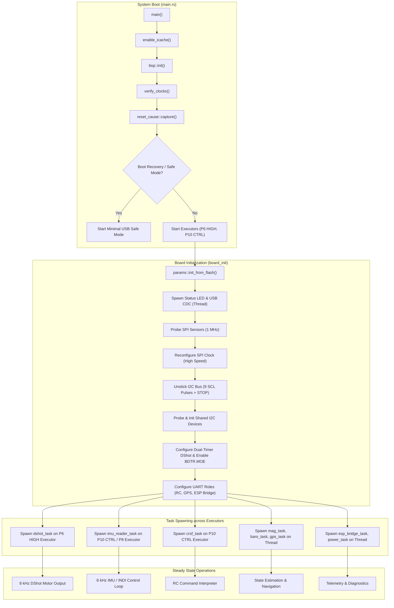

# BSP Architecture & Hardware Initialization

The Board Support Package (BSP) and hardware initialization system provides a hardware abstraction layer for running flight control software on ARM Cortex-M microcontrollers (STM32H743 and STM32F745). It decouples core estimation and control algorithms from platform-specific pin mappings, clock trees, memory layouts, and peripheral configurations.

---

## BSP Architecture & Crate Layering

The hardware abstraction is split across platform-independent type definitions, board-specific pin-mapping crates, driver abstractions, and the top-level firmware board initialization module.

```
                    ┌────────────────────────┐
                    │     cybflight main     │
                    └───────────┬────────────┘
                                │
                    ┌───────────▼────────────┐
                    │  cybflight::board_init │
                    └─────┬────────────┬─────┘
                          │            │
      ┌───────────────────▼───┐    ┌───▼──────────────────┐
      │ Pin-Mapping BSP Crate │    │  cybflight-drivers   │
      │ (e.g. bsp-flywoof745) │    └───────────┬──────────┘
      └───────────┬───────────┘                │
                  │                            │
                  └────────────┬───────────────┘
                               │
                    ┌──────────▼────────────┐
                    │       bsp-types       │
                    └───────────────────────┘
```

### 1. `bsp-types` Abstraction Crate
Located in `crates/bsp/types/src/lib.rs`, `bsp-types` defines common, board-agnostic data types and metadata structures used across all target hardware platforms:
* **`SensorAlign`**: Enum defining Betaflight-compatible sensor alignment orientations (`Default`, `Cw0Deg`, `Cw90Deg`, `Cw180Deg`, `Cw270Deg`, and flipped variants).
* **`SerialRole`**: Functional roles assigned to hardware UART ports (`Msp`, `DisplayPort`, `Gps`, `EscSensor`, `SerialRx`).
* **`SerialPortId`**: Concrete hardware UART peripheral identifiers across the STM32 superset (`Usart1` through `Uart8`, `Lpuart1`).
* **`TimerId` & `TimerChannel`**: Identifiers for general-purpose and advanced timers (`Tim1`–`Tim17`) and channels (`Ch1`–`Ch4`).
* **`PowerCalibration`**: Scale factor, resistor divider ratio, multiplier, current meter scale (mV per 10 A), and centiamp offset for battery monitoring.
* **`DmaHint` & `MotorMeta`**: Hardware metadata mapping motor output channels to timer channels, GPIO alternate functions, and DMA streams/requests.

### 2. Board Pin-Mapping Crates
Specific flight controller targets are implemented in dedicated crates (`bsp-sakurah743`, `bsp-foxeerh743`, `bsp-micoair743v2`, `bsp-flywoof745`). Each crate exports:
* **Board Identity & Capabilities**: Compile-time constants such as `BOARD_NAME`, `MANUFACTURER_ID`, `PRIMARY_GYRO_ODR_HZ`, and capability booleans (`HAS_GPS`, `HAS_SDCARD`, `HAS_BLACKBOX_STORAGE`, `HAS_BACKUP_SRAM`).
* **Clock & Timer Constants**: Core and bus frequencies (`SYSCLK_HZ`, `APB1_TIMER_HZ`, `APB2_TIMER_HZ`).
* **Peripheral Pin Structs**: Strongly typed pin ownership structures (`SpiPins`, `I2cPins`, `SerialPins`, `AdcPins`, `MotorPins`, `SensorPins`, `UsbPins`).
* **`Board` Aggregate Struct**: Owns all hardware peripherals initialized by Embassy STM32.
* **`init()` Entrypoint**: Configures Phase-Locked Loops (PLL) and RCC prescalers via `board_config()`, instantiates peripherals, configures default GPIO pin states, sets up defmt logging over UART, and returns `(Board, UartTx)`.

---

## Chip Platform Differences & Memory Layout

The architecture supports both high-performance dual-bank STM32H743 microcontrollers and space/cost-constrained single-bank STM32F745 microcontrollers.

### Memory Linker Scripts & Partitioning

Memory layout is governed by two linker scripts in `crates/cybflight/`: `memory.x` (for STM32H743) and `memory_f745.x` (for STM32F745VG). Selection is driven dynamically by `crates/cybflight/build.rs`: if `CARGO_FEATURE_BOARD_FLYWOOF745` is active, `memory_f745.x` is copied to `$OUT_DIR/memory.x`; otherwise, `memory.x` is used.

```
STM32H743 (2 MB Flash / 512 KB RAM)
+------------------------------------+ 0x0800_0000
| Firmware Image (FLASH: 1792 KB)    |
+------------------------------------+ 0x081C_0000
| KV Parameter Store (Sectors 6+7)  | (256 KB Reserved)
+------------------------------------+ 0x0820_0000
| RAM (AXI SRAM: 512 KB)             | 0x2400_0000
+------------------------------------+ 0x3880_0000
| BKPSRAM (Backup SRAM: 4 KB)        |
+------------------------------------+

STM32F745VG (1024 KB Flash / 320 KB RAM)
+------------------------------------+ 0x0800_0000
| Firmware Image (FLASH: 512 KB)     |
+------------------------------------+ 0x0808_0000
| Dual-Sector KV Store (Sectors 6+7) | (2x256 KB = 512 KB Reserved)
+------------------------------------+ 0x0810_0000
| DTCM-RAM (Stacks: 64 KB)           | 0x2000_0000
+------------------------------------+ 0x2001_0000
| RAM (SRAM1+SRAM2: 256 KB)          | (.data, .bss, .uninit, DMA)
+------------------------------------+ 0x4002_4000
| BKPSRAM (Backup SRAM: 4 KB)        |
+------------------------------------+
```

#### STM32H743 Memory Layout (`memory.x`)
* **FLASH**: `ORIGIN = 0x08000000`, `LENGTH = 1792K`. The total flash is 2 MB (2048 KB). The last 256 KB (Bank 2, sectors 6 and 7, `0x081C0000`–`0x08200000`) is explicitly excluded from the firmware region so the linker fails if code overlaps with the parameter key-value store (`crates/cybflight/src/params.rs`).
* **RAM**: `ORIGIN = 0x24000000`, `LENGTH = 512K` (AXI SRAM).
* **BKPSRAM**: `ORIGIN = 0x38800000`, `LENGTH = 4K`. D3-domain backup SRAM retained across soft-resets and power loss (when VBAT is wired). Pinned to the `.bkpsram` section (`NOLOAD`) for post-mortem fault recovery.

#### STM32F745VG Memory Layout (`memory_f745.x`)
* **FLASH**: `ORIGIN = 0x08000000`, `LENGTH = 512K`. STM32F745VG has 1024 KB single-bank flash. Sectors 0–5 (512 KB) house the firmware code, while Sectors 6 and 7 (2x256 KB) are reserved for the dual-sector parameter store.
* **DTCM**: `ORIGIN = 0x20000000`, `LENGTH = 64K`. Dedicated 0-wait-state 64-bit Data Tightly-Coupled Memory. Stack execution (`_stack_start = ORIGIN(DTCM) + LENGTH(DTCM)`) occurs entirely in DTCM. If stack overflow occurs below `0x20000000`, it immediately triggers a hardware `BusFault` rather than silently corrupting `.bss` in SRAM.
* **RAM**: `ORIGIN = 0x20010000`, `LENGTH = 256K` (SRAM1 + SRAM2). Used for `.data`, `.bss`, `.uninit`, and AHB DMA buffers.
* **BKPSRAM**: `ORIGIN = 0x40024000`, `LENGTH = 4K`. Backup SRAM at peripheral memory base address.

---

## Optimization Profile & Target Compilation Strategies

Due to the clock frequency differences (480 MHz on STM32H7 vs 216 MHz on STM32F7) and memory limits (512 KB Flash limit on F745), target compilation flags and Cargo profiles are tailored specifically for real-time safety and binary sizing.

### 1. FPU Hardware Feature Flag
In `.cargo/config.toml`, target flags for `thumbv7em-none-eabihf` enforce single-precision FPU codegen:
```toml
[target.thumbv7em-none-eabihf]
rustflags = ["-C", "target-cpu=cortex-m7", "-C", "target-feature=-fp64"]
```
* **Rationale**: The STM32F745VG hardware FPU only implements single-precision VFP (`FPv5-SP-D16`). Executing any double-precision FPU instruction (`vcvt.f64.f32`, `vmul.f64`) causes an immediate `UsageFault` (`UNDEFINSTR`). Disabling double-precision target features at the compiler level ensures all math in `cybflight-core` and control loops compiles strictly to single-precision hardware instructions.

### 2. Profile Optimization Splits
In root `Cargo.toml`, profile optimization levels are split across crates to balance executable size against loop speed:
```toml
[profile.release]
debug = 2
lto = true
codegen-units = 1
panic = "abort"
overflow-checks = false

[profile.release.package.cybflight]
opt-level = "s"

[profile.release.package.cybflight-drivers]
opt-level = 2

[profile.release.package.embassy-stm32]
opt-level = 2
```
* **Top-Level Firmware Crate (`cybflight`)**: Compiled with `opt-level = "s"` (size optimization preserving loop unrolling). This ensures the firmware binary comfortably fits within the 512 KB Flash limit of STM32F745.
* **Math & Drivers (`cybflight-core`, `cybflight-drivers`, `embassy-stm32`)**: Compiled at `opt-level = 2` or `3` so that inner control loops (8 kHz INDI, ESKF, MPC) retain vectorization and inline optimizations.

---

## Boot Sequence & Execution Architecture

The runtime architecture uses a three-tier cooperative-preemptive executor model built on Embassy interrupt executors and Cortex-M NVIC priorities.

```
                          Cortex-M NVIC Priorities
 ┌───────────────────────────────────────────────────────────────────────┐
 │ P0 - P5 : Hardware Interrupts (DMA, SPI, I2C, EXTI, USART, USB)      │
 ├───────────────────────────────────────────────────────────────────────┤
 │ P6      : EXECUTOR_HIGH   --> DShot Motor Output (8 kHz)             │
 ├───────────────────────────────────────────────────────────────────────┤
 │ P8      : EXECUTOR_IMU    --> Dedicated 8 kHz MPU6000 DRDY (F745)     │
 ├───────────────────────────────────────────────────────────────────────┤
 │ P10     : EXECUTOR_CTRL   --> IMU Readers, Mahony, INDI, Failsafe     │
 ├───────────────────────────────────────────────────────────────────────┤
 │ Thread  : Main Executor   --> ESKF, MPC, RC, GPS, Mag, Baro, USB, Log │
 └───────────────────────────────────────────────────────────────────────┘
```

### Main Initialization Flow (`crates/cybflight/src/main.rs`)

1. **Instruction Cache Enable**: `enable_icache()` enables the Cortex-M7 I-cache for flash instruction prefetch.
2. **BSP Hardware Init**: `cybflight::bsp::init()` configures RCC clocks and returns the `Board` peripheral handle and `defmt` UART logger instance.
3. **Serial Logger Setup**: `cybflight::serial_logger::init()` attaches `defmt` to the hardware UART.
4. **Clock Verification**: `cybflight::clocks::verify_clocks()` measures CPU clock speed using the DWT cycle counter over a 10 ms window against `embassy-time` and asserts against `APB1_TIMER_HZ` and `APB2_TIMER_HZ`.
5. **Reset Cause Capture**: `pre_init()` captures `RCC.RSR` flags into a `.uninit` static before HAL clear operations. `main()` classifies the boot cause (`IWDG`, `Brownout`, `POR`, `Pin`).
6. **Post-Mortem & Boot Recovery**: `boot_recovery()` checks BKPSRAM. If the prior session died of a crash within 10 seconds of boot, the system enters **Safe Mode** (minimal USB CDC + status LED only) to allow log recovery via `postmortem show`.
7. **Executor Startup**:
   * **P6 (`EXECUTOR_HIGH`)**: Triggered by `CRS` (H7) or `CAN2_TX` (F745). Runs motor output (`dshot_task`).
   * **P8 (`EXECUTOR_IMU`)**: Triggered by `CAN2_RX1` (F745 only). Runs 8 kHz MPU6000 DRDY reads to prevent P10 WLS matrix solves from stalling SPI sampling.
   * **P10 (`EXECUTOR_CTRL`)**: Triggered by `FDCAN_CAL` (H7) or `CAN2_RX0` (F745). Runs inner control loops and IMU reader tasks.
8. **Board-Specific Init Call**: Invokes `cybflight::board_init::init(&spawner, &ctrl_spawner, &high_spawner, board)`.
9. **Watchdog Initialization**: `watchdog::init()` enables the Independent Watchdog (IWDG) and arms Brownout Reset (PVD/BOR).

---

## Peripheral Setup & Board Initialization Routing

Target-specific hardware peripheral initialization logic lives in `crates/cybflight/src/board_init/`. The module routes calls according to active board feature flags.

### 1. SPI Sensor Probing & Frequency Scaling
* **Probe Phase**: SPI buses carrying IMUs (e.g., SPI4 on FlywooF745) start at low clock speeds (1 MHz, or 54 MHz / 64 = 843 kHz) to comply with MPU6000 register write limits during `WHO_AM_I` identification (`probe_imu_raw`).
* **High-Speed Read Phase**: After successful sensor detection, SPI bus clocks are reconfigured to high speed (e.g., 13.5 MHz for MPU6000/ICM42688P, 6.75 MHz for BMI270) before spawning reader tasks on `ctrl_spawner` or `imu_spawner`.

### 2. Shared I2C Bus & Wedged Bus Recovery
When multiple sensors (e.g., SPL06 barometer and QMC5883L compass) share an I2C bus (e.g., I2C1):
* **Wedged Bus Recovery (`reset_i2c1_if_wedged`)**: A warm MCU reset (such as `reboot` or IWDG reset) can interrupt an in-flight I2C byte transfer, leaving a slave device holding `SDA` low. Before calling `I2c::new`, the pins are configured as GPIO outputs, pulsing `SCL` 9 times with `SDA` high followed by an explicit STOP condition (SDA low-to-high while SCL high) to release the bus.
* **Initialization Ordering Invariant**: Per sensor bus sharing rules, **all** devices on a shared I2C bus must be fully probed and initialized sequentially before **any** sensor reader background tasks are spawned on the bus.

### 3. Dual-Timer Bidirectional DShot Configuration
DShot motor control requires precise timer channel and DMA request bindings:
* **Timer Acquisition**: Advanced timers (e.g., TIM1) and general-purpose timers (e.g., TIM3) are converted to low-level timer handles.
* **Advanced Timer MOE Bit**: Advanced control timers (TIM1/TIM8) require setting the Master Output Enable bit (`BDTR.MOE = true`) in the Break and Dead-Time Register; without this, output drivers remain floating.
* **Pin Alternate Function Assignment**: Pins are placed in Alternate Function mode (`Flex::set_as_af_unchecked`) without releasing peripheral ownership.
* **`DshotQuadConfig` Struct**: Groups low-level timer register pointers, channel indices, GPIO port/pin masks, AF numbers, and DMA requests into an array passed to `dshot_task` on `high_spawner` (P6).

### 4. UART Role Mapping
UART assignments use compile-time dispatch based on BSP constants (`PORT_SERIAL_RX`, `PORT_GPS`, `PORT_ESP_BRIDGE`):
* **SerialRx**: Configured on `PORT_SERIAL_RX` (e.g., `USART2` at 420,000 baud for CRSF/ELRS) using `BufferedUart` and spawned on `ctrl_spawner`.
* **GPS**: Configured on `PORT_GPS` (e.g., `USART6` at 115,200 baud) using `BufferedUart` and spawned on the main thread spawner.
* **ESP32 Telemetry Bridge**: Configured on `PORT_ESP_BRIDGE` (e.g., `USART1` at 460,800 baud) using full DMA `Uart` with split TX/RX tasks on the main thread spawner.

---

## Board Initialization & Task Spawning Sequence

The sequence diagram below shows the complete hardware initialization and task spawning workflow across thread and interrupt executors during system startup.


*Figure 1: Board initialization, peripheral bring-up, and task distribution across cooperative-preemptive executor tiers.*

---

## Related Documentation

* [System Architecture Overview](overview.md) - System-level architectural summary and component layout.
* [Channel Dataflow Architecture](channel-dataflow.md) - PubSub channels, lock-free signals, and inter-task communication.
* [Hardware Bringup Workflow](../workflows/hardware-bringup.md) - Step-by-step field procedures for bringing up new flight controller boards.
