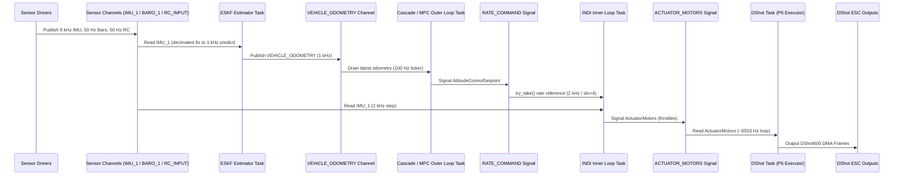

# Static Channel Infrastructure & Execution Dataflow

## Overview

In Cybflight, inter-task communication, state estimation, control loops, and motor output rely on a deterministic, zero-allocation asynchronous architecture built on Embassy primitives. All channels, signals, watches, and shared mutexes are statically allocated in `.bss` memory at compile time, eliminating runtime heap allocation and dynamic memory panics.

The system enforces strict real-time control flow across preemptive priority levels (hardware interrupts, a high-priority interrupt executor for motor output, and a thread-level executor for estimation and control tasks). Rate-driven synchronization downsamples native sensor sampling rates (such as 8 kHz IMU data) into 1 kHz state estimation predicts, 2 kHz Incremental Nonlinear Dynamic Inversion (INDI) rate control steps, 100 Hz outer-loop position/attitude updates, and 125 Hz/10 Hz decimated telemetry streams for Blackbox logging and Ground Control Station (GCS) telemetry.

For a broader overview of system architecture, see [System Overview](overview.md). For detailed concepts on the control loops and state estimation algorithms, see [Control and Actuation](../concepts/control-and-actuation.md) and [State Estimation ESKF](../concepts/state-estimation-eskf.md).

---

## Concurrency, Memory, & Thread Safety Guarantees

Cybflight operates in a `#![no_std]` embedded environment without an operating system kernel. Thread safety, real-time response, and task isolation are achieved through static Embassy channel abstractions, Cortex-M critical section mutexes, and atomic memory operations.

```
Priority   Executor / Handler          Tasks & Operations
--------   -------------------------   ----------------------------------
P0–P5      HAL-managed Interrupts      DMA completions, SPI/I2C transfers, EXTI
P6         InterruptExecutor (CRS)     dshot_task (motor command output)
Thread     Thread Executor (Main)      imu_task, eskf_task, indi_task, cascade_task,
                                       rc_interpreter_task, blackbox_recorder_task,
                                       usb_serial_task, shell_task
```

### Memory Allocation & Zero Dynamic Overhead
All channel buffers, state cells, and task execution stacks are statically declared using Rust `static` items. The firmware never calls dynamic allocators (`alloc::alloc`). Static channel queue depths (`CAP`) and subscriber array capacities (`SUBS`) are evaluated at compile time based on vehicle rate parameters and worst-case consumer drain latency.

### Critical Section Mutexes & Interrupt Safety
All Embassy channels (`PubSubChannel`, `Signal`, `Watch`, `Channel`) and shared data wrappers wrap data structures in `CriticalSectionRawMutex`. On Cortex-M microcontrollers, `CriticalSectionRawMutex` temporarily disables maskable interrupts (`cpsid i` / `cpsie i`) during atomic pointer and state transitions. This guarantees 100% thread-safe reads and writes across tasks running on different priority levels—such as the thread executor and the high-priority `InterruptExecutor`—without risk of data corruption, priority inversion, or deadlocks.

### Real-Time Primitive Selection
The choice of inter-task communication primitive depends on the required queueing and timing semantics:

*   **`PubSubChannel<CriticalSectionRawMutex, T, CAP, SUBS, PUBS>`**: Multi-publisher, multi-subscriber FIFO channel with a ring buffer of capacity `CAP`. Used when every generated record (or a bounded history) must be processed by one or more subscribers without data loss during transient execution stalls.
*   **`Signal<CriticalSectionRawMutex, T>`**: Single-value latest-wins communication primitive with zero queueing. Consumed via `try_take()` or `wait().await`. Ideal for setpoints and command overrides where stale samples must be discarded immediately in favor of the newest reference (e.g., `RATE_COMMAND`, `DIRECT_MOTOR_COMMAND`, `ACTUATOR_MOTORS`).
*   **`Watch<CriticalSectionRawMutex, T, N>`**: Single-writer, multi-reader broadcast channel that holds only the latest state value. Subscribers inspect the current snapshot non-blockingly without consuming items from a queue (e.g., `STATUS`, `NEIGHBOR_STATES`).
*   **`AtomicBool` / `AtomicU8` / `AtomicU32`**: Lock-free atomic flags used for zero-overhead safety state tracking across tasks (e.g., `IS_ARMED`, `OFFBOARD_ACTIVE`, `LAUNCHED`, `ESTIMATOR_READY`, `FAILSAFE_ACTIVE`).

### Subscriber Protection Macro (`subscribe_or_park!`)
To prevent fatal runtime executor panics when a task attempts to subscribe to a `PubSubChannel` whose compile-time `SUBS` capacity has been exhausted, Cybflight uses the `subscribe_or_park!` macro:

```rust
let mut imu_sub = subscribe_or_park!(sensors::IMU_1, "IMU_1");
```

If subscriber slot allocation fails, the macro logs a critical error to `defmt` and the USB shell, then parks the calling task on `core::future::pending()`. The rest of the firmware continues flying safely—only the functionality of the affected reader task is lost, avoiding a fatal boot loop or total flight controller abort.

---

## Static Embassy Async Channel Declarations

Channel declarations are organized by functional domain across `sensors`, `control`, `motors`, and crate roots.

### Sensor & Estimation Channels (`crate::sensors`)

| Static Name | Type / Sizing | Description & Consumers |
| :--- | :--- | :--- |
| `IMU_1` | `PubSubChannel<..., CAP=192, SUBS=8, PUBS=1>` | Primary filtered IMU sample queue (gyro + accel). CAP provides 24 ms wall-clock buffer at 8 kHz (`IMU_PUBSUB_CAP`). Drained by `indi_task`, `eskf_task`, telemetry streams, and `blackbox`. |
| `IMU_1_RAW` | `PubSubChannel<..., CAP=192, SUBS=8, PUBS=1>` | Unfiltered pre-biquad IMU sample queue. Subscribed by `blackbox` in Sysid and Large logging tiers for filter identification. |
| `IMU_1_DECIM` | `PubSubChannel<..., CAP=32, SUBS=4, PUBS=1>` | Decimated ~1 kHz mirror of `IMU_1` (decimated by `IMU_DECIM_DIV`). Wakes low-rate attitude estimators (Mahony) without waking them at 8 kHz. |
| `IMU_2` | `PubSubChannel<..., CAP=192, SUBS=8, PUBS=1>` | Secondary IMU sample queue for dual-IMU boards (e.g., SAKURAH743). |
| `BARO_1` / `BARO_2` | `PubSubChannel<..., CAP=2, SUBS=4, PUBS=1>` | Barometric pressure and altitude sample queues (50 Hz). Drained by altitude estimator and telemetry tasks. |
| `RC_INPUT` | `PubSubChannel<..., CAP=4, SUBS=6, PUBS=1>` | Raw RC stick channels and switch states from CRSF/GHST receiver task. |
| `RC_LINK_STATUS` | `PubSubChannel<..., CAP=2, SUBS=4, PUBS=1>` | RC link quality, RSSI, and frame loss status. |
| `VEHICLE_ODOMETRY` | `PubSubChannel<..., CAP=8, SUBS=6, PUBS=1>` | ESKF output odometry (1 kHz). Subscribed by `indi_task`, `cascade_task`, `outer_loop`, `rc_interpreter`, and telemetry bridges. |
| `BLACKBOX_ODOMETRY` | `PubSubChannel<..., CAP=25, SUBS=2, PUBS=1>` | Decimated mirror of `VEHICLE_ODOMETRY` (125 Hz, `BLACKBOX_ODOM_DECIM` = 8). Prevents recorder queue starvation without wasting PubSub slots. |
| `VEHICLE_ATTITUDE` | `PubSubChannel<..., CAP=4, SUBS=6, PUBS=1>` | Primary fused orientation quaternion and angular rates. |
| `MAHONY_ATTITUDE` | `PubSubChannel<..., CAP=4, SUBS=4, PUBS=1>` | Backup IMU-only Mahony attitude filter output (~100 Hz). |
| `GPS_FIX` | `PubSubChannel<..., CAP=2, SUBS=4, PUBS=1>` | GPS fix metadata and satellite status (5 Hz). |
| `GPS_NAV_PVT` | `Signal<..., GpsNavPvt>` | Latest GNSS position, velocity, and time solution (5 Hz signal, latest wins). Drained by ESKF GPS task. |
| `GPS_HEADING` | `Signal<..., GpsHeading>` | Dual-antenna GNSS heading solution (UM982 Unicore driver). Drained by ESKF for yaw aiding. |
| `POWER_STATUS` | `PubSubChannel<..., CAP=2, SUBS=5, PUBS=1>` | Filtered battery voltage and current (100 Hz). Drained by INDI thrust table and failsafe logic. |
| `POWER_TELEM` | `PubSubChannel<..., CAP=8, SUBS=2, PUBS=1>` | Unfiltered power telemetry for Blackbox logging (decimated to 10 Hz). |

### Control & Actuation Channels (`crate::control` & `crate::motors`)

| Static Name | Type / Sizing | Description & Consumers |
| :--- | :--- | :--- |
| `RATE_COMMAND` | `Signal<..., AttitudeControlSetpoint>` | Primary body-rate and thrust command from active outer loop (`cascade_task`, `outer_loop`, or `rc_interpreter`) to `indi_task`. |
| `OFFBOARD_ACTIVE` | `AtomicBool` | Atomic toggle indicating whether offboard UART or onboard RL policy has override control. |
| `DIRECT_MOTOR_COMMAND`| `Signal<..., ActuatorMotors>` | Direct normalized 4-motor throttle command `[m0, m1, m2, m3]` in `[0.0, 1.0]` used in Offboard/RL mode. |
| `ACTUATOR_MOTORS` | `Signal<..., ActuatorMotors>` | Final calculated motor command output from `indi_task` to `dshot_task`. Drained on every DShot frame iteration. |
| `ARM_STATE` / `ARM_DISARM` | `Signal<...>` / `PubSubChannel<...>` | Arm/disarm command signals. Written by RC interpreter, failsafe, or USB shell; read by `dshot_task`. |
| `IS_ARMED` | `AtomicBool` | Atomic flag reflecting live arm status. Drained by `indi_task`, ESKF, and watchdog logic. |
| `ACTIVE_SETPOINT_READY`| `Signal<..., ()>` | One-shot initialization signal posted when position setpoint seed is ready. |
| `ACTUATOR_MOTORS_TELEM`| `PubSubChannel<..., CAP=48, SUBS=4, PUBS=1>` | Mirror of calculated motor commands for Blackbox and ESP telemetry (up to 500 Hz on Sysid tier). |
| `CONTROL_SETPOINT_TELEM`| `PubSubChannel<..., CAP=4, SUBS=4, PUBS=3>` | Mirror of `RATE_COMMAND` for Blackbox logging. |
| `TRACKING_ERROR` | `PubSubChannel<..., CAP=16, SUBS=3, PUBS=3>` | Real-time position, velocity, and rate tracking error telemetry. |
| `DSHOT_HEALTH` | `PubSubChannel<..., CAP=2, SUBS=3, PUBS=1>` | Cumulative per-motor DShot telemetry health (commutation, range, slew, NIS rejections). |
| `PROCESSED_MOTOR_STATE`| `PubSubChannel<..., CAP=48, SUBS=4, PUBS=1>` | Filtered motor RPM, angular acceleration ($\dot{\omega}$), and raw telemetry. |

---

## Rate-Driven Synchronization & Downsampling Pipeline

Cybflight manages real-time rate synchronization using clock-driven decimation and sample counters. Downsampling isolates high-frequency noise from low-frequency control loops and limits CPU execution overhead.

```
+-----------------------------------------------------------------------------------+
| High-Rate Sensor Pipeline (8000 Hz Native Gyro / Accel ODR)                       |
|                                                                                   |
|  [ICM426xx IMU] ---> IMU_1 PubSubChannel (CAP=192 / 24ms Buffer)                  |
+--------------------------+--------------------------------+-----------------------+
                           |                                |
             (Decimate /8) |                  (Decimate /4) |
                           v                                v
+------------------------------------+   +------------------------------------------+
| ESKF State Estimation (~1000 Hz)   |   | INDI Inner Loop Control (2000 Hz)        |
|                                    |   |                                          |
| - IMU Predict Step (1000 Hz)       |   | - Drains IMU_1 & RATE_COMMAND             |
| - GPS / Baro / Mag Measurement Ref |   | - Savitzky-Golay Rate-Dot Filter          |
| - VEHICLE_ODOMETRY PubSub (1 kHz)  |   | - WLS Control Allocation                 |
+------------------+-----------------+   | - ACTUATOR_MOTORS Signal                 |
                   |                     +------------------+-----------------------+
     (Decimate /10)|                                        |
                   v                                        v
+------------------------------------+   +------------------------------------------+
| Cascade Outer Loop (100 Hz Ticker) |   | DShot Motor Task (6553 Hz Timer Loop)    |
|                                    |   |                                          |
| - Reads VEHICLE_ODOMETRY           |   | - Runs on NVIC Priority P6 (CRS Executor)|
| - PD Position & Geometric Controller|  | - Drains ACTUATOR_MOTORS                 |
| - Signals RATE_COMMAND (100 Hz)    |   | - DShot600 Timer DMA Outputs to ESCs     |
+------------------------------------+   +------------------------------------------+
```

### High-Rate IMU Pipeline (8 kHz / 3.2 kHz / 1 kHz)
Primary IMUs (e.g., ICM426xx) sample at `PRIMARY_GYRO_ODR_HZ` (typically 8000 Hz). The `imu_task` applies biquad low-pass filtering and publishes every sample to `IMU_1`.
*   **Buffer Depth**: At 8 kHz, `IMU_PUBSUB_CAP` allocates 192 ring buffer slots (~24 ms of wall-clock jitter margin).
*   **Decimated Mirror (`IMU_1_DECIM`)**: Divided by `IMU_DECIM_DIV` (8 at 8 kHz, 3 at 3.2 kHz, 1 at 1 kHz). Emits samples at ~1 kHz to wake tasks like Mahony without waking them 8000 times per second.

### State Estimation Predict Decimation (1 kHz ODOM)
The ESKF estimator (`eskf_imu_gps`) drains `IMU_1`. It accumulates timestep $\Delta t$ from sample timestamps and executes an ESKF prediction step every `PREDICT_DECIMATION` samples (8th sample at 8 kHz).
*   **Odometry Output**: Publishes `VEHICLE_ODOMETRY` at exactly 1 kHz (`ODOM_PUBLISH_HZ`).
*   **Blackbox Decimation**: The `BLACKBOX_ODOMETRY` channel decimates `VEHICLE_ODOMETRY` by `BLACKBOX_ODOM_DECIM` (8 $\rightarrow$ 125 Hz). This allows Blackbox logging at 125 Hz without consuming memory bandwith or dropping primary odometry slots for control tasks.

### INDI Inner-Loop Decimation & Savitzky-Golay Filtering
`indi_task` executes every `ctrl_decimation` IMU samples (`loop_rate_hz = IMU_ODR_HZ / ctrl_div`, e.g., 8 kHz / 4 = 2000 Hz).
*   **Savitzky-Golay Windowing**: To compute body angular acceleration ($\dot{\omega}$) without introducing excess phase lag, the inner loop uses a dynamically sized Savitzky-Golay (SG) FIR filter (`rate_dot_sg_window`). The window size is derived from the control loop rate:

| Control Loop Rate | SG Window Size | Group Delay |
| :--- | :--- | :--- |
| 8000 Hz (Full ODR) | 13 taps | 0.75 ms |
| 3200 Hz (BMI270) | 13 taps | 1.88 ms |
| 2000 Hz (8 kHz / 4) | 9 taps | 2.00 ms |
| 1000 Hz (`imu_1khz`) | 5 taps | 2.00 ms |

*   **Control Allocation**: Drains the latest rate reference from `RATE_COMMAND` (or `DIRECT_MOTOR_COMMAND` when `OFFBOARD_ACTIVE` is `true`), computes Weighted Least Squares (WLS) motor allocation, and updates `ACTUATOR_MOTORS`.

### Cascade & MPC Outer-Loop Rate Control
*   **Cascade Loop (`cascade_task`)**: Driven by an Embassy `Ticker` at `cascade_rate_hz` (default 100 Hz, clamped between 25 Hz and 500 Hz). Drains `VEHICLE_ODOMETRY`, checks sample timestamp staleness against `cascade_odom_stale_s` (100 ms fallback), runs PD position and geometric attitude control, and signals `RATE_COMMAND`.
*   **MPC Loop (`outer_loop`)**: Runs SQP/MPC solves at 50–100 Hz, outputting full state trajectories and signaling `RATE_COMMAND`.

### DShot Motor Execution & Timeout Guard (~6553 Hz)
`dshot_task` runs on the P6 `InterruptExecutor` preemptively over all thread-executor tasks. It runs on a timer loop taking 5 embassy ticks per frame (32,768 Hz tick rate $\rightarrow$ 152.6 $\mu$s frame period $\approx$ 6553 Hz).
*   **Command Consumption**: Drains `ACTUATOR_MOTORS` and computes DShot bit timing for 4 PWM/DMA timer channels.
*   **Staleness Guard**: If no new command arrives on `ACTUATOR_MOTORS` for longer than `MOTOR_CMD_STALE` (10 ms) while armed, `dshot_task` forces motor throttles to idle (`DSHOT_IDLE_THROTTLE`), preventing frozen thrust outputs during transient control task stalls.

---

## End-to-End Control & Telemetry Dataflow

The end-to-end dataflow links hardware sensor drivers through state estimation and dual-loop control to motor execution and logging telemetry.


*Figure 1: End-to-end execution dataflow and message propagation from hardware sensors through state estimation and dual-loop control to DShot motor outputs.*

### Telemetry Mirroring & Buffer Sizing Rationale
To ensure Blackbox logging does not degrade control loop execution:
1.  **Separate Decimated Mirrors**: Channels like `BLACKBOX_ODOMETRY` (125 Hz) and `POWER_TELEM` (10 Hz) mirror primary data streams at lower rates. Thinning occurs before channel publication so the Blackbox task does not spend CPU cycles draining unused samples.
2.  **Sysid Tier Sizing**: Telemetry mirrors (`ACTUATOR_MOTORS_TELEM`, `PROCESSED_MOTOR_STATE`, `TRACKING_ERROR`) use an expanded queue depth (`INDI_TELEM_PUBSUB_CAP` = 48) to absorb SD card cluster flush stalls (10–18 ms CMD25 writes) during high-rate (500 Hz) system identification sessions.

---

## System Invariants & Failure Isolation

Cybflight enforces strict failure isolation and graceful degradation semantics:

1.  **Silent Inner-Loop Failures**: If `indi_task` encounters NaN states, invalid sensor inputs, or voltage staleness exceeding `VOLTAGE_FAILSAFE_TIMEOUT` (2000 ms in Table mode), it stops updating `LAST_CONTROLLER_PUBLISH` and ceases signaling `ACTUATOR_MOTORS`.
2.  **Two-Stage Failsafe Degradation**:
    *   *Stage 1 (10 ms)*: `dshot_task` detects `MOTOR_CMD_STALE` and drops motor output to idle throttle.
    *   *Stage 2 (`fs_ctrl_timeout_s`, e.g., 100–500 ms)*: The failsafe controller watchdog detects the lack of publishing on `LAST_CONTROLLER_PUBLISH` and signals full vehicle disarm (`ARM_STATE`).
3.  **Hardware Watchdog Guard (IWDG)**: Independent Hardware Watchdog 1 (IWDG1) is clocked by an internal LSI oscillator (~32 kHz) with a 500 ms timeout. It is fed every 200 ms by `iwdg_feed_task` on the thread executor. If the thread executor stalls for >500 ms (e.g., hard fault or infinite loop), IWDG resets the MCU, forcing ESCs to disarm independently after ~1 second without valid DShot frames.
