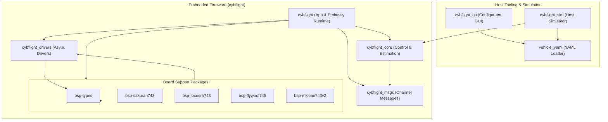
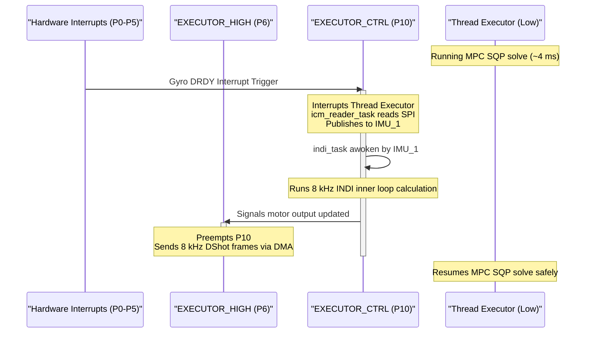

# System Architecture & Design Principles

**Cybflight** is a high-performance, `#![no_std]` autopilot firmware written in Rust for multirotor aircraft. It uses the [Embassy](https://embassy.dev) async runtime on ARM Cortex-M microcontrollers (specifically STM32H7 and STM32F7 series) to achieve deterministic real-time execution, clean component isolation, and zero-cost compile-time hardware abstractions.

The system is designed around a strict decoupling boundary: hardware-specific board support packages (BSPs) and driver tasks publish normalized sensor measurements into **static Embassy pub/sub channels**, while board-agnostic control algorithms and state estimators consume those channels without direct knowledge of physical pins, buses, or sensor chips.

---

## Crate Hierarchy & Component Responsibilities

The codebase is organized as a workspace of focused, single-responsibility crates. This structure isolates hardware access from control theory, enables fast host-side unit testing, and provides desktop simulation and ground station tooling.

```
                    ┌────────────────────────┐
                    │  cybflight_gs (GUI)    │
                    └───────────┬────────────┘
                                │
                    ┌───────────▼────────────┐
                    │  cybflight_sim (Sim)   │
                    └───────────┬────────────┘
                                │
┌───────────────────────────────┼───────────────────────────────┐
│ Firmware Workspace            │                               │
│                               ▼                               │
│                     ┌───────────────────┐                     │
│                     │  cybflight (App)  │                     │
│                     └─┬───────────────┬─┘                     │
│                       │               │                       │
│        ┌──────────────▼───┐       ┌───▼──────────────┐        │
│        │ board_init / BSP │       │ cybflight_core   │        │
│        └──────┬───────────┘       └──────────────────┘        │
│               │                                               │
│        ┌──────▼───────────┐                                   │
│        │ cybflight_drivers│                                   │
│        └──────────────────┘                                   │
└───────────────────────────────────────────────────────────────┘
```

*Diagram: High-level crate dependencies and application layout across firmware, simulation, ground station, and hardware abstraction layers.*



*Diagram: Component relationships and dependency structure across firmware crates, board support packages, and host tools.*

### Crate Breakdown

1. **`cybflight` (Firmware Binary & Library)**
   - **Path**: `crates/cybflight`
   - **Role**: Top-level application crate. Contains the `#[embassy_executor::main]` entrypoint, multi-tier executor setup, board initialization dispatch (`board_init`), static channel definitions (`sensors/mod.rs`), sensor reader tasks, USB CDC streaming tasks, defmt serial logger, watchdog feeder, and post-mortem fault recovery system.
   - **Key Property**: Re-exports the selected BSP crate as `crate::bsp` based on Cargo feature flags (`board_sakurah743`, `board_foxeerh743`, etc.).

2. **`cybflight_core` (Control & Estimation Library)**
   - **Path**: `crates/cybflight_core`
   - **Role**: Hardware-agnostic, `#![no_std]` flight control algorithms, state estimators, trajectory planners, and parameter schema.
   - **Subsystems**:
     - **Inner Loop**: Incremental Nonlinear Dynamic Inversion (INDI) angular acceleration controller (`indi`).
     - **Outer Loops**: Nonlinear Model Predictive Control (NMPC / MPC SQP solver in `mpc`), ACMPC DDP solver (`acmpc`), and cascaded position-to-attitude geometric controller (`attitude_control`, `position_control`).
     - **State Estimation**: 15-state Error-State Kalman Filter (`eskf`) supporting MOCAP/Vicon and GPS fusion, and Mahony attitude filter (`mahony`).
     - **Trajectory Planning**: Minimum-snap/jerk/acceleration polynomial planners (`trajectory_planning`) utilizing MINCO representations and BFGS optimization.
     - **Actuator Mixers**: Control allocation and motor mixing (`mixer`).
     - **Parameter System**: `#[derive(Params)]` registry macro and runtime parameter store (`params`, `param_registry`, `param_store`).
   - **Invarient**: Contains **no static storage or Embassy dependencies**. Every solver receives scratchpad memory (`&mut Workspace`) from the caller. This keeps core control math pure, deterministic, and host-testable under standard `cargo test`.

3. **`bsp-*` (Board Support Packages)**
   - **Paths**: `crates/bsp/types`, `crates/bsp/sakurah743`, `crates/bsp/foxeerh743`, `crates/bsp/flywoof745`, `crates/bsp/micoair743v2`
   - **Role**: Target-specific pin mappings, peripheral clock initializers, interrupt bindings, and capability flags.
   - **Exported Interface**: Every BSP crate exports a `Board` struct containing peripheral singletons, `pub fn init() -> (Board, UartTx)`, `pub use embassy_stm32 as hal;`, and `const` capability flags (`IMU_COUNT`, `HAS_BARO`, `HAS_MAG`, `HAS_GPS`, `HAS_SDCARD`, `LED_COUNT`).
   - **Constraint**: BSP crates depend only on `embassy-stm32` (HAL), `bsp-types`, and `cybflight-drivers` (for constructed types like `Beeper`). BSPs **never** depend on `embassy-executor`, `embassy-sync`, or task code.

4. **`cybflight_drivers` (Async Hardware Drivers)**
   - **Path**: `crates/drivers`
   - **Role**: Generic, hardware-agnostic device drivers built on `embedded-hal-async` traits.
   - **Supported Hardware**:
     - **IMUs**: InvenSense ICM-42688-P / IIM-42652 (`Icm426xx`), MPU-6000 / MPU-6500 (`Mpu6x00`), Bosch BMI270 (`Bmi270`).
     - **Barometers**: Infineon DPS310 (`Dps310`), TDK ICP20100 (`Icp20100`), SPL06 (`Spl06`).
     - **Magnetometers**: iSentek IST8310 (`Ist8310`), QMC5883L (`Qmc5883l`).
     - **GNSS**: u-blox F9/M8 (`ublox`), Unicore UM982 (`unicore`).
     - **RC Protocols**: ExpressLRS / TBS Crossfire (`Crsf`), Ghost (`Ghst`).
     - **Actuators & Indicators**: DShot motor protocol framing (`dshot`), status LEDs (`led`), and beeper control (`beeper`).

5. **`cybflight_sim` (Host Simulation Harness)**
   - **Path**: `crates/cybflight_sim`
   - **Role**: Host-side simulator running full rigid-body flight dynamics (`QuadPlant`), sensor noise models (`NoisyImu`, `FaultedGps`), and mission scenarios without requiring the Embassy runtime or microcontroller hardware. Evaluates control stability and trajectory tracking in CI.

6. **`cybflight_gs` (Ground Station & Configurator)**
   - **Path**: `crates/cybflight_gs`
   - **Role**: Cross-platform desktop GUI application built with `eframe`/`egui`. Includes 3D vehicle orientation display, real-time telemetry plots, parameter configuration tab, firmware flasher, and CLI terminal over USB CDC or mock FC backends.

7. **`cybflight_rl` (Reinforcement Learning)**
   - **Path**: `crates/cybflight_rl`
   - **Role**: Reinforcement learning environment interface and neural network policy inference bindings for high-speed quadrotor racing.

8. **`vehicle_yaml` & `cybflight_msgs`**
   - **`vehicle_yaml`**: Host-side loader and validator crate for parsing vehicle configuration YAML files (`vehicles/<name>.yaml`) and mission files (`missions/<name>.yaml`) at compile time.
   - **`cybflight_msgs`**: Shared data structures (`Imu`, `VehicleAttitude`, `VehicleOdometry`, `RcInput`, `PowerStatus`, etc.) passed across pub/sub channels and wire telemetry.

---

## Embassy Async Execution Model & Real-Time Concurrency

Firmware execution is built on the **Embassy** async ecosystem, operating on ARM Cortex-M hardware without an RTOS kernel. Instead of thread context switching, Embassy uses Rust futures and cooperative task scheduling driven by hardware interrupts and Wakers.

### Three-Tier Cooperative-Preemptive Executor Architecture

To guarantee strict real-time deadlines for motor control while accommodating compute-heavy optimization algorithms, `cybflight` organizes its task execution across **three distinct NVIC priority tiers**:

```
Priority Tier         Tasks Hosted                                       Execution Basis
─────────────────────────────────────────────────────────────────────────────────────────────
P0–P5 (Hardware)      SPI / I2C DMA, EXTI DRDY, USART, USB OTG           Hardware Interrupts
                      
P6 (EXECUTOR_HIGH)    DShot motor output task (8 kHz)                    InterruptExecutor (CRS / CAN2_TX)
                      
P10 (EXECUTOR_CTRL)   IMU readers, 8 kHz INDI inner loop, failsafe,      InterruptExecutor (FDCAN_CAL / CAN2_RX0)
                      RC parsers
                      
Thread (Main Exec)    ESKF estimator (1 kHz), MPC SQP solver (~50 Hz),   Thread Executor (Main loop)
                      BFGS trajectory planner, Mahony filter, Baro/Mag/GPS,
                      USB CDC streams, defmt logger, watchdog
```



*Diagram: Real-time preemption sequence showing high-priority control tasks interrupting compute-heavy thread execution.*

### Preemption & Execution Guarantees

1. **Deterministic Actuation (P6)**:
   The `EXECUTOR_HIGH` executor runs on an unassigned hardware interrupt vector (e.g., `CRS` or `CAN2_TX`). Operating at NVIC priority level 6, it preempts control computation and main thread execution to transmit 8 kHz DShot motor commands over DMA without timing jitter.

2. **Unstarvable Inner Loop (P10)**:
   The `EXECUTOR_CTRL` executor runs at priority level 10 (e.g., `FDCAN_CAL` or `CAN2_RX0`). It hosts the IMU reader tasks (`icm_reader_task`), the 8 kHz INDI rate controller (`indi_task`), the failsafe monitor, and RC input parsers.
   - **Real-Time Guarantee**: Compute-intensive outer loop tasks running on the thread executor — such as the 10-state MPC SQP solver (which takes ~4 ms per iteration) or the BFGS online trajectory planner (which takes ~100 ms) — **cannot starve or delay the 8 kHz inner loop**. Whenever fresh gyro data arrives, P10 interrupts the thread executor immediately.

3. **Compute-Heavy Outer Loops (Thread Executor)**:
   Long-running estimation and planning tasks execute on the main thread executor. When an MPC optimization step or ESKF predict step is executing, lower priority tasks yield cooperatively using `.await` points.

4. **Cross-Tier Communication**:
   Inter-task communication between different priority tiers utilizes lock-free, async-safe synchronization primitives from `embassy-sync`:
   - `PubSubChannel` parameterized with `CriticalSectionRawMutex` for multi-subscriber event streams (`IMU_1`, `VEHICLE_ATTITUDE`, `VEHICLE_ODOMETRY`).
   - `Signal` for single-value latest-wins transfers (`GPS_NAV_PVT`, `GPS_HEADING`).
   - `Watch` for non-blocking state inspection (`NEIGHBOR_STATES`).

5. **Executor Safety: Subscriber Slot Exhaustion**:
   To prevent a missing channel subscriber capacity from triggering an Embassy runtime panic and boot loop, `cybflight` provides the `subscribe_or_park!` macro (`crates/cybflight/src/lib.rs`). If a task attempts to subscribe to a `PubSubChannel` whose `SUBS` capacity is exhausted, the macro logs an error over defmt and USB shell, then parks only that task on `core::future::pending()`. The rest of the flight controller continues operating safely.

---

## Static Channels as the Hardware Abstraction Boundary

The central design principle of `cybflight` is that **static Embassy channels form the strict abstraction boundary** separating physical hardware from flight control algorithms.

```
┌──────────────────────────────────────────────────────────┐
│             Control & Estimation Layer                   │
│  (INDI, MPC, ESKF, Mahony, Trajectory Planner, Telemetry) │
│  Reads ONLY from static channels. Never touches hardware. │
└────────────────────────────▲─────────────────────────────┘
                             │
═════════════════════════════╪══════════════════════════════ static channels
                             │
┌────────────────────────────▼─────────────────────────────┐
│                   Sensor Channel Layer                   │
│   IMU_1, IMU_2, VEHICLE_ATTITUDE, VEHICLE_ODOMETRY,      │
│   BARO_1, BARO_2, MAG_EXT, MAG_INT, RC_INPUT, GPS_FIX    │
└────────────────────────────▲─────────────────────────────┘
                             │
┌────────────────────────────┴─────────────────────────────┐
│            Board Initialization & Driver Tasks           │
│  (crates/cybflight/src/board_init/ + crates/drivers)     │
│  Constructs SPI/I2C buses, initializes sensor drivers,    │
│  spawns reader tasks feeding channels.                   │
└──────────────────────────────────────────────────────────┘
```

*Diagram: The static channel boundary separating target hardware initialization from board-agnostic control algorithms.*

### Sensor Channel Definitions (`crates/cybflight/src/sensors/mod.rs`)

Channels are globally allocated `static` variables in `cybflight::sensors`:

| Static Channel Name | Type | Capacity / Subs | Purpose |
|---|---|---|---|
| `IMU_1` | `PubSubChannel<..., Imu>` | `CAP=IMU_PUBSUB_CAP`, `SUBS=8` | Primary filtered IMU samples (8 kHz or 1 kHz) |
| `IMU_1_RAW` | `PubSubChannel<..., Imu>` | `CAP=IMU_PUBSUB_CAP`, `SUBS=8` | Unfiltered IMU 1 mirror for blackbox sysid |
| `IMU_1_DECIM` | `PubSubChannel<..., Imu>` | `CAP=32`, `SUBS=4` | ~1 kHz decimated IMU 1 stream for Mahony filter |
| `IMU_2` | `PubSubChannel<..., Imu>` | `CAP=IMU_PUBSUB_CAP`, `SUBS=8` | Secondary IMU samples (empty on single-IMU boards) |
| `VEHICLE_ATTITUDE` | `PubSubChannel<..., VehicleAttitude>` | `CAP=4`, `SUBS=6` | Estimated vehicle orientation (published by ESKF) |
| `VEHICLE_ODOMETRY` | `PubSubChannel<..., VehicleOdometry>` | `CAP=8`, `SUBS=6` | 1 kHz ESKF position, velocity, and pose estimate |
| `BLACKBOX_ODOMETRY` | `PubSubChannel<..., VehicleOdometry>` | `CAP=25`, `SUBS=2` | Decimated (125 Hz) odometry stream for SD logging |
| `BARO_1` / `BARO_2` | `PubSubChannel<..., BaroSample>` | `CAP=2`, `SUBS=4` | Primary and secondary barometric pressure data |
| `MAG_EXT` / `MAG_INT` | `PubSubChannel<..., MagSample>` | `CAP=4`, `SUBS=4` | External and internal magnetometer readings |
| `RC_INPUT` | `PubSubChannel<..., RcInput>` | `CAP=4`, `SUBS=6` | Parsed stick positions and switch states |
| `GPS_NAV_PVT` | `Signal<..., GpsNavPvt>` | Latest-wins Signal | 5 Hz position, velocity, and time fix from GNSS |
| `POWER_STATUS` | `PubSubChannel<..., PowerStatus>` | `CAP=2`, `SUBS=5` | Battery pack voltage, current, and consumed mAh |

### Sensor Topology Isolation

- **Fused vs Passthrough IMUs**: Control algorithms always consume `IMU_1` or `VEHICLE_ATTITUDE`. On dual-gyro boards (e.g. SAKURAH743), `board_init` spawns reader tasks for both gyros and can run a fusion task or pass `IMU_1` directly. Control logic does not care how many physical IMU chips exist.
- **Optional Sensors**: On boards lacking optional hardware (e.g. no barometer or magnetometer), `board_init` simply refrains from spawning reader tasks for those sensors. The static channels remain quiet.

### Zero-Cost Compile-Time Branching

Control algorithms handle optional hardware using standard Rust `if` statements gated by BSP `const` flags:

```rust
// Inside control algorithm or estimation logic:
if bsp::HAS_BARO {
    if let Ok(baro) = sensors::BARO_1.try_receive() {
        // Process barometer altitude measurement
    }
}
```

Because `bsp::HAS_BARO` is a `pub const bool` exported by the target's BSP crate, LLVM's Dead Code Elimination (DCE) pass **completely removes the conditional block** when `HAS_BARO` is `false`. It produces zero machine instructions, incurs zero runtime overhead, and eliminates the need for messy `#[cfg(...)]` attributes inside flight control code.

---

## The Configuration Plane & Parameter System

Vehicle tuning, airframe physical properties, and hardware features are managed through compile-time baking and a runtime key-value parameter store.

### Vehicle YAML Specification

Every aircraft configuration is defined in a single YAML file (`vehicles/<name>.yaml`). The file contains three primary sections:

1. **`build:` (Compile-time features)**: Hardware and software selections that control Cargo build flags (`board: sakurah743`, `rc_protocol: crsf`, `outer_loop: mpc`, `pos_source: gps`, `imu_rate: 8khz`, `indi: yes`, `plan_online: no`).
2. **`airframe:` (Physical identity)**: Physical parameters including rigid-body mass (`mass_kg`), inertia matrix (`inertia_kg_m2`), motor positions/geometry, and actuator dynamics (`m0_tau`). Missing airframe parameters result in a compile-time build error.
3. **`tuning:` (Param registry overrides)**: Flat key-value map overriding default gains and thresholds (`pos_kp_x`, `batt_nominal_v`, `m0_tau`).

### Parameter Registry Schema (`cybflight_core/src/params.rs`)

The schema is defined in Rust via `#[derive(Params)]` structs organized by subsystem (`airframe`, `sensors`, `eskf`, `mahony`, `battery`, `rc`, `site`, `safety`, `indi`, `cascade`, `mpc`, `trajectory`). The derive macro generates a name-addressed, flat parameter registry where each parameter possesses metadata (`ParamMeta`: min/max limits, unit string, doc comment, reboot flag).

### Three-Tier Parameter Precedence

```
Highest Precedence  ┌─────────────────────────────────────────┐
                    │ 3. KV Flash Overrides (Bank 2 Sectors)  │ (Set via 'param set' & saved)
                    ├─────────────────────────────────────────┤
                    │ 2. Vehicle YAML Bake (BAKED_PARAMS)    │ (Baked at compile-time by build.rs)
                    ├─────────────────────────────────────────┤
Lowest Precedence   │ 1. Schema Default Implementations       │ (Rust 'Default' trait in core)
                    └─────────────────────────────────────────┘
```

1. **Schema Defaults**: Code-defined fallback values.
2. **Vehicle YAML Bake (`BAKED_PARAMS`)**: Baked into flash at compile time by `crates/cybflight/build.rs` via `vehicle_yaml`.
3. **KV Flash Overrides**: Runtime modifications stored in STM32 flash Bank 2 (sectors 6 & 7) via `cybflight_core::param_store`. Replayed over baked defaults during boot validation.

### Parameter Maintenance & Bench Loop

- **`param set <key> <val>`**: Updates a parameter in RAM (applies immediately if non-reboot).
- **`param save`**: Persists overrides to flash Bank 2.
- **`param save --prune`**: Compacts the flash store and removes keys matching current baked defaults.
- **`just param-sync`**: Host tool that extracts flash differences via `param diff --yaml` and updates the source `vehicles/<name>.yaml` file.

---

## Architectural Rules & Implementation Principles

1. **Static Channels over Generic Traits**: Static channels avoid heavy generic type parameters across SPI/I2C peripherals and fit Embassy's async task model naturally.
2. **`board_init` Cfg-Dispatch over BSP Traits**: Target boards are selected via `#[cfg(feature = "board_<name>")]` in `crates/cybflight/src/board_init/mod.rs`. This keeps `#[embassy_executor::main]` non-generic and confines hardware branching strictly to board initialization.
3. **`const` Capability Flags over `#[cfg]` in Logic**: Hardware availability is exposed via BSP constants (`bsp::HAS_BARO`, `bsp::HAS_MAG`). Control algorithms use `if bsp::HAS_BARO` to let LLVM elide dead code rather than polluting control functions with `#[cfg]` macros.
4. **No Static Allocations in `cybflight_core`**: All solvers and estimators in `cybflight_core` accept caller-allocated scratch buffers (`&mut Workspace`). Storage allocation is owned by `cybflight` tasks or host test functions.
5. **Memory Sizing by Subsystem Features**: Memory heavy tasks (such as the BFGS online trajectory solver taking ~110 KiB of `.bss`) are gated behind Cargo features (`plan_online`) rather than runtime `const bool`s, ensuring that unused features consume zero RAM on target microcontrollers.

---

## Related Documentation

- [BSP and Hardware Initialization](bsp-and-hardware-init.md) — Pin mappings, board structure, and driver initialization.
- [Channel Dataflow and Sensor Pipelines](channel-dataflow.md) — Sensor publish rates, decimation mirrors, and control flow.
- [Quickstart Guide](../quickstart.md) — Building, flashing, and running simulation scenarios.
