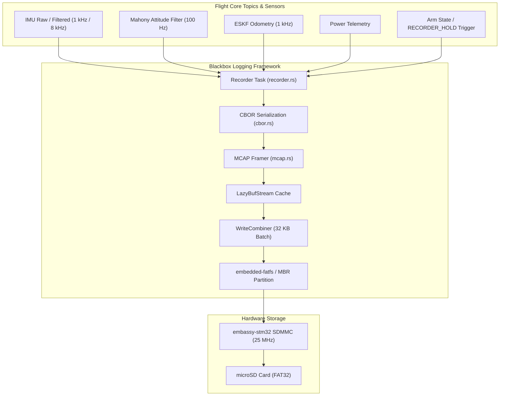
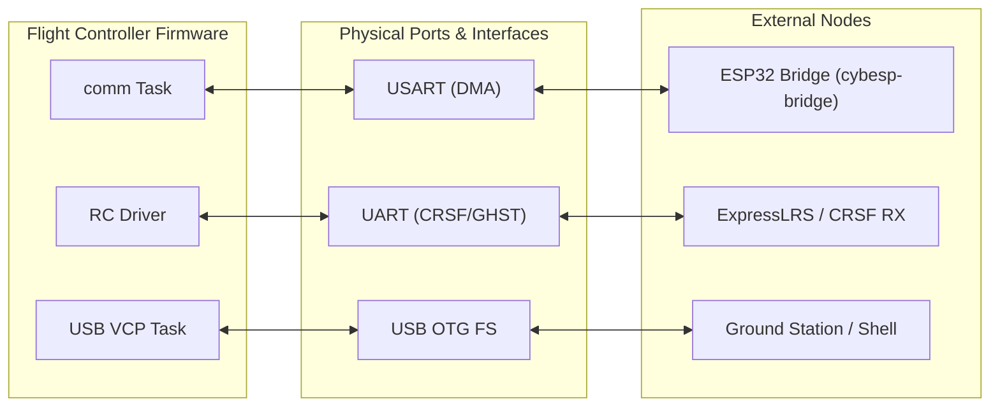

The **Blackbox Logging & Telemetry** subsystem provides comprehensive flight data recording, real-time wireless telemetry, receiver communication, and microsecond-accurate UTC clock synchronization for the cybflight flight control architecture. 

It unifies high-bandwidth local storage on SDMMC media with real-time offboard communication bridges over ESP32 UART, RC receiver channels (CRSF/ExpressLRS and GHST), and USB Virtual COM Port (VCP) interfaces.

---

## Architecture Overview

The subsystem isolates high-rate flight topic serialization from hardware I/O bottlenecks using layered abstractions, write-optimized block buffers, and decimation rules:

- **Blackbox Recorder (`blackbox`)**: Logs flight metrics to `.mcap` files using CBOR topic encoding, managed by a tier-based record set configuration (`none`, `small`, `mid`, `large`, `sysid`).
- **ESP32 Telemetry Bridge (`comm::esp_bridge`)**: Bi-directional high-speed UART DMA link transporting COBS-framed telemetry packets to offboard ground stations and companion computers.
- **Receiver Protocols (`cybflight_drivers::rc`)**: Parses uplink control commands and pushes telemetry downlink frames (battery, attitude, GPS, flight mode, link stats) over CRSF and GHST receiver links.
- **USB Serial VCP (`usb_serial`)**: Provides an interactive CLI shell, direct binary log downloads, and selective topic ASCII streaming capped at 50 Hz.
- **PTP Time Synchronization (`comm::time_sync`)**: Synchronizes internal Embassy `Instant` monotonic clocks with UTC time via ESP32 PTP follow-up packets.


*Blackbox data pipeline: flight topic messages flow through CBOR topic encoders, MCAP framing, lazy stream caching, and CMD25 write-combining into the FAT32 file system on SDMMC media.*

---

## Blackbox Logging Framework

The flight data recorder produces standardized [MCAP](https://mcap.dev/spec) log files containing CBOR-encoded schema messages. Logging is conditionally enabled based on flight arming state or manual bench toggles.

### Recording Lifecycle & Triggers

Recording is governed by the `should_record()` predicate in `recorder.rs`:
$$\text{should\_record}() = \text{IS\_ARMED} \lor \text{RECORDER\_HOLD}$$

1. **Session Initialization**: On the rising edge of `should_record()`, the recorder opens a new file named `flight_<NNNN>.mcap` in the FAT root directory. It emits the MCAP magic bytes (`\x89MCAP0\r\n`), Header, Schemas, Channels, and an initial `KIND_ARM` event record.
2. **Multi-Topic Capture Loop**: The recorder iterates through subscribed topics according to the active `RecordSet`. The capture loop polls disarm status every 50 ms (`DISARM_POLL_INTERVAL`), guaranteeing rapid disarm detection even when sensor topics are silent.
3. **Session Finalization**: On the falling edge of `should_record()`, the recorder appends `KIND_DISARM` and `KIND_LOG_END` event records, writes the MCAP `DataEnd` and `Footer` records, flushes pending write-combiner buffers, and cleanly unmounts the file system.

### Record Sets & Tier Classification

To manage storage bandwidth and SD card write limits (~600 KB/s sustained ceiling), topics are grouped into monotonic recording tiers configured via `record_set.rs`:

| Tier | Logged Topics | Typical Bandwidth (1 kHz build) | Typical Bandwidth (8 kHz build) |
|---|---|---|---|
| `none` | Recording disabled | 0 KB/s | 0 KB/s |
| `small` | `/events`, `/rc` | ~19 KB/s | ~19 KB/s |
| `mid` | `small` + `/imu1`, `/attitude`, `/motors`, `/motor_state`, `/health`, `/gps_health`, `/mpc_cost` | ~110 KB/s | ~540 KB/s |
| `large` | `mid` + `/odometry`, `/mpc`, `/tracking_error`, `/control_setpoint`, `/estimator_state` | ~230 KB/s | ~660 KB/s |
| `sysid` | `/events`, `/imu1_raw`, `/motors`, `/motor_state`, `/odometry`, `/health`, `/power` (INDI mirrors at $\ge 500\text{ Hz}$) | ~129 KiB/s | ~129 KiB/s |

*Note on Rate Scaling*: High-frequency topics like `/imu1` scale directly with the build's IMU output data rate (`IMU_ODR_HZ`). The `sysid` tier enforces publisher-side decimation (`blackbox_rate_div`) to cap raw IMU stream rates, maintaining constant output bandwidth across both 1 kHz and 8 kHz targets.

### Topic Serialization & MCAP Wire Format

Each topic registers a JSON Schema string defining its layout. Message payloads use compact CBOR positional-array structures for high-rate data (`/imu1`, `/odometry`) or string-keyed maps for status snapshots (`/health`, `/gps_health`).

The MCAP framer (`mcap.rs`) is a `#![no_std]` implementation that constructs valid MCAP records:
- `HEADER` (op `0x01`): Emits profile and writer library identification (`cybflight v<version>`).
- `SCHEMA` (op `0x03`): Registers topic schemas.
- `CHANNEL` (op `0x04`): Binds channel IDs to topic names and schemas.
- `MESSAGE` (op `0x05`): Wraps payload bytes with channel ID, sequence number, and timestamp.
- `DATA_END` (op `0x0F`) & `FOOTER` (op `0x02`): Closes the data section and marks file completion.

### Storage Driver Stack & Optimizations

The SDMMC storage stack is structured to eliminate unnecessary card reads:

1. **`SdmmcBlockStore`**: Wraps the `embassy-stm32` SDMMC peripheral running at 25 MHz (`SDMMC_FREQ`).
2. **`WriteCombiner`**: Maintains a 32 KB static batch buffer (64 blocks of 512 bytes, matching a standard FAT32 cluster). It aggregates sequential block writes into single multiblock CMD25 transfers.
3. **`LazyBufStream`**: Replaces standard `block_device_adapters::BufStream`. Standard `BufStream` executes a read-modify-write cycle (CMD17 read) whenever the byte cursor enters a new sector. `LazyBufStream` defer-loads card sectors lazily; sequential appends starting at sector offsets write directly into the cache without reading from the card, reducing data sector read operations to zero during active logging.
4. **FAT32 Layer**: Uses `embedded-partitions` to locate MBR partition tables and `embedded-fatfs` to manage file allocations.

### Shell File Operations & Concurrency

The blackbox subsystem provides file management commands via the CLI shell:
- `blackbox ls`: Lists files in the root FAT directory.
- `blackbox get <file>`: Downloads binary log files over USB VCP using `GET_STREAM` signals.
- `blackbox rm <file>`: Deletes a specified log file.
- `blackbox clean`: Deletes all `flight_NNNN.mcap` log files.

*Concurrency Safety*: Shell requests interact with `blackbox_task` via static signals (`LS_REQUEST`, `GET_REQUEST`, `RM_REQUEST`, `CLEAN_REQUEST`). If a shell file operation is attempted while recording is active, the task immediately returns `LsReport::Busy` or `OpError::Busy`, preventing concurrent access races on the SDMMC peripheral.

---

## Telemetry Protocols & Bridges

cybflight supports multi-channel telemetry output across dedicated ESP32 wireless bridges, RC receiver backhaul links, and USB serial interfaces.



### ESP32 Telemetry Bridge (`cybesp-bridge`)

The ESP32 bridge (`comm::esp_bridge.rs`) operates over DMA-backed UART using COBS (Consistent Overhead Byte Stuffing) framing:
- **Uplink (RX)**: Uses `read_until_idle()` to receive external state updates:
  - `WirePose` (`0x01`): Vicon / Motion Capture pose updates pushed to `VICON_POSE`.
  - `WireTimeSync` (`0x02`): PTP time synchronization follow-up packets.
  - `WirePingResp` (`0x04`): Latency and clock drift measurement responses.
  - `WireFleetState` (`0x05`): Neighboring drone position and velocity vectors for swarm coordination.
  - `WireAttitudeControlSetpoint` (`0x06`) & `WireManualControlSetpoint` (`0x07`): Offboard control overrides.
- **Downlink (TX)**: Batch-encodes flight status and telemetry frames (`WireVehicleOdometry`, `WireVehicleAttitude`, `WireArmDisarm`, `WirePowerStatus`, `WireDshotTelemetry`, `WireSystemHealth`, `WireGpsHealth`) into single DMA transfers per tick, maintaining low CPU interrupt overhead.

### RC Receiver Telemetry (CRSF & GHST)

The CRSF driver (`cybflight_drivers::rc::crsf`) parses uplink RC frames and formats telemetry backhaul:
- **Baudrate & Speed Negotiation**: Operates at 420,000 baud by default, with support for CRSF V3 speed negotiation proposals up to 2 Mbaud (`CRSF_COMMAND_SUBCMD_GENERAL_CRSF_SPEED_PROPOSAL`).
- **Channel Unpacking**: Decodes full 16-channel 11-bit packed frames (type `0x16`) and subset variable-resolution frames (type `0x17`, supporting 10, 11, 12, and 13-bit channels).
- **Link Statistics**: Parses receiver link quality (LQ), RSSI (dBm), SNR, and RF mode (types `0x14` and `0x1D`).
- **Telemetry Downlink Builders**: Formats big-endian telemetry packets sent back to the transmitter:
  - Battery (`0x08`): Voltage (10mV steps), Current (10mA steps), Capacity drawn (mAh), Remaining %.
  - Attitude (`0x1E`): Pitch, Roll, and Yaw angles in radians $\times 10000$.
  - Flight Mode (`0x21`): Null-terminated ASCII flight mode string.
  - Heartbeat (`0x0B`): Origin FC address notification.
  - GPS (`0x02`): Latitude/Longitude ($\text{deg} \times 10^7$), ground speed, heading, altitude (+1000m offset), and satellite count.

The Ghost (`GHST`) driver provides high-speed receiver decoding and telemetry transmission over similar UART interfaces.

### USB Serial VCP (`usb_serial`)

The USB Virtual COM Port provides interactive terminal control and live diagnostic streaming:
- **Interactive Shell**: Accepts text commands for parameter management (`param get/set/save`), mission inspection, post-mortem crash analysis, and manual recording controls.
- **Selective ASCII Streaming**: Streams live ASCII topics (`imu1`, `att`, `ocp`, `rc`, `power`, `gps`, `timesync`, `eskf`).
- **Execution Rate Guard**: Stream updates are rate-limited by `STREAM_MIN_INTERVAL` = 20 ms. This caps USB ASCII output at 50 Hz, preventing high-frequency topics (e.g. 8 kHz raw IMU streams) from monopolizing the Embassy async executor and starving critical system tasks such as hardware watchdog feeding (`iwdg_feed_task`).
- **Binary File Download**: Serves `blackbox get <file>` requests via the `GET_STREAM` channel using an `OK <size>` header, raw byte chunks, and a trailing 32-bit CRC check.

---

## System Time Synchronization

To correlate onboard telemetry with offboard Ground Station logs, companion computer records, and multi-vehicle swarm captures, cybflight implements a PTP-style UTC time synchronization mechanism in `comm::time_sync.rs`.

### PTP Follow-Up Mechanism

The ESP32 module runs SNTP against a Ground Station NTP server. It periodically transmits a `WireTimeSync` frame over UART containing two timestamps:
1. `esp_send_ntp_us`: Primary NTP timestamp captured immediately prior to UART packet transmission.
2. `prev_tx_complete_ntp_us`: Refined NTP timestamp captured after the *previous* frame's UART transfer completed.

```text
Ground Station (NTP) ──(SNTP)──> ESP32 ──(WireTimeSync UART)──> Flight Controller
                                   │                                    │
                                   ├── esp_send_ntp_us                  │
                                   └── prev_tx_complete_ntp_us ─────────┴──> PTP Offset Calculation
```

### Offset Calculation & Refinement

When processing an incoming `WireTimeSync` packet at monotonic arrival instant $t_{\text{rx}}$, the flight controller computes the raw UTC offset:

- **Refined PTP Follow-Up**: If $t_{\text{prev\_rx}}$ and $\text{prev\_tx\_complete\_ntp\_us}$ are valid, transmission delay estimation is unnecessary:
  $$\text{raw\_offset} = \text{prev\_tx\_complete\_ntp\_us} - t_{\text{prev\_rx}}$$
- **Primary Fallback**: On the initial sync frame, offset calculation includes estimated UART transmission delay ($\text{UART\_FRAME\_DELAY\_US} = 217\,\mu\text{s}$ at 921,600 baud):
  $$\text{raw\_offset} = \text{esp\_send\_ntp\_us} - t_{\text{rx}} + \text{UART\_FRAME\_DELAY\_US}$$

The raw offset is smoothed using an Exponential Moving Average (EMA) with coefficient $\alpha = 26/256 \approx 0.10$:
$$\text{offset}_{\text{smoothed}} \leftarrow \text{offset}_{\text{smoothed}} + \alpha \cdot (\text{raw\_offset} - \text{offset}_{\text{smoothed}})$$

### Outlier Rejection & Step Correction

- **Jump Suppression**: Single offset jumps larger than 10 ms (`MAX_OFFSET_JUMP_US`) are rejected to guard against UART latency spikes.
- **Step Change Acceptance**: If 5 consecutive sync frames are rejected (`MAX_CONSECUTIVE_REJECTS = 5`), the system accepts the new offset as a step change, allowing rapid adaptation to Ground Station NTP clock adjustments.

### Latency & Clock Diagnostics

The ESP bridge handles `WirePing` packets from the Ground Station by echoing `WirePingResp` frames containing the flight controller's internal send timestamp. This allows real-time calculation of round-trip time (`ping_rtt_us`) and clock error (`ping_clock_err_us`).

### Monotonic vs. UTC Timebases

All internal control loops, state estimators (ESKF), and task timers run strictly on Embassy monotonic `Instant` timestamps (`embassy_time::Instant`). Monotonic timestamps are converted to UTC microseconds since UNIX epoch exclusively at serialization boundaries using `to_utc_us(instant)`:

```rust
pub fn to_utc_us(instant: Instant) -> i64 {
    critical_section::with(|cs| {
        let monotonic = instant.as_micros() as i64;
        match &*SYNC_STATE.borrow_ref(cs) {
            Some(state) => monotonic + state.smoothed_offset_us,
            None => monotonic, // Fallback to boot-relative microseconds if unsynced
        }
    })
}
```
If time sync is not established (e.g., bench testing without a Ground Station), `to_utc_us()` gracefully falls back to boot-relative microseconds, ensuring telemetry streams remain valid.

---

## Related Documentation

- [Channel Dataflow](../architecture/channel-dataflow.md) — PubSub topic routing, decimation rules, and inter-task message passing.
- [Ground Station & Integration](../integrations/ground-station-and-gs.md) — Offboard communication, cybflight_gs desktop station, and telemetry wire protocols.
