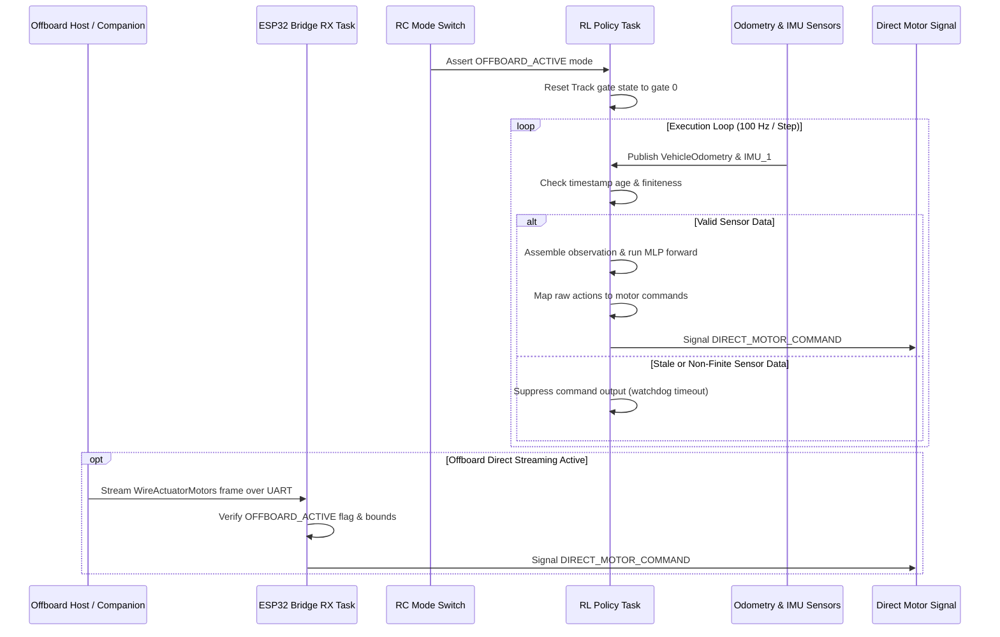

# Neural Network Policies & Offboard Control

The neural network and offboard control subsystem provides end-to-end support for reinforcement learning (RL) policies and external direct motor control in cybflight. The architecture covers the full pipeline from offline Python training and PyO3 vector environments to high-speed onboard Multi-Layer Perceptron (MLP) execution and direct motor streaming over the ESP32 UART bridge.

Key architectural highlights include:
- **Zero-Allocation Onboard Neural Inference**: Allocation-free, `no_std` Multi-Layer Perceptron (MLP) execution in `cybflight_core::nn::mlp` utilizing fixed-topology stack scratch buffers.
- **Gate-Racing Policy & Track State Machine**: Autonomous gate-racing logic in `cybflight_core::nn::race_policy` supporting multi-frame coordinate transformations, look-ahead features, and aperture-validated gate progress.
- **Onboard Task & Failsafe Watchdogs**: Asynchronous execution task in `cybflight::control::rl_policy_task` with mode-change reset semantics and sensor staleness/finiteness watchdogs.
- **High-Speed Offboard Motor Streaming**: Direct motor command ingestion over DMA-backed UART in `cybflight::comm::esp_bridge`, gated by remote control (RC) mode selection.
- **PyO3 Training Bindings**: Multi-threaded parallel environment stepping in `cybflight_rl` for direct integration with Python RL frameworks like Stable-Baselines3.
- **Deterministic Fixture Verification**: Binary policy export scripts and end-to-end validation suites matching Rust inference against PyTorch ground truth.

For broader control loop context and deployment instructions, refer to [Control & Actuation](control-and-actuation.md) and [Offboard & RL Deployment](../workflows/offboard-and-rl-deployment.md).

---

## Onboard Multi-Layer Perceptron (MLP) Engine

The onboard neural inference engine lives in `cybflight_core::nn::mlp`. It provides predictable, bounded execution for fully connected neural networks without requiring dynamic memory allocation or floating-point allocations on the heap.

```
       Flat Weight Slice &[f32]
  [ W1 | b1 | W2 | b2 | W3 | b3 ]
                │
                ▼
  ┌───────────────────────────┐
  │   Mlp::new Validation     │ ── Checks shapes, total weight count,
  └─────────────┬─────────────┘    layer continuity & MAX_WIDTH
                │
                ▼
     Stack Scratch Buffers
  ┌───────────────────────────┐
  │  src [f32; W]  (1 KiB)    │ ◄─── Swapped per layer during
  │  dst [f32; W]  (1 KiB)    │ ──── Mlp::forward execution
  └───────────────────────────┘
```

### Weight Format & Memory Layout
To eliminate runtime transpositions or byte-reordering bugs, the binary weight layout in `cybflight_core::nn::mlp` is an exact match for PyTorch exports (`nn.Linear.weight.numpy().tobytes()`). For each dense layer with `in_features` inputs and `out_features` outputs:
1. Weight matrix $W$ of dimension `[out_features, in_features]` stored in **row-major** order ($out\_features \times in\_features$ floats).
2. Bias vector $b$ of length `[out_features]` stored immediately after $W$.

Layers are concatenated sequentially into a single flat `&[f32]` weight slice. The exporter performs a direct `memcpy` from Python memory into binary fixtures, ensuring zero divergence between trainer and firmware.

### Const Generics & Stack Scratch Memory
`Mlp<'a, const W: usize = MAX_WIDTH>` uses compile-time const generic `W` (default `MAX_WIDTH = 128`) to bound scratch memory requirements.
- Memory during `Mlp::forward` is allocated entirely on the call stack as two fixed-size scratch arrays: `src: [f32; W]` and `dst: [f32; W]`.
- For $W = 128$, the total stack allocation is 1 KiB ($2 \times 128 \times 4$ bytes), keeping stack footprint minimal for microcontroller execution.
- After processing each layer, `src` and `dst` buffers are swapped in-place using `core::mem::swap`.

### Supported Activations
Hidden layers apply a configured `Activation` function, while the final output layer is kept linear (conforming to standard actor networks such as Stable-Baselines3's `MlpPolicy` actor head):
- `Activation::Relu`: Standard $x \cdot \mathbb{I}(x > 0)$ non-linearity via `x.max(0.0)`.
- `Activation::Gelu`: Exact Gaussian Error Linear Unit $0.5 \cdot x \cdot (1 + \text{erf}(x / \sqrt{2}))$ evaluated using `libm::erff`. The approximation variant is intentionally omitted because polynomial compound error across wide layers violates numerical precision guarantees.
- `Activation::Tanh`: Hyperbolic tangent non-linearity via `libm::tanhf`.

### Construction & Safety Invariants
Calling `Mlp::new(weights, shapes, activation)` eagerly checks network invariants before execution:
1. **Topology Check**: Verifies `shapes` is non-empty.
2. **Width Check**: Ensures every layer input/output dimension does not exceed compile-time bound `W` (returning `MlpError::TooWide`).
3. **Continuity Check**: Ensures output dimension of layer $i-1$ equals input dimension of layer $i$ (returning `MlpError::Discontinuous`).
4. **Length Check**: Calculates expected float count $\sum (in_k \cdot out_k + out_k)$ and verifies it matches `weights.len()` exactly (returning `MlpError::WeightLen`).

Because `Mlp::new` validates all array index bounds and lengths upon construction, `Mlp::forward` is a total function that cannot panic or perform out-of-bounds reads during flight.

---

## Gate-Racing Policy & Observation Pipeline

The high-level policy wrapper `RacePolicy` in `cybflight_core::nn::race_policy` combines the `Mlp` inference network with gate course representation (`Track`), frame conversions (`PolicyFrame`), and action scaling.

```
       Vehicle State (ENU/FLU)
                 │
                 ▼
     ┌───────────────────────┐
     │  PolicyFrame Adapter  │ ── ENU/FLU → Legacy NED/FRD if configured
     └───────────┬───────────┘
                 │
                 ▼
     ┌───────────────────────┐
     │ Track::observe Vector │ ── 16 Base + (4 * gates_ahead) Look-ahead
     └───────────┬───────────┘
                 │
                 ▼
     ┌───────────────────────┐
     │ Mlp::forward Network  │ ── Dual stack buffer forward pass
     └───────────┬───────────┘
                 │
                 ▼
     ┌───────────────────────┐
     │  actions_to_commands  │ ── Range map [-1, u_max] → [0, 1] + motor_map
     └───────────┬───────────┘
                 │
                 ▼
       Motor Commands [m0..m3]
```

### Coordinate Frames & Transformations
Firmware operations natively use **ENU world / FLU body** coordinates (East-North-Up world frame, Forward-Left-Up body frame). However, RL models trained in external simulators often expect **NED world / FRD body** (North-East-Down world frame, Forward-Right-Down body frame) with ZYX Euler attitude conventions.

The `PolicyFrame` enum dictates how state observations are formatted in `RacePolicy::observe`:
- `PolicyFrame::Enu`: Native mode. Observations are generated directly without coordinate rotation.
- `PolicyFrame::LegacyNed`: Converts position, linear velocity, body rates (`flu_to_frd`), and attitude rotation matrices (`attitude_in_frame`) into the NED/FRD frame prior to constructing the observation vector.

### Observation Vector Assembly
`Track::observe` writes up to `MAX_OBS = 32` floats into the observation buffer. For standard configuration with `gates_ahead = 1`, the observation dimension is 20:

| Index Range | Field Description | Frame / Units |
| :--- | :--- | :--- |
| `0..=2` | Relative position to target gate $[dx, dy, dz]$ | Target gate frame $[m]$ |
| `3..=5` | Relative velocity to target gate $[vx, vy, vz]$ | Target gate frame $[m/s]$ |
| `6..=8` | Attitude: Roll $\phi$, Pitch $\theta$, Relative Yaw $\psi - \psi_{\text{gate}}$ | Radians $\in [-\pi, \pi]$ |
| `9..=11` | Body rates $[\omega_x, \omega_y, \omega_z]$ | Body frame $[\text{rad}/s]$ |
| `12..=15` | Normalized motor speeds $2 \cdot \frac{\omega - \omega_{\min}}{\omega_{\max} - \omega_{\min}} - 1$ | Dimensionless $\in [-1, 1]$ |
| `16..=19` | Look-ahead gate 1: Relative position $[dx, dy, dz]$ and relative yaw $d\psi$ | Previous gate frame |

Rotor speed observations apply the policy configuration's explicit `omega_norm_min` and `omega_norm_max` parameters rather than current physical airframe limits, ensuring policy input normalization remains identical to training conditions.

### Gate Progress State Machine
`Track::update_gate(prev_pos, new_pos)` tracks vehicle progress through the gate course step-by-step:
1. Calculates line-segment intersection against target gate plane along the gate normal vector.
2. Checks whether vehicle position at plane crossing falls within the gate aperture square ($|x|, |y|, |z| < \frac{1}{2} \cdot \text{gate\_size\_m}$).
3. Emits a `GateEvent`:
   - `GateEvent::None`: No plane crossing.
   - `GateEvent::Passed { gate }`: Crossed plane inside aperture. Increments `gates_passed` counter and advances target gate index $target \leftarrow (target + 1) \pmod{N}$.
   - `GateEvent::Clipped { gate }`: Crossed plane outside aperture (flying around or clipping frame). Increments `gates_clipped` counter **without** advancing the target gate index.

### Action Mapping
Raw network outputs lie in the range $[-1, u_{\max}]$, where $u_{\max} = 2 \cdot \text{motor\_limit} - 1.0$. Function `RacePolicy::actions_to_commands`:
1. Clamps raw values to $[-1.0, u_{\max}]$.
2. Normalizes clamped outputs to $[0.0, 1.0]$ motor throttle space via $u_{\text{norm}} = \frac{v + 1.0}{2.0}$.
3. Re-maps network motor outputs to physical airframe motor indices according to `motor_map: [u8; 4]`.
4. Replaces any non-finite raw outputs with $-1.0$ (0.0 normalized throttle) for failsafe protection.

---

## Onboard Task & Failsafe Watchdogs

Onboard neural policies execute within the `run_race_policy` async task in `cybflight::control::rl_policy_task`.

### Task Lifecycle & Mode Engagement
The task runs continuously on the Embassy executor at a fixed periodicity (e.g. 100 Hz / 10 ms period):
- **Activation Invariants**: Evaluates the policy only when both `motors::IS_ARMED` and `control::OFFBOARD_ACTIVE` atomic flags are set.
- **Rising-Edge Mode Reset**: When `OFFBOARD_ACTIVE` transitions from `false` to `true`, the task triggers `policy.track.reset()`, forcing target gate back to 0 and clearing previous position history.

### Sensor Staleness & Safety Guardrails
Before invoking policy inference, `run_race_policy` performs validity checks on latest `VEHICLE_ODOMETRY` and `IMU_1` messages:
- **Timestamp Timeout Check**: Ensures $t_{\text{now}} - t_{\text{odom}} \le t_{\text{timeout}}$ and $t_{\text{now}} - t_{\text{imu}} \le t_{\text{timeout}}$ (default timeout: 100 ms).
- **Finiteness Check**: Verifies position, linear velocity, and gyro rates contain no `NaN` or `Infinity` values.

If any check fails, the task **suppresses output signal generation** to `control::DIRECT_MOTOR_COMMAND`. Going silent allows the lower-level cascade/INDI task staleness watchdog (100 ms timeout) to trigger disarm or revert control to manual RC attitude stabilization.

---

## Offboard Direct Motor Command Streaming

High-speed direct motor commands can also be streamed from an offboard computer (e.g., Companion Computer or Ground Station) over the ESP32 UART bridge implemented in `cybflight::comm::esp_bridge`.

```
 Offboard Host / Companion Computer
                 │
                 │ COBS Frames over UART
                 ▼
 ┌────────────────────────────────────────┐
 │ esp_bridge_rx_task (DMA read_until_idle)│
 └───────────────┬────────────────────────┘
                 │
                 ▼
 ┌────────────────────────────────────────┐
 │ OFFBOARD_ACTIVE Atomic Flag Check      │ ── Drops frame if false
 └───────────────┬────────────────────────┘
                 │
                 ▼
 ┌────────────────────────────────────────┐
 │ WireActuatorMotors Finite & Range Check│ ── Validates [0.0..1.0] bounds
 └───────────────┬────────────────────────┘
                 │
                 ▼
 ┌────────────────────────────────────────┐
 │ Signal DIRECT_MOTOR_COMMAND            │ ── Forwarded to motor drivers
 └────────────────────────────────────────┘
```

### DMA UART Ingestion
`esp_bridge_rx_task` uses DMA-backed UART asynchronously (`UartRx::read_until_idle`) to minimize interrupt overhead:
- Incoming bytes pass through `FrameAccumulator` to decode COBS-encoded wire protocol frames.
- Supported message types under offboard mode:
  - `wire::msg_id::ACTUATOR_MOTORS`: Direct 4-motor normalized command vector `[m0, m1, m2, m3]`.
  - `wire::msg_id::ATTITUDE_CONTROL_SETPOINT`: Collective thrust, target quaternion, body rates, and torque feedforwards.
  - `wire::msg_id::MANUAL_CONTROL_SETPOINT`: Normalized thrust and body rate setpoints.

### RC Mode Switch Interlock
Offboard message handlers in `esp_bridge.rs` check `control::OFFBOARD_ACTIVE.load(Ordering::Acquire)` before accepting incoming control setpoints:
- If `OFFBOARD_ACTIVE` is `false` (e.g., RC mode switch set to manual or position hold), all offboard setpoint frames are silently discarded.
- This interlock prevents offboard software bugs from overriding pilot command during manual operation.

### Command Bounds Validation
For `WireActuatorMotors` frames, `esp_bridge_rx_task` verifies that all four motor float values satisfy $v \in [0.0, 1.0]$ and `v.is_finite()`. Validated values are packaged into `msgs::ActuatorMotors` with `NormalizedThrottle` bounds and signaled to `control::DIRECT_MOTOR_COMMAND`.

---

## PyO3 Reinforcement Learning Environment (`cybflight_rl`)

The `cybflight_rl` crate exports Rust simulation environments to Python as a C-extension module using PyO3 and `numpy-rust`.

### Parallel Multi-Environment Architecture
Class `VecEnv` encapsulates a vector of `RecoveryEnv` instances:
- `VecEnv::new(n, vehicle_yaml, seed, ...)` creates $n$ environment instances with independent ChaCha8 random seeds.
- Environment stepping (`VecEnv::step`) and resetting (`VecEnv::reset`) run in parallel across CPU threads using Rayon (`par_iter_mut`), releasing PyO3 GIL lock (`py.detach`).

### Stable-Baselines3 Vector API Compatibility
`VecEnv` implements the vectorized environment contract required by SB3 and Ray RLlib:
- `reset()`: Resets all environments, returning a NumPy 2D array of observations `(n, OBS_DIM)`.
- `step(actions)`: Accepts a NumPy 2D array of actions `(n, NZ)`. Returns `(obs, rewards, dones, infos)` tuple.
- **Auto-Reset & Terminal Observations**: When an environment finishes (`done == true`), `VecEnv::step` automatically invokes `reset()` on that specific environment, places the new reset observation into `obs`, and stores the terminal step observation in `infos["terminal_obs"]`.

### Domain Randomization & Reward Configuration
Python callers pass environment parameters directly into `VecEnv::new`:
- **Domain Randomization**: Configures mass jitter (`mass_jitter`), body/rotor drag, motor time constants, inertia scaling, wind force vectors, and sensor noise standard deviations (`gyro_sigma`, `accel_sigma`).
- **Reward Weights**: Accepts weights for geometric error (`w_geom`), time-indexed error (`w_time`), body rates (`w_rate`), control rate changes (`w_du_rate`), and crash penalties (`w_crash`).

---

## Complete Offboard/Onboard Execution Flow

The sequence diagram below illustrates control flow and signal pathways between offboard streaming, onboard neural task evaluation, sensors, safety watchdogs, and actuation outputs.


*Execution flow of onboard neural policy evaluation and offboard direct motor command streaming over the ESP32 UART bridge.*

---

## Policy Export & Fixture Verification

The export script `tools/export_rl_policy.py` and test suite `cybflight_sim/tests/nn_gate_race.rs` provide an end-to-end verification pipeline that guarantees numerical equivalence between Python PyTorch policies and Rust firmware execution.

### Export Tooling (`tools/export_rl_policy.py`)
Run from the Python RL project root, the export script extracts trained policy parameters and outputs four binary files into target fixture directory:
1. `policy.bin`: Flat `<f4` float binary blob of `nn.Linear` weight matrices and bias vectors.
2. `samples.bin`: Paired matrix of $[ \text{world\_state\_ned} \mid \text{observation} \mid \text{raw\_action} \mid \text{target\_gate} ]$ rows for ground-truth observation testing.
3. `traj.bin`: Reference closed-loop trajectory array.
4. `meta.json`: Layer dimensions, track definition, gate pass events, and normalization constants.

### Hierarchical Integration Tests (`nn_gate_race.rs`)
The test suite in `cybflight_sim/tests/nn_gate_race.rs` localizes failures across five distinct validation tiers:
1. `weights_match_declared_topology`: Verifies total float count of `policy.bin` matches declared layer shapes and checks all weights are finite.
2. `forward_pass_matches_pytorch`: Evaluates Rust `Mlp::forward` using exported ground-truth observations and asserts maximum absolute difference $|\Delta \text{action}| < 10^{-5}$ against PyTorch outputs.
3. `observation_matches_python_ground_truth`: Feeds NED world states through Rust `Track::observe` and asserts observation values match Python trainer outputs.
4. `enu_track_matches_upstream_ned_table`: Validates involutive ENU/NED coordinate transformations for track gate positions and headings.
5. `policy_completes_race`: Verifies closed-loop flight through the gate course on both the simplified reference plant model and full `QuadPlant` physics simulator.
