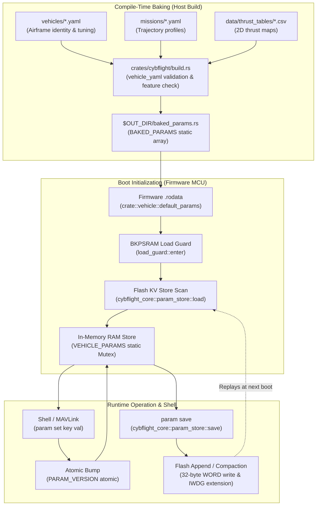

The **Parameter & Vehicle Configuration System** in CybFlight governs how physical airframe properties, flight control gains, estimator thresholds, sensor calibrations, and system settings are defined, validated, baked at compile time, modified at runtime, and persisted across reboots.

The configuration architecture bridges host-side vehicle specifications in YAML with real-time execution on STM32 microcontrollers. It guarantees type safety, spatial accuracy, and crash-resilient persistence without relying on heap allocation or dynamic string parsing during flight.

---

## Configuration Plane Design: Vehicle & Mission YAML Specifications

CybFlight enforces a strict separation between physical hardware identity, flight environment tuning, host simulation physics, and offline trajectory missions. The configuration plane comprises two YAML file trees located at the repository workspace root: `vehicles/*.yaml` and `missions/*.yaml`.

```text
workspace_root/
├── vehicles/
│   ├── sakura_vicon.yaml        # Mocap-tracked indoor airframe configuration
│   ├── sakura_um982.yaml        # Dual-antenna RTK GNSS outdoor configuration
│   └── goku_f745.yaml           # Lightweight F745 indoor/outdoor quad
├── missions/
│   ├── indoor_splits_slow.yaml  # Indoor track mission profile
│   └── outdoor_fast.yaml        # High-speed outdoor GNSS mission profile
└── data/
    ├── thrust_tables/*.csv      # Bench-measured 2D motor/esc thrust maps
    └── cost_policies/*.bin      # Trained neural-network MPC cost policy checkpoints
```

### Vehicle YAML Schema (`vehicles/*.yaml`)

Every vehicle YAML file defines a complete hardware and tuning profile. The top-level schema consists of seven primary sections parsed via `vehicle_yaml::load()`:

1. **`airframe:` (Required Physical Identity)**: Declares immutable facts about the physical drone.
   - `name`: Non-empty ASCII string (`airframe.name`) serving as the join key across the mocap subject name, the ground control station fleet roster (`cybgcs/fleet.toml`), and baked firmware constants.
   - `mass_kg`: Total takeoff mass in kilograms.
   - `inertia_kg_m2`: 9-element array representing the $3 \times 3$ inertia tensor $[I_{xx}, I_{xy}, I_{xz}, I_{yx}, I_{yy}, I_{yz}, I_{zx}, I_{zy}, I_{zz}]$ in $\text{kg}\cdot\text{m}^2$. Diagonal terms $I_{xx}, I_{yy}, I_{zz}$ must be strictly positive.
   - `max_rate_rad_s`: Maximum physical body rate bounds $[p_{\max}, q_{\max}, r_{\max}]$ in $\text{rad/s}$.
   - `motors`: Array of exactly 4 motor definitions specifying position $[x, y]$ in body frame (meters), rotation direction (`cw` or `ccw`), maximum per-rotor thrust in Newtons (`max_thrust_n`), and torque coefficient $k_\tau$ (`torque_coeff_m`).
   - `thrust_model`: Mandatory thrust-to-command linearization model. Specified either as a 2D bench-measured CSV table reference (`{ type: table, table: a2rl_0114 }`) or an analytic curve (`{ type: quadratic, k: 0.518 }` or `{ type: sqrt_squared, k: 0.5 }`).
2. **`build:` (Hardware & Feature Bindings)**: Declares compile-time hardware capabilities and control selections.
   - `board`: PCB target (`sakurah743`, `foxeerh743`, `micoair743v2`, or `flywoof745`).
   - `rc_protocol`: Remote control receiver protocol (`crsf` or `ghst`).
   - `outer_loop`: Outer-loop control law (`mpc`, `mpc_full`, `cascade`, or `rate`).
   - `pos_source`: ESKF position source (`mocap` or `gps`).
   - `gps_model`: GNSS receiver driver (`ublox` or `unicore`).
   - `gps_dual_antenna`: Dual-antenna heading setup (`yes` or `no`). Cross-checked at build time to require `gps_model: unicore`.
   - `imu_rate`: Primary IMU sample rate (`8khz` or `1khz`).
   - `indi`: Incremental Nonlinear Dynamic Inversion inner loop enable (`yes` or `no`).
   - `plan_online`: Online BFGS trajectory solver compilation (`yes` or `no`).
3. **`origin:` (Fixed Geodetic ENU Anchor)**: Optional fixed origin (`lat_deg`, `lon_deg`, `alt_msl_m`). Formatted using `f64` double precision for latitude and longitude. An `f32` representation of latitude quantizes to ~0.6 m at mid-latitudes, throwing away RTK centimeter accuracy; storing origin coordinates as `f64` in a dedicated section prevents this quantization loss.
4. **`sim:` (Host Simulation Plant Physics)**: Optional plant physics parameters used by host simulations (`cybflight_sim`), including aerodynamic rotor drag (`aero_drag`), parasitic body drag (`body_drag`), ESC idle rotor speed, rotor polar moment of inertia, and per-motor thrust scale factors.
5. **`default_mission:`**: String stem naming the default offline mission profile file under `missions/`.
6. **`mpc_cost_policy:`**: String stem naming a baked neural network cost policy under `data/cost_policies/`.
7. **`tuning:`**: Optional flat map keying parameter names directly to `f32` scalar values (e.g. `mpc_w_pos_x: 500.0`). Every key under `tuning:` is validated against the parameter schema; unrecognized keys or out-of-range values raise build errors.

### Mission YAML Schema (`missions/*.yaml`)

Mission profiles represent pre-computed or recorded trajectories parsed by `vehicle_yaml::mission::load_mission()`:
- `env`: Flying environment (`indoor` or `outdoor`).
- `variant`: Trajectory geometry type (`oval`, `figure8`, `race_track`, etc.).
- `speed`: Target flight velocity designation (`slow`, `medium`, `fast`).
- `start`: 3D ENU starting coordinate $[x, y, z]$ in meters.
- `lookahead`: Trajectory tracker lookahead distance in meters.
- `yaw_lookahead_dt_s` / `yaw_lookahead_max_rate_rad_s`: Yaw lookahead time horizon and rate limits.
- `flatness_map`: Differential flatness mapping mode (`TiltYaw` or `TrueYaw`).
- `waypoints`: Array of 3D position keypoints $[x_i, y_i, z_i]$.
- `durations` or `timestamps`: Segment duration allocations converted at build time into monotonic timestamp arrays.
- `headings`: Optional array of explicit yaw references $\psi_i$ in radians.

### Safety Invariants in Configuration

1. **The "No Default Mass" Rule**: Physical identity parameters (`mass_kg`, `inertia_kg_m2`, `motors`) carry no default values in schema structs. `FirmwareConfig::scaffold()` explicitly initializes mass to `0.0`. An un-configured drone cannot fly, preventing silent fallback to incorrect airframe dynamics.
2. **Mandatory Thrust Model**: The firmware build fails if a vehicle YAML omits `airframe.thrust_model`.
3. **Pin-What-You-Fly Validation**: `build.rs` checks `tuning:` for hardware-coupled parameters (e.g., motor time constants `m0_tau`, battery cell limits `batt_max_cells`, IMU filter cutoffs, RC endpoints). Unpinned keys trigger compile-time warnings to alert developers when schema defaults are inherited.

---

## Compile-Time Feature Baking & Build Pipeline

Compile-time baking turns human-readable YAML specifications, thrust CSV curves, and neural cost policy binaries into static C-compatible arrays and structs embedded in the firmware's `.rodata` section.

```
+-------------------+      +--------------------+      +-----------------------+
|  vehicles/*.yaml  |      | missions/*.yaml    |      | data/thrust_tables/*  |
+---------+---------+      +---------+----------+      +-----------+-----------+
          |                          |                             |
          +-------------------+      |      +----------------------+
                              |      |      |
                              v      v      v
                   +----------------------------------+
                   |     crates/cybflight/build.rs    |
                   |   (driven by vehicle_yaml)       |
                   +----------------+-----------------+
                                    |
            +-----------------------+-----------------------+
            |                       |                       |
            v                       v                       v
  $OUT_DIR/baked_params.rs    $OUT_DIR/missions.rs   $OUT_DIR/thrust_tables.rs
```

### Build-Time Generation (`crates/cybflight/build.rs`)

1. **Vehicle Resolution**: Reads the `VEHICLE` environment variable (defaulting to board-specific defaults like `sakura_vicon` or `goku_f745` when unset during bare `cargo check`).
2. **Feature Consistency Guard (`check_build_section`)**: Compares the vehicle's `build:` section declarations against active Cargo features (`CARGO_FEATURE_*`). If `build.board` specifies `sakurah743` but `CARGO_FEATURE_BOARD_FOXEERH743` is active, or if `pos_source: gps` is set without `CARGO_FEATURE_EST_POS_GPS`, the build aborts with a descriptive error. This prevents flashing pinouts or state estimators mismatched with the vehicle hardware.
3. **Thrust Table Generation (`bake_thrust_tables`)**: Parses $50 \times 50$ CSV grids under `data/thrust_tables/*.csv`. Header ranges (`thrust_min`, `thrust_max`) are converted from 4-motor collective force to single-rotor force by dividing by 4. Grid cells are validated for monotonicity along the thrust axis. Generated code emits `pub static` instances of `ThrustTable<50>`.
4. **Mission Array Generation (`bake_missions`)**: Reads all `missions/*.yaml` files, converts durations to timestamps, validates segment counts against `MAX_PIECES`, sorts profiles deterministically by filename stem, and emits the `PROFILES` static slice alongside default profile indices `DEFAULT_PROFILE_INDEX_INDOOR` and `DEFAULT_PROFILE_INDEX_OUTDOOR`.
5. **Cost Policy Baking (`emit_cost_policy`)**: Reads policy checkpoints (`data/cost_policies/<stem>.bin`), verifies binary headers against `COST_MAP_VERSION`, `OBS_DIM`, and output dimension `NZ`, and embeds layer shapes and floating-point weights bit-exact (`f32::from_bits`) into `.rodata`.
6. **Baked Snapshot Output (`$OUT_DIR/baked_params.rs`)**: Emits `BAKED_PARAMS`, a static array of `(&str, f32)` tuples covering all parameters in declaration order, alongside constants `BAKED_VEHICLE`, `BAKED_AIRFRAME_NAME`, `BAKED_THRUST_MODEL`, `BAKED_DEFAULT_MISSION_INDEX`, `BAKED_ORIGIN`, and `BAKED_COST_POLICY`.

---

## Proc-Macro Parameter Schema: `#[derive(Params)]` & `cybflight_core::params`

The parameter registry is defined declaratively in `cybflight_core::params` using Rust structs annotated with `#[derive(Params)]` provided by the `cybflight-params-derive` proc-macro crate.

```
                      +-----------------------------+
                      |     #[derive(Params)]       |
                      | (cybflight-params-derive)   |
                      +--------------+--------------+
                                     |
                                     v
                      +-----------------------------+
                      |    impl ParamGroup for T    |
                      +--------------+--------------+
                                     |
    +-----------------+--------------+---------------+-------------------+
    |                 |                              |                   |
    v                 v                              v                   v
COUNT: usize    param_get(idx)                 param_find(name)     param_meta(idx)
(Total count)   param_set_f32(idx, v)          param_write_name     (Range, unit,
                (Typed access & saturation)    param_write_path     doc, reboot)
```

### Field Attributes Supported by `#[derive(Params)]`

- `#[param(key = "name")]`: Renames a scalar field in the registry namespace (e.g., field `mass_kg` exposed as `"mass"`).
- `#[param(keys = "k1,k2,k3")]`: Maps 1D or 2D array elements (`[f32; N]` or `[[f32; C]; R]`) to row-major scalar parameter names.
- `#[param(nested)]`: Splices a child `ParamGroup` struct into the parent registry.
- `#[param(nested_array, prefix = "m")]`: Slices an array of `ParamGroup` structs `[T; N]`, prefixing child keys with `m0_`, `m1_`, etc.
- `#[param(as_u16)]`: Exposes a `usize` field as a saturating `u16` parameter.
- `#[param(enum_u8)]`: Exposes a type implementing `ParamEnum` as a `u8` parameter with safe fallback bounds.
- `#[param(skip)]`: Omits internal scratch fields from the registry.
- `#[param(reboot)]`: Marks the parameter (and all child parameters if applied to a nested group) as requiring a reboot before live application.
- `#[param(unit = "...", min = ..., max = ...)]`: Specifies physical units and valid numeric bounds. Captures the first line of the field's doc comment (`///`) as documentation text.

### The `ParamGroup` Trait Interface

`cybflight_core::param_registry::ParamGroup` is the code-generated runtime interface:

```rust
pub trait ParamGroup {
    const COUNT: usize;

    fn param_get(&self, idx: usize) -> Option<ParamValue>;
    fn param_set_f32(&mut self, idx: usize, v: f32) -> bool;
    fn param_meta(idx: usize) -> ParamMeta;
    fn param_find(name: &str) -> Option<usize>;
    fn param_write_name(idx: usize, w: &mut dyn core::fmt::Write) -> core::fmt::Result;
    fn param_write_path(idx: usize, w: &mut dyn core::fmt::Write) -> core::fmt::Result;
}
```

#### Trait Guarantees and Zero-Heap Streaming
1. **Flat Index Space**: Parameters are indexed contiguously from `0..COUNT` in depth-first field declaration order.
2. **Type Safety & Value Conversion**: `ParamValue` represents typed values (`F32`, `U8`, `U16`, `U32`, `Bool`). Setter writes accept `f32` (e.g. from shell input or flash records) and apply saturating conversions:
   - `f32_to_u8` / `f32_to_u16` / `f32_to_u32`: Clamps negative numbers/NaNs to 0 and upper values to integer maxima.
   - `f32_to_bool`: Maps values $\ge 0.5$ to `true`.
   - `ParamEnum::from_u8`: Total mapping function guaranteeing out-of-bounds integers fall back to valid enum variants.
3. **Zero-Allocation Formatting**: `param_write_name` and `param_write_path` stream parameter names and dot-separated group paths (e.g., `eskf.mocap_guard`) into caller-provided format writers without allocating string buffers on the heap.

### Root Schema Hierarchy (`FirmwareConfig`)

`FirmwareConfig` (`cybflight_core::params`) aggregates all subsystem parameter groups:

| Group Field | Group Type | Description | Reboot Required |
| :--- | :--- | :--- | :--- |
| `airframe` | `AirframeParams` | Mass, 3x3 inertia tensor, motor geometry, and motor dynamics | No |
| `sensors` | `SensorParams` | IMU low-pass cutoffs, primary IMU selection, accel/gyro bi-quads | Yes |
| `eskf` | `EskfParams` | Error-State Kalman Filter noise sigmas, gate thresholds, guard parameters | Yes |
| `mahony` | `MahonyParams` | Backup Mahony attitude filter gains ($K_p, K_i$) | Yes |
| `battery` | `BatteryParams` | Voltage/current scaling, cell count caps, low-voltage thresholds | Yes |
| `rc` | `RcParams` | Channel mappings, endpoint calibration, stick deadbands | Yes |
| `site` | `SiteParams` | Gravitational acceleration $g$, safety fence boundaries | Yes |
| `safety` | `SafetyParams` | Arming preconditions, RC loss timeout, failsafe ordering | Yes |
| `indi` | `IndiParams` | Rate gains, control decimation, WLS matrix weights, motor idle floor | No |
| `rpm_notch` | `RpmNotchParams` | ESC telemetry RPM notch filter tracking parameters | Yes |
| `cascade` | `CascadeParams` | Outer-loop position PD and attitude $P$ gains | No |
| `mpc` | `MpcParams` | MPC cost weights, discretization $dt$, horizon $N$, rate/tilt barriers | No |
| `trajectory` | `TrajectoryParams` | Online BFGS planner weights, maximum velocity/tilt, smoothing $\varepsilon$ | No |
| `system` | `SystemSettings` | Blackbox logging rate dividers, record set tiers, shell verbosity | No |

---

## Dual-Sector Flash KV Store & Watchdog Safety

Persistent parameter changes made in flight or on the bench are saved to internal microcontroller flash using an append-only Key-Value (KV) store (`cybflight_core::param_store` and `cybflight::params`).

```text
Sector 0 / Bank 2 Sector 6 (Header: "PRMS", Generation: G)
+-------------------------------------------------------------------------+
| PRMS | Gen: G | CRC32 | ... 0xFF ...                                    |
+-------------------------------------------------------------------------+
| PRMR | Hash: 0x8A12F3B0 | Val: 500.0 (f32) | CRC32 | ... 0xFF ...        |
+-------------------------------------------------------------------------+
| PRMR | Hash: 0x14C9E01F | Val:  10.0 (f32) | CRC32 | ... 0xFF ...        |
+-------------------------------------------------------------------------+
| ... (Appended records)                                                  |
+-------------------------------------------------------------------------+

Sector 1 / Bank 2 Sector 7 (Erased / Compaction Target)
+-------------------------------------------------------------------------+
| 0xFFFFFFFF ...                                                          |
+-------------------------------------------------------------------------+
```

### Hardware Flash Layout Across MCU Targets

- **STM32H743 (2 MB Dual-Bank Flash)**:
  - Uses Bank 2 sectors 6 and 7 (`0x081C_0000` and `0x081E_0000`, 128 KB per sector).
  - Linker script `memory.x` shrinks the executable application region from 2048 KB to 1792 KB, reserving the final 256 KB.
  - **Read-While-Write**: Firmware executes instructions from Bank 1 while Bank 2 performs flash program and sector erase operations without stalling CPU instruction fetches.
- **STM32F745 (1 MB Single-Bank Flash)**:
  - Uses sectors 6 and 7 (`0x0808_0000` and `0x080C_0000`, 256 KB per sector).
  - Linker script `memory_f745.x` adjusts memory bounds accordingly.
  - **Single-Bank Stall**: Sector erase operations stall all flash instruction fetches across the MCU for ~1–2 seconds.

### 32-Byte Flash Word Format

STM32H7 flash memory requires programming in 256-bit (32-byte) words (`cybflight_core::param_store::WORD`). Each log entry occupies exactly one 32-byte flash word:

#### Sector Header Word (Word 0)
- `[0..4]`: Magic bytes `"PRMS"` (`0x534D5250`).
- `[4..8]`: Generation counter (`u32`, monotonically increasing across compactions).
- `[8..12]`: CRC32 checksum over bytes `[0..8]`.
- `[12..32]`: Padding (`0xFF`).

#### Override Record Word (Words 1..)
- `[0..4]`: Magic bytes `"PRMR"` (`0x524D5250`).
- `[4..8]`: FNV-1a 32-bit hash of the parameter key string (`name_hash`).
- `[8..12]`: Parameter value as little-endian `f32` (`ParamValue::as_f32`).
- `[12..16]`: CRC32 checksum over bytes `[4..12]`.
- `[16..32]`: Padding (`0xFF`).

### Boot Recovery & BKPSRAM Load Guard

Power loss during a flash program operation can leave an uncorrectable ECC error in STM32H7 flash, which triggers a Hardware BusFault on subsequent memory-mapped reads. CybFlight implements a boot recovery mechanism using Backup SRAM (`.bkpsram`):

1. `init_from_flash()` calls `load_guard::enter()`, writing a marker `"PRML"` (`0x4C4D5250`) into persistent BKPSRAM.
2. If the previous boot crashed inside the flash load/replay path, `load_guard::enter()` detects the pre-existing marker.
3. Instead of re-reading corrupt flash and entering a bootloop, `init_from_flash()` logs an error, erases both KV flash sectors, and falls back to compile-time baked YAML defaults.
4. If load succeeds without faulting, `load_guard::exit()` clears the BKPSRAM marker.

```rust
// Boot Initialization Path (cybflight::params)
pub fn init_from_flash(flash_peri: hal::Peri<'static, hal::peripherals::FLASH>) {
    let mut params = crate::vehicle::default_params();
    let mut flash = hal::flash::Flash::new_blocking(flash_peri);

    #[cfg(feature = "postmortem")]
    let prev_boot_died_in_load = load_guard::enter();

    if prev_boot_died_in_load {
        // Erase corrupt sectors and fly on baked defaults
        let mut kv = H7KvFlash { flash: &mut flash };
        let _ = kv.erase_sector(0);
        let _ = kv.erase_sector(1);
    } else {
        let mut kv = H7KvFlash { flash: &mut flash };
        let report = param_store::load(&mut kv, &mut params);
        // Apply overrides with range checks
    }

    #[cfg(feature = "postmortem")]
    load_guard::exit();

    // Publish to RAM Mutex and increment PARAM_VERSION
}
```

### Save, Prune, Compaction & Watchdog Management

Parameter persistence supports two distinct operations:

1. **`save_to_flash()` (`param_store::save`)**:
   - Compares live RAM parameter values against the effective stored state.
   - Appends 32-byte record words for modified keys into the active sector.
   - **No Sector Erase**: Plain appends do not erase flash, completing quickly without blocking CPU threads.
   - **Sector Full / Compaction**: When the active sector lacks space for pending records, compaction triggers:
     a. Erases the inactive sector.
     b. Writes new override records containing only parameters that differ from baked defaults.
     c. Writes the target sector header (Generation $+ 1$) **last**.
     d. Erases the old sector last.
     - *Crash Safety*: If power fails during compaction before step (c), the target sector lacks a valid header; the old sector retains its generation and remains authoritative on reboot.
2. **`prune_to_flash()` (`param_store::save_pruned`)**:
   - Re-writes the store with *only* records that differ from compile-time baked defaults, dropping unnecessary override records.
   - Required because the KV log lacks tombstone records; resetting a parameter to default via `param set` followed by plain `save` appends a record of that default value, which would shadow future YAML updates. Pruning removes the record entirely.

#### Watchdog & Arming Guards During Sector Erase

Sector erase operations block for ~1–2 seconds. To prevent independent system failures during erases:

```rust
fn erase_sector(&mut self, sector: u8) -> Result<(), StoreError> {
    // 1. Armed Re-Check: Refuse erase if motors are armed
    if crate::motors::IS_ARMED.load(core::sync::atomic::Ordering::Acquire) {
        return Err(StoreError::Armed);
    }
    // 2. Extend Independent Watchdog (IWDG) timeout to ~4 seconds
    crate::watchdog::extend_timeout();
    let result = self.flash.blocking_erase(start, start + KV_SECTOR_SIZE as u32)
        .map_err(|_| StoreError::Flash);
    // 3. Restore IWDG timeout to normal operating window (~500 ms)
    crate::watchdog::restore_timeout();
    result
}
```

---

## End-to-End Parameter Resolution Architecture

The sequence below illustrates parameter flow from YAML source files on the host, through build-time code generation and MCU boot replay, to live runtime modification and flash persistence.


Parameter resolution pipeline from compile-time YAML baking to runtime RAM storage and dual-sector flash KV store persistence.

---

## Operational Workflows & Console Commands

Operators and developers interact with parameters using the CybFlight serial shell interface:

- `param list [filter]`: Displays parameters matching an optional filter string. Outputs parameter name, current value, physical units, and group path (e.g. `eskf.mocap_guard`).
- `param get <key>`: Reads a specific parameter value and its declared metadata (min, max, unit, doc comment).
- `param set <key> <val>`: Updates a parameter value in RAM. Verifies disarmed status for `reboot`-flagged parameters, checks numeric bounds against `ParamMeta::in_range()`, updates `VEHICLE_PARAMS`, and increments `PARAM_VERSION`. Refused while armed.
- `param save`: Appends changed parameters to internal flash KV storage.
- `param save --prune`: Compacts internal flash, persisting only parameters that differ from compile-time YAML defaults.
- `param reset <key>`: Resets a parameter in RAM to its compile-time baked default.
- `param reset all`: Resets all RAM parameters to compile-time baked defaults.

---

## Related Documentation

- [Building and Flashing](../workflows/building-and-flashing.md) — Toolchain requirements, `VEHICLE` environment variable selection, target compilation, and flashing firmware to STM32 boards.
- [Parameter Tuning and Sync](../workflows/parameter-tuning-and-sync.md) — In-flight parameter tuning guidelines, shell commands, blackbox log synchronization, and YAML update procedures.
