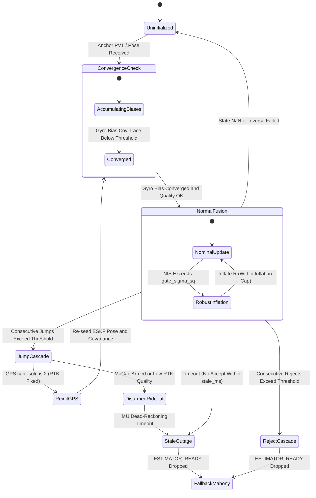

The state estimation subsystem in Cybflight provides robust, real-time 6-DoF rigid-body state estimates for high-bandwidth flight control. At its core is a 15-state **Error-State Kalman Filter (ESKF)** that propagates full navigation states from IMU readings at 1 kHz and fuses external measurements from GPS/RTK GNSS receivers, Vicon Motion Capture (MoCap) systems, barometric altimeters, and magnetometers.

Source-specific guards (`EskfGpsGuard` and `EskfMocapGuard`) wrap the filter to provide quality gating, jump cascade detection, adaptive covariance inflation, and disarm/re-initialization policies. If the primary ESKF becomes uninitialized or degraded, the system seamlessly falls back to a **Mahony nonlinear complementary filter** for backup attitude estimation.

For details on signal routing and control loops, see [Channel Dataflow](../architecture/channel-dataflow.md), [Control & Actuation](control-and-actuation.md), and [Safety & Postmortem](safety-and-postmortem.md).

---

## 15-State ESKF Formulation & Mathematics

The Error-State Kalman Filter divides estimation into a high-rate non-minimal **nominal state** vector and a low-rate minimal **error state** vector. The nominal state is updated directly by high-rate IMU integrations, while external measurement updates estimate the error state, which is then injected back into the nominal state via a manifold addition ($\oplus$) operator.

### Nominal State and Error State Layout

The nominal state vector $\mathbf{x} \in \mathbb{R}^{16}$ contains position, orientation (as a unit quaternion), velocity, accelerometer bias, and gyroscope bias:

$$\mathbf{x} = \begin{bmatrix} \mathbf{p} \\ \mathbf{q} \\ \mathbf{v} \\ \mathbf{a}_b \\ \mathbf{g}_b \end{bmatrix} \in \mathbb{R}^3 \times S^3 \times \mathbb{R}^3 \times \mathbb{R}^3 \times \mathbb{R}^3$$

The true state $\mathbf{x}_{true}$ is parametrized by the nominal state $\mathbf{x}$ and the 15-dimensional error state $\delta\mathbf{x} \in \mathbb{R}^{15}$:

$$\delta\mathbf{x} = \begin{bmatrix} \delta\mathbf{p} \\ \delta\boldsymbol{\theta} \\ \delta\mathbf{v} \\ \delta\mathbf{a}_b \\ \delta\mathbf{g}_b \end{bmatrix} \in \mathbb{R}^{15}$$

| Component | Dimensions | Description | Reference Frame |
| :--- | :--- | :--- | :--- |
| $\mathbf{p} \, / \, \delta\mathbf{p}$ | 3 | Position vector & position error | ENU (East-North-Up) |
| $\mathbf{q} \, / \, \delta\boldsymbol{\theta}$ | 4 / 3 | Unit quaternion & small-angle rotation vector | Body to ENU |
| $\mathbf{v} \, / \, \delta\mathbf{v}$ | 3 | Linear velocity vector & velocity error | ENU |
| $\mathbf{a}_b \, / \, \delta\mathbf{a}_b$ | 3 | Accelerometer bias vector & bias error | Body frame [m/s²] |
| $\mathbf{g}_b \, / \, \delta\mathbf{g}_b$ | 3 | Gyroscope bias vector & bias error | Body frame [rad/s] |

### Boxplus Composition ($\oplus$)

When a measurement update yields an estimated error state $\delta\mathbf{x}$, the nominal state is updated using the generalized addition operator $\mathbf{x} \leftarrow \mathbf{x} \oplus \delta\mathbf{x}$ implemented in `NominalState::boxplus`:

$$\begin{aligned}
\mathbf{p} &\leftarrow \mathbf{p} + \delta\mathbf{p} \\
\mathbf{q} &\leftarrow \mathbf{q} \otimes \exp\left(\delta\boldsymbol{\theta}\right) \\
\mathbf{v} &\leftarrow \mathbf{v} + \delta\mathbf{v} \\
\mathbf{a}_b &\leftarrow \mathbf{a}_b + \delta\mathbf{a}_b \\
\mathbf{g}_b &\leftarrow \mathbf{g}_b + \delta\mathbf{g}_b
\end{aligned}$$

where $\exp\left(\delta\boldsymbol{\theta}\right)$ maps the scaled axis rotation vector $\delta\boldsymbol{\theta}$ to a unit quaternion.

---

## State & Covariance Propagation

During the IMU predict step (`Eskf::predict` / `predict_sparse`), specific force $\mathbf{a}_{imu}$ and angular velocity $\boldsymbol{\omega}_{imu}$ are corrected for current bias estimates:

$$\mathbf{a}_{ub} = \mathbf{a}_{imu} - \mathbf{a}_b, \qquad \boldsymbol{\omega}_{ub} = \boldsymbol{\omega}_{imu} - \mathbf{g}_b$$

### Discrete Nominal State Kinematics

Given timestep $\Delta t$ and constant gravity vector $\mathbf{g}_{ENU} = [0, 0, -9.81]^\top$, the discrete state propagation equations are:

$$\begin{aligned}
\mathbf{p}_{k+1} &= \mathbf{p}_k + \mathbf{v}_k \Delta t \\
\mathbf{q}_{k+1} &= \mathbf{q}_k \otimes \exp\left(\boldsymbol{\omega}_{ub} \Delta t\right) \\
\mathbf{v}_{k+1} &= \mathbf{v}_k + \left( \mathbf{R}(\mathbf{q}_k) \mathbf{a}_{ub} + \mathbf{g}_{ENU} \right) \Delta t
\end{aligned}$$

where $\mathbf{R}(\mathbf{q}_k)$ is the rotation matrix derived from unit quaternion $\mathbf{q}_k$.

### Error State Transition Matrix ($\mathbf{F}$) and Process Noise ($\mathbf{Q}$)

The linearized $15 \times 15$ error state transition matrix $\mathbf{F}$ is given by:

$$\mathbf{F} = \begin{bmatrix}
\mathbf{I}_3 & \mathbf{0}_3 & \mathbf{I}_3 \Delta t & \mathbf{0}_3 & \mathbf{0}_3 \\
\mathbf{0}_3 & \mathbf{R}(-\boldsymbol{\omega}_{ub} \Delta t) & \mathbf{0}_3 & \mathbf{0}_3 & -\mathbf{I}_3 \Delta t \\
\mathbf{0}_3 & -\mathbf{R}(\mathbf{q}_k) [\mathbf{a}_{ub}]_\times \Delta t & \mathbf{I}_3 & -\mathbf{R}(\mathbf{q}_k) \Delta t & \mathbf{0}_3 \\
\mathbf{0}_3 & \mathbf{0}_3 & \mathbf{0}_3 & \mathbf{I}_3 & \mathbf{0}_3 \\
\mathbf{0}_3 & \mathbf{0}_3 & \mathbf{0}_3 & \mathbf{0}_3 & \mathbf{I}_3
\end{bmatrix}$$

where $[\mathbf{a}_{ub}]_\times$ is the skew-symmetric matrix (hat operator) of $\mathbf{a}_{ub}$.

The diagonal process noise covariance matrix $\mathbf{Q} \in \mathbb{R}^{15 \times 15}$ is constructed from IMU noise densities:

$$\mathbf{Q} = \text{diag}\left( \mathbf{0}_3, \, \sigma_{gyro}^2 \Delta t \, \mathbf{I}_3, \, \sigma_{accel}^2 \Delta t \, \mathbf{I}_3, \, \sigma_{a,rw}^2 \Delta t \, \mathbf{I}_3, \, \sigma_{g,rw}^2 \Delta t \, \mathbf{I}_3 \right)$$

### Block-Sparse Covariance Update (`propagate_state_sparse`)

The standard dense matrix multiplication $\mathbf{P}_{k+1} = \mathbf{F} \mathbf{P}_k \mathbf{F}^\top + \mathbf{Q}$ requires approximately 6,750 floating-point Multiply-Accumulate (FMA) operations per predict step. Because $\mathbf{F}$ contains only 9 non-zero $3 \times 3$ blocks, `Eskf::propagate_state_sparse` explicitly evaluates the upper-triangle blocks:

```rust
// Block-sparse propagation reduces computation from ~6750 FMAs to ~1100 FMAs (~6x speedup)
let (new_state, new_cov) = self.propagate_state_sparse(accel, gyro, dt);
self.state = new_state;
self.cov = new_cov;
```

This optimization reduces computational overhead by ~6× on ARM Cortex-M7 processors (STM32H743) and enforces mathematical symmetry by constructing the lower triangle via transposes.

---

## Sensor Fusion & Observation Models

The filter integrates diverse sensor modalities through standardized measurement update calls.

```
+-------------------------------------------------------------------------------+
|                           Multi-Sensor Fusion Pipeline                         |
+-------------------+--------------------+------------------+-------------------+
|  Vicon MoCap      |  GPS / RTK GNSS    |  Barometer       |  Magnetometer     |
|  (Position/Att)   |  (Pos/Vel/Heading) |  (Altitude)      |  (Heading/3D Mag) |
+---------+---------+---------+----------+--------+---------+---------+---------+
          |                   |                   |                   |
          v                   v                   v                   v
+-------------------------------------------------------------------------------+
|                       Observation Update Functions                            |
|  update_pose()    | update_pos/vel()   | update_altitude()| update_mag()      |
|                   | update_baseline()  |                  |                   |
+-------------------------------------------------------------------------------+
          |
          v
+-------------------------------------------------------------------------------+
|                     15-State Error-State Kalman Filter                        |
|   - Absolute Jump Gate Check (max_pos_jump_m, max_att_jump_rad)              |
|   - Huber R-Inflation (Normalized Innovation Squared / gate_sigma^2)         |
|   - Joseph Form Covariance Update & Diag Clamping (MIN_VAR = 1e-10)           |
+-------------------------------------------------------------------------------+
```

### 1. Motion Capture (MoCap / Vicon 6-DoF Pose)

Vicon systems measure position $\mathbf{p}_{mocap}$ and orientation $\mathbf{q}_{mocap}$ simultaneously at 100–360 Hz. Calling `Eskf::update_pose` or `update_pose_sparse` executes a joint 6-D observation step:

$$\mathbf{z} = \begin{bmatrix} \mathbf{p}_{mocap} - \mathbf{p} \\ \text{scaled\_axis}\left(\mathbf{q}^{-1} \otimes \mathbf{q}_{mocap}\right) \end{bmatrix} \in \mathbb{R}^6, \qquad \mathbf{H} = \begin{bmatrix} \mathbf{I}_3 & \mathbf{0}_3 & \mathbf{0}_3 & \mathbf{0}_3 & \mathbf{0}_3 \\ \mathbf{0}_3 & \mathbf{I}_3 & \mathbf{0}_3 & \mathbf{0}_3 & \mathbf{0}_3 \end{bmatrix} \in \mathbb{R}^{6 \times 15}$$

Updating 6-D pose jointly preserves cross-covariance pathways between position and attitude error, producing sharper gain matrices than two separate 3-D updates. The sparse Joseph form reduces update cost from ~16,500 FMAs to ~4,800 FMAs.

### 2. GPS / RTK GNSS (u-blox & Unicore UM982)

GPS receivers supply 3D ENU position (`update_pos`) and 3D ENU velocity (`update_vel`). Measurement noise variance is dynamically scaled based on the carrier solution state (`carr_soln`):

| Carrier Solution (`carr_soln`) | Fix Type | Position Noise Floor ($\sigma_{pos}$) | Velocity Noise Floor ($\sigma_{vel}$) |
| :--- | :--- | :--- | :--- |
| `2` (RTK Fixed) | Centimeter RTK | $0.05 \text{ m}$ | $0.10 \text{ m/s}$ |
| `1` (RTK Float) | Decimeter Float | $0.30 \text{ m}$ | $0.10 \text{ m/s}$ |
| `0` (Stand-alone / None) | Standard GNSS | $2.00 \text{ m}$ | $0.10 \text{ m/s}$ |

#### Dual-Antenna Heading / Baseline Fusion (`update_baseline`)
For dual-antenna receivers (such as the Unicore UM982), a body-fixed baseline vector $\mathbf{b}_{body}$ (e.g., $[0, -1, 0]^\top$ for ANT1 $\rightarrow$ ANT2) is converted from measured azimuth and pitch into a world-frame unit vector $\mathbf{b}_{meas}$.

$$\mathbf{z}_{base} = \mathbf{b}_{meas} - \mathbf{R}(\mathbf{q}) \mathbf{b}_{body}, \qquad \mathbf{H}_{att} = -\mathbf{R}(\mathbf{q}) [\mathbf{b}_{body}]_\times$$

Unlike scalar yaw updates ($\psi_{meas} - \psi_{pred}$), vector baseline fusion has **no Euler angle singularity** during vertical climbs or inverted flight (+90° pitch), making yaw fully observable for acrobatic maneuvers. An anisotropic 2-axis covariance matrix $R$ scales noise along azimuth and elevation tangents.

### 3. Barometric Altitude

Barometer updates (`update_altitude`) observe vertical position $p_z$:

$$z = h_{baro} - p_z, \qquad \mathbf{H} = \begin{bmatrix} 0 & 0 & 1 & 0 & \dots & 0 \end{bmatrix} \in \mathbb{R}^{1 \times 15}$$

### 4. Magnetometer 3D Heading Aiding

Magnetometers (`update_mag`) compare body-frame readings $\mathbf{m}_{body}$ against a world reference vector $\mathbf{m}_{world\_ref}$:

$$\mathbf{z} = \mathbf{m}_{body} - \mathbf{R}(\mathbf{q})^\top \mathbf{m}_{world\_ref}, \qquad \mathbf{H} = \begin{bmatrix} \mathbf{0}_3 & [\mathbf{R}(\mathbf{q})^\top \mathbf{m}_{world\_ref}]_\times & \mathbf{0}_3 & \mathbf{0}_3 & \mathbf{0}_3 \end{bmatrix}$$

A norm gate rejects magnetic updates if $\|\mathbf{m}_{body}\| - \|\mathbf{m}_{world\_ref}\|$ exceeds `mag_norm_gate` (default 30%) to prevent local ferrous distortion from corrupting the estimate.

---

## Gating, Robust Huber Inflation & Stability

Every measurement update passes through a two-stage validation pipeline before modifying filter state:

```
                  Raw Sensor Innovation z
                             |
                             v
              +------------------------------+
              |   Absolute Jump Gate Check   |
              | z_pos > max_pos_jump_m OR    |
              | z_att > max_att_jump_rad     |
              +--------------+---------------+
                             |
                   Passed    |    Failed -> Reject (UpdateOutcome::JumpRejected)
              +--------------+
              |
              v
    Mahalanobis Normalized Innovation Squared
            gamma = (1/dof) zᵀ S⁻¹ z
                             |
        +--------------------+--------------------+
        |                                         |
 gamma <= gate_sigma²                      gamma > gate_sigma²
        |                                         |
        v                                         v
   Standard R                               Compute Inflation Factor
(Huber Normal)                               inflate = gamma / gate_sigma²
                                                  |
                                 +----------------+----------------+
                                 |                                 |
                         inflate <= inflation_cap          inflate > inflation_cap
                                 |                                 |
                                 v                                 v
                           Scale R_eff = R * inflate         Reject Outlier
                         (Accepted { inflated: true })     (UpdateOutcome::InflationCapExceeded)
```

### 1. Absolute Jump Gates
Prior to covariance-dependent gating, raw innovations are checked against fixed spatial bounds:
- **Position Jump Gate**: $\|\mathbf{p}_{meas} - \mathbf{p}\| \le \text{max\_pos\_jump\_m}$ (Default: 1.0 m for MoCap, 3.0 m for GPS).
- **Attitude Jump Gate**: $\|\mathbf{z}_{att}\| \le \text{max\_att\_jump\_rad}$ (Default: 0.7 rad $\approx 40^\circ$).

If an innovation exceeds these thresholds, it is immediately returned as `UpdateOutcome::JumpRejected`. This prevents catastrophic glitches—such as Vicon rigid-body re-associations or RTK ambiguity loss—from corrupting the nominal state.

### 2. Huber Robust R-Inflation
For innovations passing the absolute jump gate, the Normalized Innovation Squared (NIS) is calculated:

$$\gamma = \frac{1}{\text{dof}} \mathbf{z}^\top \mathbf{S}^{-1} \mathbf{z}, \qquad \mathbf{S} = \mathbf{H} \mathbf{P} \mathbf{H}^\top + \mathbf{R}$$

If $\gamma > \text{gate\_sigma}^2$ (default $\text{gate\_sigma} = 10.0$), measurement noise is scaled up proportionally:

$$\text{inflate} = \frac{\gamma}{\text{gate\_sigma}^2}, \qquad \mathbf{R}_{eff} = \mathbf{R} \cdot \text{inflate}$$

If $\text{inflate} \le \text{inflation\_cap}$ (default 100.0), the update is accepted with reduced gain (`Accepted { inflated: true }`). If $\text{inflate} > \text{inflation\_cap}$, the measurement is dropped (`InflationCapExceeded`).

### 3. Joseph Form & Covariance Clamping
State covariance updates use the Joseph stabilized formulation to guarantee symmetry and positive definiteness:

$$\mathbf{P} \leftarrow (\mathbf{I} - \mathbf{K} \mathbf{H}) \mathbf{P} (\mathbf{I} - \mathbf{K} \mathbf{H})^\top + \mathbf{K} \mathbf{R}_{eff} \mathbf{K}^\top$$

Additionally, each diagonal entry is clamped to a lower bound $P_{ii} \ge 10^{-10}$ (`MIN_VAR`) and orientation quaternions are normalized every step to prevent single-precision float drift.

---

## Guard Failsafes & Health Tracking

High-level failsafe orchestration is split between generic filter health tracking (`EskfFailsafe`) and source-specific guards (`EskfGpsGuard` and `EskfMocapGuard`).


*Figure 1: ESKF health state transitions, cascade triggers, and fallback pathways.*

### Shared Failsafe Logic (`EskfFailsafe`)

`EskfFailsafe` tracks statistics across update calls:
1. **Convergence Gate**: Monitors the trace of the gyroscope bias covariance diagonal ($\text{tr}(\mathbf{P}_{12..14})$). For GPS-only systems where yaw is unobservable in hover, 2-axis tracking ($\text{tr}(\mathbf{P}_{12..13})$) is used so lack of yaw excitation does not block arming.
2. **Cascade Counters**:
   - `consecutive_jumps`: Incremented on `JumpRejected`.
   - `consecutive_rejects`: Incremented on filter errors (`InflationCapExceeded`, `InverseFailed`, `NaNAfterUpdate`).
3. **Staleness Clock**: Triggers if no measurement has been accepted for `stale_ms` (100 ms for MoCap, 2,000 ms for GPS).

### Source-Specific Guard Policies

#### GPS Guard (`EskfGpsGuard`)
- **Usability Gate**: Requires $\text{fix\_type} \ge 3$, $\text{num\_sv} \ge \text{min\_sv}$ (default 6), and horizontal accuracy $h_{acc} \le \text{max\_h\_acc}$ (default 50 m).
- **Jump Cascade Handling**: If `consecutive_jumps` reaches `max_consecutive_jumps` (default 5), the guard will re-initialize the filter at the incoming position **only if** $\text{carr\_soln} \ge 2$ (RTK Fixed). Re-seeding from an unanchored fix is blocked to prevent injecting meter-scale biases.

#### MoCap Guard (`EskfMocapGuard`)
- **Armed Policy**: MoCap jumps indicate rigid-body misidentifications in the Vicon volume. When armed, the guard **never** re-initializes on a jump cascade; it rides out IMU dead-reckoning until the body clears or staleness fires.
- **Disarmed Escape Hatch**: If disarmed and wedged outside the jump gate, the guard automatically re-anchors once incoming poses remain stationary within `reanchor_radius_m` (0.10 m) for `reanchor_frames` (5 consecutive frames).

---

## Mahony Complementary Filter Fallback

When the ESKF is uninitialized, corrupted by NaNs, or degraded by sensor loss, the flight stack relies on the **Mahony nonlinear complementary filter on SO(3)** (`cybflight_core::mahony::Mahony`) for primary attitude estimation.

### Algorithm & Mathematical Principles

The Mahony filter computes orientation quaternion $\mathbf{q} \in S^3$ by integrating corrected gyro rates on $SO(3)$ using accelerometer and optional magnetometer direction vectors.

1. **Gravity Reference Alignment**:
   Given gravity reference $\mathbf{v}_{0} = [0, 0, 1]^\top$ in ENU, estimated body gravity vector is $\hat{\mathbf{v}}_a = \mathbf{R}(\mathbf{q})^\top \mathbf{v}_0$.
   Normalized accelerometer reading $\mathbf{v}_a = \mathbf{a} / \|\mathbf{a}\|$ yields directional error:

$$\boldsymbol{\omega}_{mes} = \mathbf{v}_a \times \hat{\mathbf{v}}_a + \mathbf{v}_m \times \hat{\mathbf{v}}_m$$

2. **Online Gyroscope Bias Estimation**:
   Integrated error compensates sensor drift online:

$$\dot{\hat{\mathbf{b}}} = -k_i \boldsymbol{\omega}_{mes}$$

3. **Corrected Angular Velocity & Integration**:

$$\boldsymbol{\omega}_{corr} = \boldsymbol{\omega} - \hat{\mathbf{b}} + k_p \boldsymbol{\omega}_{mes}, \qquad \mathbf{q}_{k+1} = \mathbf{q}_k \otimes \exp\left(\boldsymbol{\omega}_{corr} \Delta t\right)$$

### Acceleration Norm Rejection

If measured specific force falls below `min_accel_norm` (default $0.981 \text{ m/s}^2$), accelerometer correction is skipped (`MahonyError::ZeroAcceleration`) to prevent corruption during free-fall or zero-g flight.

---

## Configuration & Firmware Operations

ESKF parameters are defined in vehicle YAML configuration files and exposed via `cybflight_core::params`.

### Key Configuration Key Reference

| Key Path | Default Value | Description |
| :--- | :--- | :--- |
| `eskf.filter.accel_noise_density` | `0.01` | Accelerometer spectral density [m/s²/$\sqrt{\text{Hz}}$] |
| `eskf.filter.gyro_noise_density` | `0.0001` | Gyroscope spectral density [rad/s/$\sqrt{\text{Hz}}$] |
| `eskf.filter.gate_sigma` | `10.0` | Outlier gating threshold in standard deviations |
| `eskf.filter.max_pos_jump_m` | `1.0` (MoCap) / `3.0` (GPS) | Absolute position jump gate threshold [m] |
| `eskf.filter.max_att_jump_rad` | `0.7` | Absolute attitude jump gate threshold [rad] ($\approx 40^\circ$) |
| `eskf.gps_guard.max_consecutive_jumps` | `5` | Jumps before triggering cascade failsafe |
| `eskf.gps_guard.gyro_bias_cov_trace_xy_thresh` | `0.002` | Gyro bias covariance trace threshold for `is_ready` |
| `eskf.mocap_guard.mocap_stale_ms` | `100` | Maximum allowable MoCap outage duration [ms] |

### System Arming Atomic Flags

The state estimation task updates system-wide health flags read by the arming gate:
- `ESTIMATOR_READY`: Atomic boolean set to `true` when `converged == true` and sensor quality gates pass.
- `ESKF_HEALTH`: Bitfield reflecting sensor rejections, NaN resets, and covariance status.
- `ESKF_SEVERE_FAULT`: Set when cascades exhaust failsafe retries, triggering automated disarm or RTL.

---

## Verification & Key Source Tests

The state estimation subsystem is covered by unit tests across `cybflight_core`:

1. **Matrix Equivalences**:
   - `crates/cybflight_core/src/eskf/equivalence_test.rs`: Verifies bit-identical output between dense `propagate_state` / `update_pose` and sparse `propagate_state_sparse` / `update_pose_sparse`.
2. **Outlier & Health Verification**:
   - `crates/cybflight_core/src/eskf/eskf.rs` (`health_tests`): Tests `gate_rejects_pos` counters, NaN handling, and dual-antenna vector baseline fusion at vertical pitch (+90°).
3. **Mahony Filter Tests**:
   - `crates/cybflight_core/src/mahony.rs` (`tests`): Validates zero-acceleration error rejection, bias estimation convergence, and gain limits.
