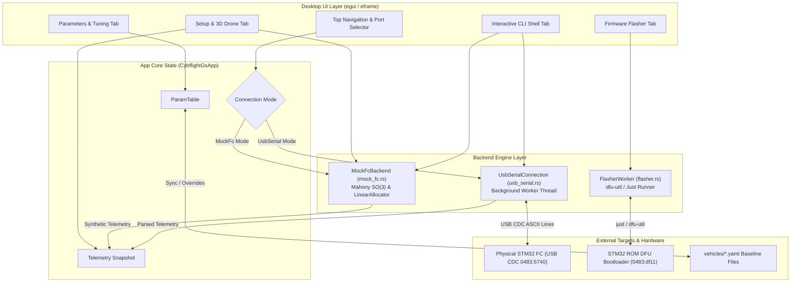

# Desktop Configurator & Ground Station (`cybflight-gs`)

The `cybflight-gs` crate delivers a cross-platform desktop Configurator and Ground Station GUI application inspired by Betaflight Configurator. Built on top of `eframe` and `egui` (version 0.31), it provides real-time 3D attitude visualization, parameter editing with RAM/Flash/YAML synchronization, background firmware flashing over USB DFU, an interactive CLI shell, and an in-process offline flight controller simulator (`MockFcBackend`).

For practical hardware workflows and tuning procedures using the ground station, refer to [Hardware Bringup](../workflows/hardware-bringup.md) and [Parameter Tuning and Sync](../workflows/parameter-tuning-and-sync.md).

---

## Desktop Configurator Architecture

The application entrypoint in `src/main.rs` parses command-line arguments using `clap` to select an initial vehicle YAML configuration (`--vehicle <stem>`, defaulting to `goku_f745`) and an optional forced offline mode (`--mock`). It then launches an `eframe` native window initialized to $1280 \times 820$ pixels.

```
+-----------------------------------------------------------------------------------+
|                            CybflightGsApp (app.rs)                                |
|  +-----------------------------------------------------------------------------+  |
|  | Top Header Bar: Port Target | Refresh Ports | Connect/Disconnect | Vehicle  |  |
|  +-----------------------------------------------------------------------------+  |
|  | Navigation Tabs: [Setup & 3D Attitude] [Parameters] [Flasher] [CLI Shell]   |  |
|  +-----------------------------------------------------------------------------+  |
|  | Central Panel: Active Tab Renderer (show_setup_tab, show_params_tab, etc.) |  |
|  +-----------------------------------------------------------------------------+  |
|  | Bottom Status Bar: FC status message, telemetry rate, loaded CAD mesh label |  |
+-----------------------------------------------------------------------------------+
```

### Application Lifecycle and Repaint Loop

The main application structure `CybflightGsApp` implements `eframe::App`. At every frame tick ($60\text{ Hz}$ when connected or flashing, via `ctx.request_repaint_after(Duration::from_millis(16))`):

1. **Backend Polling**: `poll_backend()` drains incoming events from the background USB serial worker or advances the mock simulator by real wall-clock time.
2. **Top Header Panel**: Displays target port selection, port rescan controls, active connection status indicators (battery voltage, line counts, USB vs Mock tag), and the active tab navigation bar.
3. **Central Panel**: Invokes the UI function associated with the active tab (`ActiveTab::Setup`, `ActiveTab::Parameters`, `ActiveTab::Flasher`, or `ActiveTab::Cli`).
4. **Bottom Status Bar**: Displays transient status messages and CAD STL model loading details.

---

## Ground Station Architecture & Component Flow



Diagram 1: Architecture of the cybflight-gs desktop configurator showing interaction between UI tabs, core state, backend threads, and hardware targets.

---

## Backend Serial Engine (`usb_serial.rs`)

Communication with a physical STM32 flight controller occurs over USB CDC (`0483:5740`).

### Thread Model and Connection Lifecycle

When a user selects a USB port target and clicks **Connect**, `UsbSerialConnection::connect()` executes the following sequence:

1. Opens the target serial port (`serialport::new(port_name, 115_200)` with a $20\text{ ms}$ read timeout).
2. Asserts **Data Terminal Ready (DTR)** and **Request To Send (RTS)** signals (`write_data_terminal_ready(true)`), which signals Cybflight's USB CDC task to begin accepting I/O.
3. Spawns a dedicated background OS worker thread.
4. The worker thread sends startup initialization commands (`version`, `param list`, and high-rate streaming requests `stream att on`, `stream imu1 on`, `stream power on`, `stream dshot on`).
5. The thread enters a non-blocking loop reading incoming raw bytes into a chunk accumulator, converting newline-delimited chunks into `SerialEvent::Line(String)` events transmitted across an `mpsc` channel.
6. Outgoing user commands are popped from a command queue (`cmd_tx`) and written with `\r\n` line endings to the serial port.
7. Upon explicit disconnect or drop, the worker issues `stream off\r\n` to gracefully halt telemetry streaming on the flight controller before terminating the thread.

### USB Serial Port Discovery

`discover_serial_ports()` enumerates available USB serial devices. On macOS, call-out devices (`/dev/cu.*`) are preferred over incoming tty devices (`/dev/tty.*`) to avoid blocking on carrier detect. Cybflight flight controllers are automatically flagged as `is_cybflight` if their USB Vendor/Product ID matches `0483:5740` or if product strings contain `"cybflight"`.

---

## Offline Simulation Backend (`mock_fc.rs`)

For offline bench testing and developer verification without hardware, `MockFcBackend` embeds the flight controller's estimator and mixer directly into the desktop application process.

### Mathematical Sub-Stepping and Estimator Loop

`MockFcBackend` runs Cybflight's real algorithms from `cybflight-core`:

- **Mahony SO(3) Filter**: A non-linear complementary attitude filter (`Mahony<f32>`) operating on special orthogonal group $SO(3)$.
- **LinearAllocator Matrix Mixer**: Computes QuadX motor effectiveness allocation based on motor positions and torque vectors.

When `step()` is called during application repaints, wall-clock time delta is clamped ($1\text{ ms} .. 50\text{ ms}$) and sub-stepped at $500\text{ Hz}$ ($dt = 2\text{ ms}$):

$$\begin{aligned}
\mathbf{e}_{\text{euler}} &= \boldsymbol{\theta}_{\text{target}} - \boldsymbol{\theta}_{\text{current}} \\
\mathbf{a}_{\text{euler}} &= \omega_n^2 \mathbf{e}_{\text{euler}} - 2 \zeta \omega_n \boldsymbol{\omega}_{\text{current}} \quad (\omega_n = 18\text{ rad/s}, \zeta = 1.0)
\end{aligned}$$

This critically-damped 2nd-order tracker models virtual hand-tilt on the bench. The true body orientation $q_{\text{true}}$ synthesizes gravity specific force in the FLU body frame ($\mathbf{a}_{\text{body}} = q_{\text{true}}^{-1} \mathbf{g}_{\text{world}}$), body rates ($\boldsymbol{\omega}_{\text{body}}$), and synthetic magnetometer vectors ($\mathbf{m}_{\text{body}} = q_{\text{true}}^{-1} [0, 45, -20]^T$), which feed directly into `Mahony::update()`.

### Closed-Loop Stabilizing Bench Response

When bench motors are active (`bench_motors_active = true`), `MockFcBackend` calculates stabilizing control torques using the active `FirmwareConfig` cascade rate gains and INDI controller rate gains:

$$\boldsymbol{\tau} = \mathbf{J}_{\text{body}} \cdot \mathbf{K}_{\text{rate}} \cdot \left( \mathbf{K}_{\text{att}} \cdot (-\boldsymbol{\theta}_{\text{est}}) - \boldsymbol{\omega}_{\text{body}} \right)$$

The resulting torque $\boldsymbol{\tau}$ and hover thrust $F_z = m \cdot g$ are fed to `LinearAllocator::allocate()`, yielding normalized thrust fractions $f_0..f_3$ and throttle commands $u_i = \sqrt{f_i}$.

---

## Firmware Flasher & DFU Engine (`flasher.rs`)

`FlasherWorker` handles firmware compilation and low-level USB flashing into the STM32 internal Flash memory.

### DFU Discovery and Reboot Triggering

- **DFU Scan**: `refresh_dfu_status()` executes `dfu-util -l` to check whether an STM32 ROM DFU bootloader (`0483:df11`) is connected.
- **CDC-to-DFU Reboot**: When connected over live USB CDC, clicking **Reboot Connected FC into DFU** transmits `reboot --dfu`. The flight controller writes the magic key `0xDEADBEEF` to RTC backup register `RTC_BKP0R`, closes serial interfaces, and triggers a system reset into the STM32 ROM bootloader.

### Build and Flashing Process Pipeline

Flashing actions spawn asynchronous child processes:

1. **Build Only**: Spawns `just size <vehicle>` (optionally setting `OUTER_LOOP=<override>`).
2. **Build & Flash**: Spawns `just flash <vehicle>` or `just flash-verify <vehicle>`.
3. **Direct Binary Flash**: Spawns `dfu-util -d 0483:df11 -a 0 -s 0x08000000:leave -D <bin_path>`.

Output lines are parsed in real time to update progress bar percentages (`parse_dfu_progress_percent`) and stream output to the log console. On macOS, a safety supervisor automatically kills `dfu-util` after manifest completion if the driver hangs on USB disconnect.

---

## Interactive UI Tabs

The desktop Configurator groups functional tools across distinct interactive tabs.

```
+------------------------------------------------------------------------------------+
| UI Tab Architecture                                                                |
+-----------------------+------------------------------------------------------------+
| Setup & 3D Drone      | Interactive 3D STL/procedural mesh, FLU axes, motors,     |
|                       | gravity/accel/gyro, battery voltage, bench tilt controls.  |
+-----------------------+------------------------------------------------------------+
| Airframe & Parameters | Tabular parameter registry, RAM edit dirty tracking,       |
|                       | Flash persist, YAML sync, top group & search filtering.    |
+-----------------------+------------------------------------------------------------+
| Tuning                | Rate gains, cascade attitude control, INDI, and MPC outer  |
|                       | loop parameters managed via group filters in ParamTable.   |
+-----------------------+------------------------------------------------------------+
| Receiver & Modes      | Real-time telemetry monitoring, receiver state checks.      |
+-----------------------+------------------------------------------------------------+
| Motors                | QuadX motor outputs (m0..m3), thrust (gf/N), DShot eRPM.  |
+-----------------------+------------------------------------------------------------+
| Sensors / ESKF        | IMU temperature, accelerometer, gyroscope, ESKF summary.   |
+-----------------------+------------------------------------------------------------+
| Blackbox              | Telemetry stream capture and packet logging.               |
+-----------------------+------------------------------------------------------------+
| CLI Shell             | Interactive ASCII shell with quick diagnostic buttons,      |
|                       | command history, and stream log suppression.              |
+-----------------------+------------------------------------------------------------+
```

### 1. Setup & 3D Drone Visualization (`setup_tab.rs` & `drone_3d.rs`)

The **Setup** tab renders a live 3D visualization of vehicle attitude in Front-Left-Up (FLU) body frame coordinates.

- **3D Mesh Rendering**: Renders either a high-detail multipart CAD STL mesh (loaded from `drone_firefly_2s_nano_baby_20`) or a procedural QuadX frame. Triangles are depth-sorted using the painter's algorithm and shaded via diffuse directional lighting.
- **Visual Overlays**: Displays FLU body axes (+X Forward Red, +Y Left Green, +Z Up Blue), ground grid at $Z = -0.04\text{ m}$, and 3D motor thrust pillars scaled by real-time motor throttle.
- **Interactive Viewport Controls**:
  - *Mock Mode Primary Drag*: Mouse drag directly tilts vehicle Roll/Pitch.
  - *Camera Orbit*: Secondary mouse drag (or Shift + Drag) orbits the 3D camera azimuth and elevation. Scroll wheel adjusts camera zoom.
  - *Reset Controls*: Buttons to reset camera orbit, zero display Yaw offset relative to current heading, or re-enable telemetry streams over USB.
- **Telemetry Readout Panel**: Displays numerical Euler angles, quaternion $[x, y, z, w]$, accelerometer specific force $[a_x, a_y, a_z]\text{ m/s}^2$, gyro angular rate $[g_x, g_y, g_z]\text{ deg/s}$, battery voltage, cell count, and IMU die temperature.
- **Live Motor Bar Output**: Four color-coded progress bars ($m_0..m_3$) displaying current throttle percentage, thrust in grams-force ($g_f$) and Newtons ($N$), and DShot eRPM.

### 2. Ports Discovery & Selection

Port selection is embedded directly in the top header bar across all tabs:
- Dropdown selector lists all discovered serial ports with USB Vendor/Product IDs and Cybflight board identification tags.
- Includes `[Mock] Offline Bench Simulator` for hardware-free operation.
- **↻ Ports** button triggers immediate rescan of USB serial interfaces and DFU bootloaders.

### 3. Airframe, Parameters & Tuning (`params_tab.rs`)

The **Parameters** tab manages all `PARAM_COUNT` entries in `FirmwareConfig`.

```
+-------------------------------------------------------------------------------------------------+
| ParamTable Data & Synchronization Model                                                         |
|                                                                                                 |
|   vehicles/<name>.yaml  <====== [Sync to YAML] =======  FC RAM State  <====== [Apply] ====== UI |
|      (Baseline File)                                  (Firmware)                           (Edit)|
+-------------------------------------------------------------------------------------------------+
```

- **Top Action Controls**:
  - **↻ Refresh from FC**: Queries `param list` over USB serial or syncs from Mock FC.
  - **⚡ Apply to FC RAM ($N$)**: Sends `param set <name> <val>` for all dirty rows.
  - **💾 Save to Flash**: Transmits `param save` to persist RAM overrides to STM32 Flash KV store.
  - **★ Save & Prune Flash**: Transmits `param save --prune` to compact Flash KV store.
  - **↺ Reset All to Baked**: Reverts runtime parameters to original vehicle YAML baseline (`param reset all`).
  - **⇩ Sync to vehicles/<name>.yaml**: Exports non-structural tuning overrides into `vehicles/<name>.yaml` using `serde_yaml` and validates the resulting document schema via `vehicle_yaml::load`.
- **Filtering & Search**: Filters parameters by top-level group (`airframe`, `indi`, `cascade`, `mpc`, `battery`, `eskf`, `root`) or text query. Includes a toggle to show modified rows only.
- **Dirty State Indicator Logic**:
  - `is_dirty_ram()`: Highlighted in yellow if UI edit value differs from FC RAM (`fc_value`).
  - `differs_from_yaml()`: Tracks parameters whose FC value differs from the baseline `vehicles/<name>.yaml`.

### 4. Tuning (PID / INDI / MPC)

Control tuning is integrated directly into the parameter table through group selection filters:
- **Rate & Cascade Tuning**: Adjusts $K_{\text{att}}$ (`att_k_rate`) and $K_{\text{rate}}$ gains.
- **INDI Tuning**: Configures rate loop control gains (`rate_gains`), actuator effectiveness matrices, and filtering time constants.
- **MPC Outer Loop**: Configures state weight matrices ($Q, R$), velocity limits, and trajectory tracking bounds.

### 5. Receiver & Modes

Telemetry monitoring tracks live system state, radio receiver status, and mode flags derived from flight controller telemetry streams.

### 6. Motor Outputs & Mixer Response

Monitors QuadX motor command distribution across the four physical motors:
- $m_0$: Rear-Right (CW)
- $m_1$: Front-Right (CCW)
- $m_2$: Rear-Left (CCW)
- $m_3$: Front-Left (CW)

Displays real-time telemetry eRPM feedback from DShot ESCs and calculated thrust output in Newtons.

### 7. Sensors & ESKF Navigation

Monitors sensor integrity and estimator state:
- **IMU Telemetry**: Tri-axial accelerometer ($m/s^2$), tri-axial gyroscope ($rad/s$), and die temperature ($^\circ C$).
- **GPS Status**: Satellite count ($SV$), 3D fix status ($0..3$), latitude, longitude, and MSL altitude.
- **ESKF Diagnostics**: Displays live `ESKF[...]` state summaries transmitted by the flight controller.

### 8. Blackbox & Telemetry Parsing

`parse_shell_line()` in `backend/mod.rs` parses high-rate ASCII streaming telemetry lines output by the FC USB CDC task:

| Telemetry Line Prefix | Extracted Telemetry Fields |
| :--- | :--- |
| `VehicleAttitude(...)` | Timestamp ($ms$), orientation quaternion $[x, y, z, w]$, Euler angles ($deg$) |
| `Imu(...)` | Timestamp ($ms$), accelerometer $[a_x, a_y, a_z]$, gyro $[g_x, g_y, g_z]$, IMU temp ($^\circ C$) |
| `DshotTelem(...)` | DShot eRPM per motor $M1..M4$, motor status (`stopped`, `invalid`, eRPM value) |
| `Power(...)` | Battery voltage ($V$), current ($A$), drawn capacity ($mAh$), cell count ($S$) |
| `GpsFix(...)` | Fix type, satellite count, latitude, longitude, MSL altitude |
| `ESKF[...]` | Error-State Kalman Filter state summary line |
| `[build]` / `key = val` | Firmware compile-time facts and `param list` responses |

### 9. Interactive CLI Shell (`cli_tab.rs`)

The **CLI Shell** tab provides an interactive terminal directly connected to the Cybflight command shell.

- **Diagnostic Quick-Buttons**: One-click execution for `help`, `version`, `health`, `eskf`, `resetcause`, `postmortem show`, `param diff`, `param list build`, and `stream off`.
- **Command Dispatcher**: Transmits user commands over active USB CDC or executes commands against `MockFcBackend`.
- **Stream Suppression Filter**: Includes a **Show Stream Telemetry in CLI** toggle. High-rate streaming telemetry lines (`VehicleAttitude`, `Imu`, `Power`, `DshotTelem`) are processed in the background for instrument panels but suppressed from the CLI scroll area unless explicitly enabled, keeping the shell output readable during interactive sessions.
- **Command History**: Supports command recall and console clearing.

---

## Verification & Unit Testing

The ground station backend is validated by unit tests:

- **Telemetry Parsing**: Test `parses_attitude_imu_dshot_and_param_lines` in `backend/mod.rs` verifies correct parsing of ASCII telemetry headers, quaternion conversions, IMU vectors, DShot eRPMs, and `[build]` section facts.
- **Mock FC Stabilization & Mixer Verification**: Test `mock_fc_tilt_converges_and_responds_on_correct_motors` in `backend/mock_fc.rs` injects a $+15^\circ$ nose-down pitch command into `MockFcBackend`. It verifies that the Mahony estimator converges to $15^\circ \pm 1.5^\circ$ and asserts that front motors ($m_1, m_3$) output significantly higher thrust than rear motors ($m_0, m_2$) to generate restoring pitch torque.
