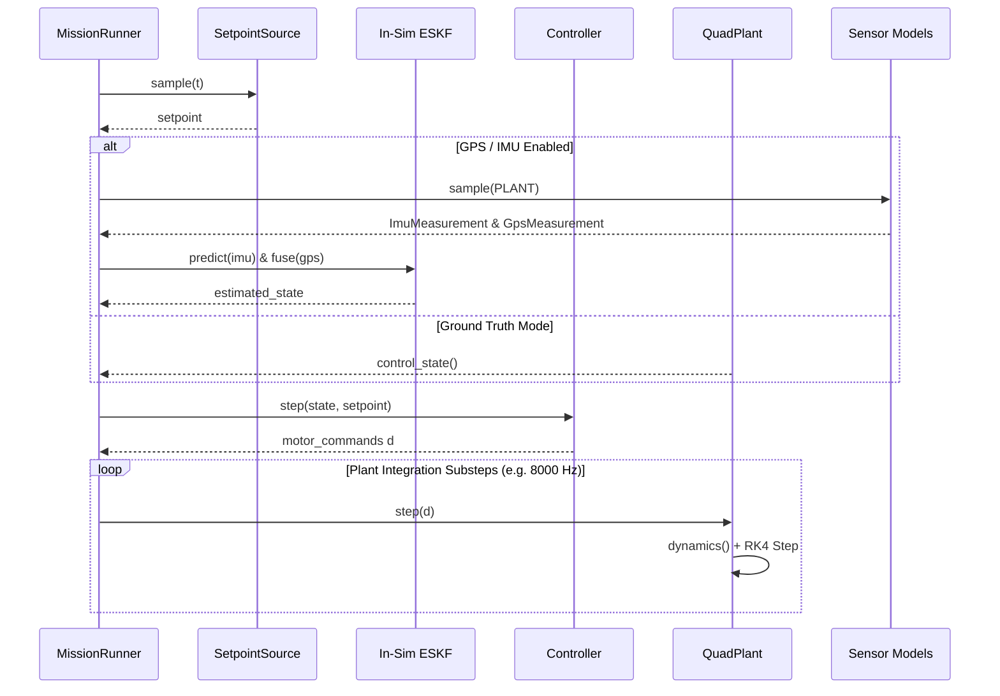
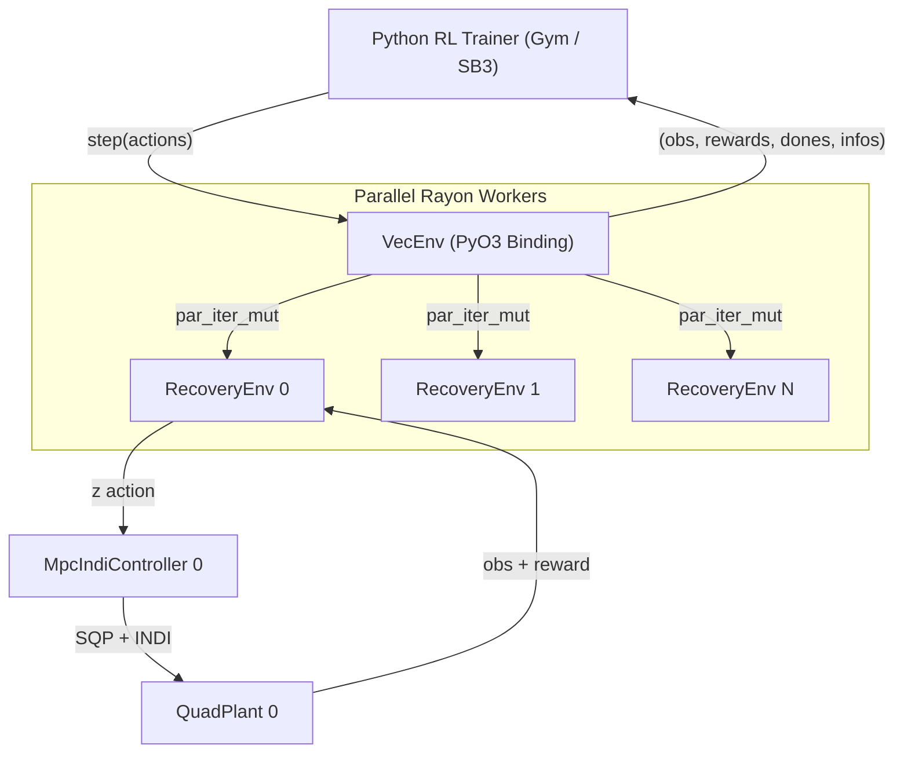

The `cybflight_sim` crate and its Python wrapper `cybflight_rl` form the host-side evaluation, automated testing, and reinforcement learning training harness for the CybFlight ecosystem. Designed to run deterministically on developer workstations and CI pipelines without hardware or Embassy runtime dependencies, the simulation harness evaluates full control and planning stacks end-to-end against unmodeled physical phenomena and realistic sensor noise.

By decoupling simulation from firmware execution primitives, `cybflight_sim` tests the math in `cybflight_core`—including NMPC SQP solvers, INDI rate controllers, trajectory planners, and ESKF state estimators—under realistic plant-model mismatch, motor lag, aerodynamic drag, and environmental disturbances.

---

## Architecture & Integration Flow

The simulation system is structured around four primary layers:

1. **Physical Plant (`QuadPlant`)**: A 17-state 6DOF rigid body and motor dynamics engine.
2. **Sensor Synthesis (`cybflight_sim::sensors`)**: Composable traits for generating raw IMU, GPS, and ESC rotor telemetry with configurable noise and fault injection.
3. **Execution Harness (`MissionRunner`)**: A multi-rate harness that steps outer/inner loop controllers while sub-stepping plant integration and running an optional in-sim ESKF.
4. **Python RL Bridge (`cybflight_rl`)**: PyO3 bindings exposing Rayon-parallelized vector environments (`VecEnv`) to Gymnasium and Stable-Baselines3.


*Figure 1: Control loop iteration within `MissionRunner`, showing state propagation, sensor synthesis, optional ESKF fusion, and high-frequency plant integration.*

---

## 6DOF Rigid-Body Dynamics & Plant Physics (`QuadPlant`)

The core physics engine resides in `cybflight_sim::plant::QuadPlant`. Crucially, `QuadPlant` is **not** identical to internal controller models such as `cybflight_core::mpc::FullQuadModel`. Internal prediction models assume ideal instant force allocation and diagonal inertia, whereas `QuadPlant` simulates unmodeled dynamics that challenge controller robustness.

### 17-Dimensional State Vector Layout

`QuadPlant` operates on a 17-dimensional continuous-time state vector (`NX_PLANT = 17`):

$$\mathbf{x}_{\text{plant}} = \begin{bmatrix} p_x & p_y & p_z & q_x & q_y & q_z & q_w & v_x & v_y & v_z & \omega_x & \omega_y & \omega_z & \omega_0 & \omega_1 & \omega_2 & \omega_3 \end{bmatrix}^T$$

- **Positions ($0..2$)**: Inertial ENU frame position $\mathbf{p} \in \mathbb{R}^3$ [m].
- **Attitude Quaternion ($3..6$)**: Scalar-last quaternion $\mathbf{q} = [q_x, q_y, q_z, q_w]^T$ mapping body FLU to world ENU.
- **Velocities ($7..9$)**: Linear velocity $\mathbf{v} \in \mathbb{R}^3$ in inertial ENU [m/s].
- **Body Rates ($10..12$)**: Angular velocity $\boldsymbol{\omega}_b \in \mathbb{R}^3$ in body FLU [rad/s].
- **Rotor Speeds ($13..16$)**: Individual motor rotor speeds $\omega_i \ge 0$ [rad/s].

The leading 13 states correspond byte-for-byte with `FullQuadModel`'s state, allowing `QuadPlant::control_state()` to yield standard rigid-body feedback to controllers.

### Equations of Motion

Given normalized motor commands $\mathbf{d} \in [0, 1]^4$ (output by the ESC mixer):

1. **Actuator Dynamics & Non-linear Command Curve**:
   Motor commands are mapped through a non-linear throttle curvature $k \in [0, 1]$ to yield target steady-state rotor speed $\omega_{c,i}$, followed by a first-order lag with time constant $\tau_s$:
   $$\omega_{c,i} = (\omega_{\text{max}} - \omega_{\text{min}}) \sqrt{k d_i^2 + (1-k) d_i} + \omega_{\text{min}}$$
   $$\dot{\omega}_i = \frac{\omega_{c,i} - \omega_i}{\tau_s}$$

2. **Rotor Thrust & Body Aerodynamic Drag**:
   Each motor produces thrust $T_i = c_T \omega_i^2$. Total thrust acts along $+z_b$. Aerodynamic drag includes rotor-speed-proportional drag and body quadratic drag:
   $$\mathbf{v}_b = \mathbf{R}(\mathbf{q})^T \mathbf{v}_{\text{world}}$$
   $$\mathbf{F}_b = \begin{bmatrix} -c_{dx} (\sum \omega_i) v_{bx} - c_{\text{body},x} |v_{bx}| v_{bx} \\ -c_{dy} (\sum \omega_i) v_{by} - c_{\text{body},y} |v_{by}| v_{by} \\ \sum T_i - c_{dz} (\sum \omega_i) v_{bz} - c_{\text{body},z} |v_{bz}| v_{bz} \end{bmatrix}$$
   $$\mathbf{a}_{\text{world}} = \frac{\mathbf{R}(\mathbf{q}) \mathbf{F}_b + \mathbf{F}_{\text{ext}}}{m} - \begin{bmatrix} 0 \\ 0 \\ g \end{bmatrix}$$

3. **Torque Balance & Gyroscopic Precession**:
   Torque combines motor moment arms $(l_{x,i}, l_{y,i})$, motor yaw drag coefficients $c_{Q,i}$, rotor angular acceleration reaction torque $J_r \dot{\omega}_i$, and rotor gyroscopic precession:
   $$\tau_x = \sum l_{y,i} T_i, \quad \tau_y = \sum -l_{x,i} T_i$$
   $$\tau_z = \sum s_i \left( c_{Q,i} T_i + J_r \dot{\omega}_i \right) \quad (s_i = +1 \text{ for CW, } -1 \text{ for CCW})$$
   $$\boldsymbol{\tau}_{\text{gyr}} = J_r \left(\sum s_i \omega_i\right) \left( \boldsymbol{\omega}_b \times \hat{\mathbf{z}}_b \right)$$
   $$\dot{\boldsymbol{\omega}}_b = \mathbf{I}^{-1} \left( \boldsymbol{\tau} + \boldsymbol{\tau}_{\text{gyr}} - \boldsymbol{\omega}_b \times (\mathbf{I} \boldsymbol{\omega}_b) \right)$$

4. **Integration Scheme**:
   `QuadPlant` integrates continuous dynamics using 4th-order Runge-Kutta (RK4). At every intermediate RK4 stage, the quaternion vector is projected back onto the unit 3-sphere to prevent numerical drift.

---

## Sensor Noise & Hardware Models

The `cybflight_sim::sensors` module isolates sensor synthesis from plant dynamics via trait interfaces:

```rust
pub trait ImuModel: Send {
    fn sample(&mut self, plant: &QuadPlant) -> ImuMeasurement;
}

pub trait GpsModel: Send {
    fn rate_hz(&self) -> f32;
    fn sample(&mut self, plant: &QuadPlant) -> GpsMeasurement;
}

pub trait RotorModel: Send {
    fn sample(&mut self, plant: &QuadPlant) -> RotorTelemetry;
}
```

### Sensor Implementations & Physics Realism

- **IMU Models (`ImuModel`)**:
  - `PerfectImu`: Returns ground-truth body rate and strapdown specific force computed via `QuadPlant::specific_force_body()` (proper acceleration excluding gravity, including aerodynamic drag).
  - `NoisyImu`: Adds Gaussian white noise and constant bias to gyro and accelerometer measurements using `ChaCha8Rng` and Box-Muller transformations.
- **GPS Models (`GpsModel`)**:
  - `PerfectGps`: 5 Hz position and velocity fixes with near-zero variance.
  - `NoisyGps`: Simulates SBAS (σ_pos = 0.5 m, σ_vel = 0.2 m/s) or degraded GNSS receiver fixes.
  - `OutageGps` & `FaultedGps`: Inject total signal loss or step jumps/drift faults for testing failsafe guards.
- **ESC Telemetry (`RotorModel`)**:
  - `PerfectRotorTelemetry`: Exact rotor speeds $\omega_i$, marked valid across all motors.
  - `NoisyRotorTelemetry`: Quantizes mechanical RPM to DShot eRPM resolution ($100 / (\text{poles}/2)$) and applies configurable per-frame dropout probabilities.

---

## Mission Test Harness (`MissionRunner` & `Scenario`)

`MissionRunner` executes automated scenarios that benchmark control strategies against position tracking and safety metrics.

### Scenario Configuration & Pass Criteria

A `Scenario` encapsulates a complete evaluation test case:
- **Vehicle Configuration**: `FirmwareConfig` loaded from baseline vehicle definitions (`vehicles/sim_baseline.yaml`).
- **Initial Conditions**: World position, velocity, and attitude.
- **Setpoint Generator**: Trajectory generation (e.g., polynomial MINCO trajectories, step responses, figure-8 patterns).
- **PassCriteria**: Gates evaluated by the runner at scenario termination:
  - `terminal_pos_err_m`: Maximum allowable position error at mission completion.
  - `rms_pos_err_m`: Root-mean-square tracking error over the full trajectory.
  - `peak_tilt_rad`: Maximum allowable vehicle tilt angle.
  - `geofence_min` / `geofence_max`: Axis-aligned spatial boundary constraints.

### Substep Execution & In-Sim ESKF

`MissionRunner` decouples controller execution rates from plant integration:
- Controllers tick at their native rates (e.g., 100 Hz outer NMPC / 1000 Hz inner INDI).
- `QuadPlant` integrates in small substeps (default `dt_sim = 1/8000` s) to capture high-frequency motor lag and rotational dynamics accurately.

When a scenario includes a `GpsModel`, `MissionRunner` initializes an in-sim Error-State Kalman Filter (`cybflight_core::eskf::Eskf`) and guard (`EskfGpsGuard`). IMU predictions and GPS measurements are fed directly to the ESKF, and estimated state feedback is passed to the controller rather than ground truth.

---

## Reinforcement Learning Training Harness (`cybflight_rl`)

The `cybflight_rl` crate provides high-throughput PyO3 bindings for training situation-conditioned MPC cost modulation policies in Python Gymnasium environments.


*Figure 2: Architecture of `cybflight_rl::VecEnv`, distributing parallel RL environment steps across CPU cores via Rayon to train situation-conditioned MPC cost policies.*

### Recovery Episode Environment (`RecoveryEnv`)

In `cybflight_sim::rl_env::RecoveryEnv`, one environment step corresponds to one outer-loop MPC period ($dt = 0.05$ s). The RL agent emits an action vector $z \in \mathbb{R}^{\text{NZ}}$ ($\text{NZ} = 6$) that dynamically scales diagonal cost weights in the `MpcIndiController` SQP solver.

- **Observation Vector (`OBS_DIM` = 31)**: Local tracking errors, current body rates, estimated vehicle state, primitive curvature features, and previous cost weights.
- **Reward Function (`RewardWeights`)**: Penalizes geometric tracking error, time-indexed position error, excessive body rates, control action rate changes ($\Delta z$), motor saturation, and crash events.
- **Domain Randomization (`domain_rand`)**: Per-episode randomization of mass, principal moments of inertia, motor time constants $\tau$, motor thrust scaling, rotor drag, Ornstein-Uhlenbeck wind gusts, and state estimation noise/bias.

### Python Vector Environment (`VecEnv`)

The `VecEnv` PyO3 class exposes multi-environment parallel training to Python:

- **Parallel Step & Reset**: Leverages Rayon (`par_iter_mut`) to step multiple `RecoveryEnv` instances concurrently across CPU threads.
- **Stable-Baselines3 Compatibility**: Automatically resets terminated environments and returns terminal observations inside `infos["terminal_obs"]`.
- **Checkpoint Version Guarding**: Exposes `COST_MAP_VERSION` alongside `OBS_DIM` and `NZ` to ensure neural network weights exported to C code header files match firmware cost map layouts.

---

## Simulation Binaries & Visualization Tools

### `sim-run` CLI Tool

The `sim-run` binary (`crates/cybflight_sim/src/bin/sim_run.rs`) provides command-line execution of simulation scenarios.

```bash
# Run square mission with MPC+INDI under MEMS noise
cargo run --bin sim-run -- --scenario mission_square --controller mpc-indi --noise mems

# Run figure-8 trajectory with full NMPC ablation and Rerun visualization
cargo run --features viz --bin sim-run -- --scenario figure8 --controller mpc-full-indi --rerun
```

Supported controller options include:
- `MpcIndi`: Standard 10-state NMPC (100 Hz) + INDI inner loop (8 kHz).
- `TinympcIndi`: TinyMPC hover-linearized controller (100 Hz) + INDI (8 kHz).
- `GeometricIndi`: Geometric position controller (500 Hz) + INDI (8 kHz).
- `MpcFullIndi`: 13-state NMPC with thrust/angular acceleration outputs + INDI $\alpha$-loop.
- `MpcFullNoindi`: Static inversion ablation of `MpcFullIndi`.
- `Cascade`: Legacy PD position + geometric attitude controller.

### Rerun Real-time Visualization (`RerunLogger`)

When built with `--features viz`, `RerunLogger` (`crates/cybflight_sim/src/viz.rs`) streams simulation telemetry directly to a Rerun viewer session:
- **3D Trajectories**: Static polylines showing planned references (yellow) versus actual flight paths (cyan).
- **Quadrotor Pose**: Real-time 3D transform visualization of vehicle position and orientation.
- **Time-Series Metrics**: Live scalar plots of position tracking error, body rates, tilt angles, and per-motor thrust commands.

### Parameter Reference Generator (`param-doc`)

The `param-doc` binary (`crates/cybflight_sim/src/bin/param_doc.rs`) introspects the firmware parameter registry (`FirmwareConfig`) and auto-generates Markdown parameter tables (`docs/parameters.md`).

---

## Related Documentation

- [Neural & Offboard Control](../concepts/neural-and-offboard-control.md) - Details on situation-conditioned learned MPC cost policies and neural race policy inference.
- [NMPC & Trajectory Planning](../concepts/nmpc-and-trajectory.md) - Real-time SQP solvers, MINCO trajectory generation, and full quadrotor prediction models.
- [Control Systems & Actuation](../concepts/control-and-actuation.md) - Cascaded architectures, INDI angular acceleration control, and DShot motor mixing.
