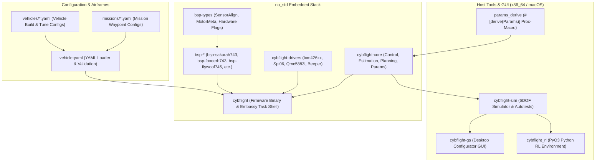

# Cybflight Quickstart & Developer Map

Welcome to the Cybflight codebase. Cybflight is a high-performance, modular, `no_std` flight controller firmware written in Rust targeting STM32 microcontrollers (specifically STM32H743 and STM32F745). The stack leverages the **Embassy** async runtime (`embassy-stm32`, `embassy-executor`), `defmt` logging, and `nalgebra` matrix math to execute high-rate control and estimation loops with strict real-time guarantees.

This guide serves as the primary task routing entrypoint for engineers and researchers. It outlines core architectural boundaries, provides quick command snippets for building and testing, provides a developer task routing matrix across all subsystems, and maps navigation paths into the detailed domain pages of this wiki.

---

## Workspace Architecture & Key Principles

The repository is structured as a Cargo workspace with distinct embedded targets and host tools:



### Architectural Principles

When extending or modifying the codebase, adhere to these fundamental architectural rules:

1. **Static Channels as Abstraction Boundaries**: Inter-task communication relies on static channels (e.g., `FUSED_IMU`, `BARO`, `MOTORS`, `ATTITUDE_TARGET`). Control algorithms read from and write to static channels and never interact directly with hardware peripherals or driver instances. See [Static Channel Infrastructure & Execution Dataflow](architecture/channel-dataflow.md).
2. **BSP Crates for Pin Mapping Only**: Board Support Package crates (`bsp-sakurah743`, `bsp-foxeerh743`, `bsp-micoair743v2`, `bsp-flywoof745`) contain only pin definitions, peripheral mappings, sensor orientation transformations, and capability `const` flags (`HAS_BARO`, `IMU_COUNT`). They contain zero control logic or driver dependencies. See [BSP Architecture & Hardware Initialization](architecture/bsp-and-hardware-init.md).
3. **Single Board Initialization Point**: `crates/cybflight/src/board_init/` is the sole location where board wiring diverges. Module files (e.g., `sakurah743.rs`, `flywoof745.rs`) construct bus instances, initialize drivers, bind DMA interrupts, and spawn Embassy tasks.
4. **Compile-Time DCE Over Feature Flags in Logic**: `#[cfg(feature = "...")]` attributes are strictly confined to BSP imports and `board_init` dispatch. Control and estimation algorithms use `const` flags (e.g., `bsp::HAS_BARO`) to allow compiler dead-code elimination (DCE) without scattering `cfg` checks throughout math routines.
5. **Concrete Monomorphized Tasks**: Trait objects (`dyn`) are forbidden in hot control/sensor loops. Sensor tasks and motor drivers are monomorphized using concrete types for zero-cost execution.

---

## Developer Subsystem Task Routing Matrix

To quickly find the code, tests, and documentation relevant to your task, locate your subsystem below:

| Subsystem / Role | Primary Crates & Directories | Key Entry Points & Source Files | Primary Wiki Destination |
|---|---|---|---|
| **Flight Control & Actuation** | `cybflight-core`<br>`crates/cybflight/src/control/`<br>`crates/cybflight/src/motors/` | `indi.rs`, `mpc.rs`, `acmpc.rs`, `mixer.rs`, `indi_task.rs`, `dshot_bdshot.rs` | [Flight Control & Actuation](concepts/control-and-actuation.md)<br>[NMPC & Trajectory Generation](concepts/nmpc-and-trajectory.md) |
| **State Estimation & Fusion** | `cybflight-core`<br>`crates/cybflight/src/estimation/`<br>`crates/cybflight/src/sensors/` | `eskf.rs`, `mahony.rs`, `eskf_task.rs`, `imu_task.rs`, `gps_task.rs` | [State Estimation & ESKF](concepts/state-estimation-eskf.md) |
| **BSP & Peripheral Drivers** | `crates/bsp/*`<br>`cybflight-drivers`<br>`crates/cybflight/src/board_init/` | `board_init/flywoof745.rs`, `icm426xx.rs`, `spl06.rs`, `memory_f745.x` | [BSP Architecture](architecture/bsp-and-hardware-init.md)<br>[Hardware Bring-up](workflows/hardware-bringup.md) |
| **Desktop Configurator & GUI** | `cybflight-gs` | `src/app.rs`, `src/backend/`, `src/ui/` | [Desktop Configurator (cybflight-gs)](integrations/ground-station-and-gs.md) |
| **Simulation & RL Training** | `cybflight-sim`<br>`cybflight_rl`<br>`tools/` | `plant.rs`, `runner.rs`, `rl_env.rs`, `export_rl_policy.py`, `train_cost_policy.py` | [Simulator & RL Env](integrations/simulation-and-rl-env.md)<br>[Offboard & RL Deployment](workflows/offboard-and-rl-deployment.md) |
| **Neural & Offboard Control** | `cybflight-core`<br>`crates/cybflight/src/control/`<br>`crates/cybflight/src/comm/` | `nn.rs`, `rl_policy_task.rs`, `esp_bridge.rs` | [Neural & Offboard Control](concepts/neural-and-offboard-control.md)<br>[Offboard & RL Deployment](workflows/offboard-and-rl-deployment.md) |
| **Vehicle Config & Parameters** | `vehicle-yaml`<br>`params_derive`<br>`vehicles/`, `missions/` | `params.rs`, `vehicle_features.sh`, `param_sync.py`, `vehicles/*.yaml` | [Parameter System](concepts/parameter-system.md)<br>[Parameter Tuning & Sync](workflows/parameter-tuning-and-sync.md) |
| **Safety, Arming & Failsafes** | `crates/cybflight/src/` | `health.rs`, `watchdog.rs`, `postmortem/`, `rc.rs` | [Safety & Failsafes](concepts/safety-and-postmortem.md) |
| **Blackbox & Telemetry** | `crates/cybflight/src/blackbox/`<br>`crates/cybflight/src/comm/` | `sdmmc_block.rs`, `cbor.rs`, `esp_bridge.rs`, `usb_serial.rs` | [Blackbox & Telemetry](concepts/blackbox-and-telemetry.md) |

---

## Command Snippets & Quick Reference

All build, flash, test, and simulation commands are driven via `just` (which reads default settings from `.env`).

### 1. Vehicle Selection & Feature Inspection

Vehicle YAML files under `vehicles/*.yaml` define the build flags, airframe parameters, and default missions.

```sh
# List all available vehicle YAML target configurations and their build properties
just vehicles

# Explain feature resolution and provenance for a specific vehicle (e.g. goku_f745)
just print-features goku_f745
```

### 2. Building Firmware & Analyzing Static Memory

Build outputs target `thumbv7em-none-eabihf` in `target/thumbv7em-none-eabihf/release/cybflight.bin`.

```sh
# Build firmware for default vehicle (VEHICLE= in .env)
just build

# Build STM32F745 firmware for FLYWOO Firefly 2S Nano Baby 20
just build goku_f745

# Build STM32H743 firmware for SAKURA Vicon indoor setup
just build sakura_vicon

# Override outer-loop controller variant for testing without changing YAML
just build-mpc sakura_vicon
just build-cascade sakura_vicon

# Generate static memory allocation report (sections, BSS/data symbols, stack headroom)
just size goku_f745
```

### 3. Flashing & Interactive USB Operations

Firmware is flashed over USB using `dfu-util`.

```sh
# Build and flash target vehicle in DFU mode (retries transfer and checks boot state)
just flash goku_f745

# Open interactive USB CDC parameter shell
python3 tools/fc_shell.py /dev/ttyACM0

# Sync modified runtime parameters from drone memory back to vehicle YAML file
just param-sync goku_f745
```

### 4. Desktop Configurator & Ground Station GUI

The native `egui` configurator application communicates with live USB targets or runs offline simulations.

```sh
# Launch Cybflight Configurator connected to target vehicle profile
just gs goku_f745

# Run Configurator in offline Mock Drone mode
cargo run -p cybflight-gs --profile release-host -- --mock
```

### 5. Running Tests & Simulation Verification

Cybflight features extensive unit, driver, and closed-loop simulation regression test suites.

```sh
# Run fast cybflight-core math and convergence tests
just test

# Run MPC solver convergence and benchmark tests
just test-mpc

# Run hardware driver unit tests on host
just test-drivers

# Run build tool and YAML parser tests
just test-build-tools

# Run full commit gate (core + drivers + build tools + sim regression snapshot)
just test-all

# Execute CI smoke check across all supported board/feature matrix combinations
just check-all

# Run closed-loop host simulation scenarios (hover, p2p, mission square) across controllers
just sim-compare

# Verify controller trajectory behavior against committed regression_snapshot.json
just sim-check

# Run a single simulation scenario with optional Rerun 3D visualization
just sim-run SCENARIO=mission_square CONTROLLER=mpc-indi VIZ=1
```

---

## Detailed Navigation Map

Use the following links to navigate into domain-specific deep dives across the wiki:

### 🏛️ System Architecture (`architecture/`)
- [System Architecture & Design Principles](architecture/overview.md): Crate workspace organization, Embassy executor model, task priorities, and static channel dataflow rules.
- [BSP Architecture & Hardware Initialization](architecture/bsp-and-hardware-init.md): Board Support Package structure, pin definitions, peripheral initialization, and memory layouts (`memory.x`, `memory_f745.x`).
- [Static Channel Infrastructure & Execution Dataflow](architecture/channel-dataflow.md): Static channel primitives, cross-task message passing, telemetry pipelines, and deterministic execution ordering.

### 🧠 Core Concepts (`concepts/`)
- [Flight Control & Motor Actuation Systems](concepts/control-and-actuation.md): Rate loop, INDI angular acceleration control, notch filters, motor mixing, and DShot/BDShot DMA drivers.
- [State Estimation & ESKF Sensor Fusion](concepts/state-estimation-eskf.md): 15-state Error-State Kalman Filter, Mahony attitude filter, Vicon MoCap fusion, and u-blox / Unicore RTK GNSS integration.
- [NMPC & Trajectory Generation](concepts/nmpc-and-trajectory.md): Non-linear Model Predictive Control, TinyMPC ADMM solver, MINCO trajectory generation, and online BFGS planning.
- [Neural Network Policies & Offboard Control](concepts/neural-and-offboard-control.md): Onboard MLP policy execution, high-rate offboard direct motor command streaming, and watchdogs.
- [Parameter & Vehicle Configuration System](concepts/parameter-system.md): Compile-time YAML baking, proc-macro parameter registry, flash KV store persistence, and CLI tuning.
- [Safety, Failsafes & Postmortem Diagnostics](concepts/safety-and-postmortem.md): System health monitoring, arming state machine, failsafe mode triggers, and crash dump recovery.
- [Blackbox Logging & Telemetry](concepts/blackbox-and-telemetry.md): SDMMC/flash blackbox logging, CBOR encoding, ESP32 WiFi/UART bridge, and CRSF/GHST receiver interfaces.

### 🔌 Integrations & Host Tools (`integrations/`)
- [Desktop Configurator & Ground Station (cybflight-gs)](integrations/ground-station-and-gs.md): Desktop GUI tabs, 3D model visualization, PID/INDI/MPC tuning controls, and offline Mock Drone mode.
- [Simulator Framework & RL Environment](integrations/simulation-and-rl-env.md): 6DOF rigid body plant physics, sensor noise models, PyO3 Python bindings, and reinforcement learning training loops.

### 🔄 Developer Workflows (`workflows/`)
- [Building & Flashing Firmware](workflows/building-and-flashing.md): Toolchain setup, feature flag resolution, compiler release profiles, and DFU flashing procedures.
- [Hardware Bring-up & Pre-flight Protocol](workflows/hardware-bringup.md): Bench safety checks, motor direction verification, sensor alignment validation, and pre-flight protocol.
- [Parameter Tuning & Sync Workflow](workflows/parameter-tuning-and-sync.md): Interactive parameter tuning over USB shell, `param-sync` workflow, and vehicle YAML updates.
- [Offboard Control & RL Deployment Workflow](workflows/offboard-and-rl-deployment.md): PyTorch RL policy training, policy export tools (`export_rl_policy.py`), and offboard command streaming over ESP bridge.

### 🧪 Testing & Quality Assurance (`testing/`)
- [Testing Architecture & Test Suites](testing/test-suite.md): Core mathematical verification, MPC convergence tests, simulation regression snapshots, and CI matrix checks.
