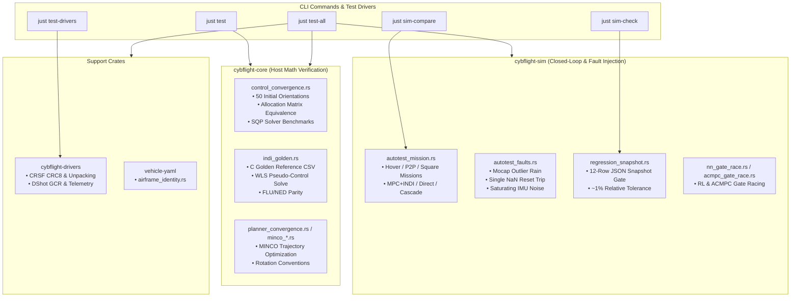
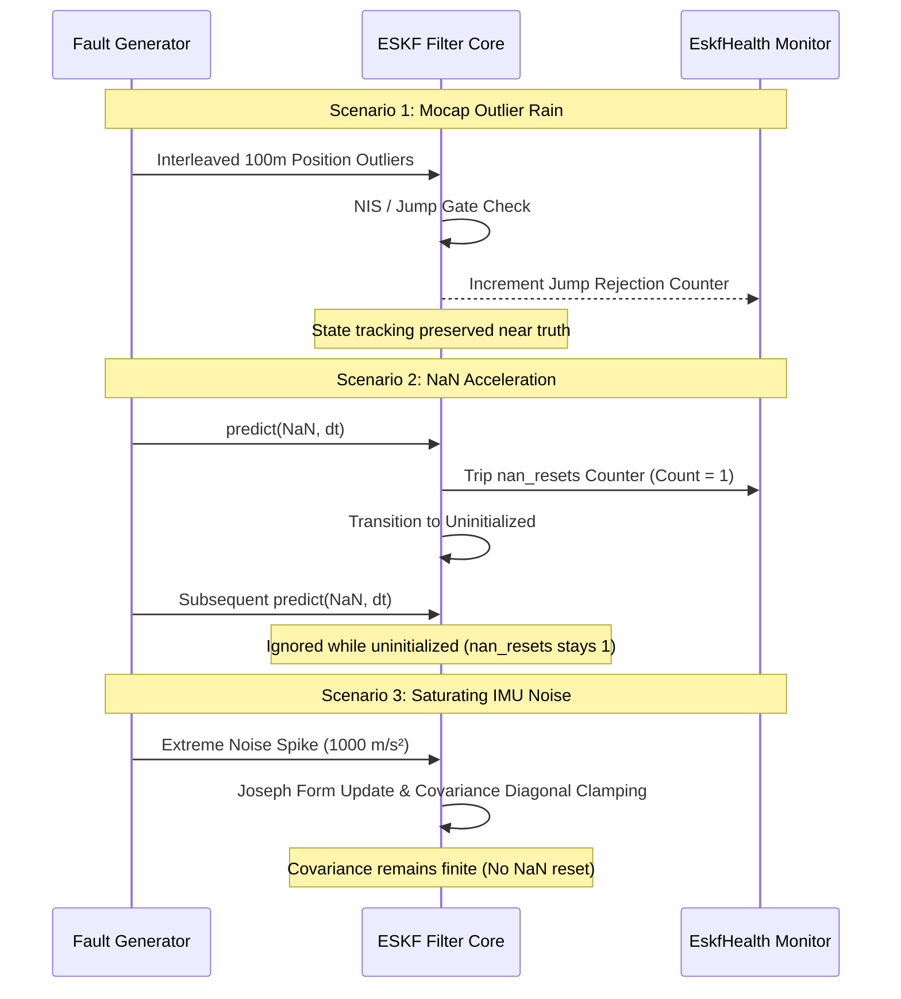

# Testing Architecture & Test Suites

The CybFlight testing suite provides multi-layered verification of estimation, trajectory planning, nonlinear model predictive control (NMPC), and Incremental Nonlinear Dynamic Inversion (INDI) attitude control. Verification ranges from unit-level mathematical assertions against C-reference golden values to closed-loop hardware-in-the-loop (HIL)-style simulations, tight snapshot regression gates, and fault injection campaigns.

For setup and build prerequisites, refer to the [Quickstart](../quickstart.md) guide. For details on plant modeling, sensor simulation, and reinforcement learning policy integration, see [Simulation and RL Environment](../integrations/simulation-and-rl-env.md).

---

## Testing Architecture & Validation Hierarchy

The test architecture separates mathematical correctness (run on host CPU via `cargo test`) from closed-loop vehicle dynamics and failsafe behavior. The workspace splits tests across specialized crates to ensure fast iteration loops, reproducible regression checks, and clean isolation between hardware abstraction drivers and core flight logic.



---

## Workspace Test Organization

The workspace organizes tests across four distinct crates based on execution target and verification layer:

| Crate Path | Primary Responsibilities | Key Test Files | Target Profile |
| :--- | :--- | :--- | :--- |
| `crates/cybflight_core/tests/` | Mathematical correctness, solver convergence, offline trajectory optimization, golden reference checks. | `control_convergence.rs`, `indi_golden.rs`, `planner_convergence.rs`, `minco_snap_offline.rs` | `--target {{HOST}} --release` |
| `crates/cybflight_sim/tests/` | Closed-loop 6-DOF simulation, sensor noise modeling, fault injection, snapshot regression, RL policy validation. | `autotest_mission.rs`, `autotest_faults.rs`, `regression_snapshot.rs`, `nn_gate_race.rs` | `--target {{HOST}} --profile release-host` |
| `crates/drivers/src/` | Low-level driver protocol unit tests (DShot frame assembly, GCR decoding, CRSF telemetry/CRC8). | `rc/crsf.rs`, `dshot/frame.rs`, `dshot/telemetry.rs` | `--target {{HOST}}` |
| `crates/vehicle_yaml/tests/` | Vehicle configuration schema parsing and physical airframe identity consistency checks. | `airframe_identity.rs` | `--target {{HOST}} --release` |

---

## Mathematical Verification & Convergence Testing

Mathematical tests in `cybflight-core` isolate control algorithms and optimization solvers from simulation physics to guarantee deterministic behavior and numerical stability.

### MPC Convergence & Optimization Benchmarks (`control_convergence.rs`)

The `control_convergence.rs` suite tests the sequential quadratic programming (SQP) NMPC solver (`FullSqpSolver`) using a 13-state, 4-input quadrotor model (`FullQuadModel` with RK4 integration):

1. **Multi-Orientation Convergence (`mpc_converges_50_orientations`)**: Evaluates MPC recovery from 50 distinct initial quaternions with tilt angles ranging from 5° to 50°. Asserts that position error drops below the target threshold (e.g., $0.05\text{ m}$) within $15\text{ s}$ without state divergence.
2. **Allocation Equivalence (`mpc_alloc_matches_firmware_mixer`)**: Verifies that the control allocation matrix computed inside the MPC problem matches the physical motor thrust and torque mapping computed by `MotorEffectiveness::from_motors`.
3. **Solver Runtime Benchmarking (`bench_solve_runtime`, `bench_solve_runtime_varied`)**: Measures cold-start vs. warm-start SQP execution times across various state linearization points, ensuring real-time execution bounds on embedded targets.
4. **Steady-State Error Decay (`final_steady_state_error`)**: Monitors position error decay at discrete checkpoints ($0.5\text{ s}, 1.0\text{ s}, 2.0\text{ s}, 5.0\text{ s}, 10.0\text{ s}, 15.0\text{ s}$) to verify that finite-horizon MPC bias settles near zero.

### INDI Golden Reference Verification (`indi_golden.rs`)

The `indi_golden.rs` file validates Incremental Nonlinear Dynamic Inversion math against C-reference golden outputs recorded in `tests/indi_golden/golden.csv`:

* **Filter & Linearization Pipeline**: Runs Biquad low-pass filtering on angular rate derivatives ($\dot{\boldsymbol{\omega}}$), specific force, and motor control inputs ($u$). Validates non-linear thrust-to-throttle linearization (`ThrustLinearization`).
* **Weighted Least Squares (WLS) Allocation**: Evaluates pseudo-control allocation solving $G_1 \Delta u = \Delta v$ subject to actuator rate and position limits.
* **Coordinate Frame Parity**: Asserts that an FLU (Forward-Left-Up) $G_1$ matrix derived from `MotorParams` produces identical physical pseudo-controls to the legacy NED (North-East-Down) reference after frame transformation.

---

## Closed-Loop Simulation & Snapshot Regression

Simulation tests in `cybflight-sim` combine the 6-DOF rigid-body plant model (`QuadPlant`) with controller implementations and sensor models (`NoisyImu`, `NoisyGps`).

### Closed-Loop Mission Autotests (`autotest_mission.rs`)

The mission autotest evaluates trajectory tracking and vehicle behavior across four core scenarios:
* `hover_level`: Level hover at $[0, 0, 1]\text{ m}$.
* `hover_tilt30`: Hover initialized with a $30^\circ$ pitch/roll tilt.
* `p2p_x3`: $3\text{ m}$ point-to-point step response along the X axis.
* `mission_square`: $3\text{ m} \times 3\text{ m}$ square trajectory waypoint navigation.

Each scenario is evaluated against the primary stack (`MpcIndiController`), as well as diagnostic baselines (`MpcDirectController` and `CascadeController`). Execution generates JSON performance reports under `target/{{HOST}}/tmp/<scenario>_<controller>/report.json`, recording:
* RMS Position Error ($\text{m}$)
* Peak Position Error ($\text{m}$)
* Terminal Position Error ($\text{m}$)
* Peak Tilt Angle ($\text{deg}$)
* Peak Motor Saturation ($\%$)

### Snapshot Regression Gate (`regression_snapshot.rs`)

The snapshot test (`sim-check`) enforces tight tolerances (~1% relative error bound plus small absolute floor) against a committed JSON snapshot (`crates/cybflight_sim/tests/regression_snapshot.json`). 

```rust
// Key scenario matrices checked by regression_snapshot.rs
const SCENARIOS: &[&str] = &["hover_level", "hover_tilt30", "p2p_x3", "mission_square"];
const CONTROLLERS: &[&str] = &["cascade", "mpc_direct", "mpc_indi"];
const NOISY_SCENARIOS: &[&str] = &["mission_square_noisy"];
const GPS_SCENARIOS: &[&str] = &["mission_square_gps"];
```

Any modification to plant physics, solver weights, or controller dynamics that alters performance metrics triggers a test failure. To update the snapshot after human review, developers run `just sim-snapshot` (`UPDATE_SNAPSHOTS=1`).

---

## Fault Injection & Failsafe Autotests

The `autotest_faults.rs` suite subjects the Error-State Kalman Filter (ESKF) to pathological sensor degradation and noise injections, verifying robust health monitor tracking (`EskfHealth`) without state divergence.



Key fault injection test cases:
1. **Mocap Outlier Rain (`outlier_position_rain_increments_counter_without_corrupting_state`)**: Feeds alternating valid position updates and $100\text{ m}$ position outliers. Verifies jump-gate rejections accumulate without filter drift or state corruption.
2. **NaN Input Reset (`nan_input_trips_reset_exactly_once`)**: Injects `f32::NAN` into accelerometer prediction steps. Confirms `nan_resets` increments exactly once, the filter marks itself uninitialized, and subsequent NaN steps while uninitialized do not double-count.
3. **Saturating Noise Clamping (`saturating_noise_imu_does_not_explode_covariance`)**: Drives 1 kHz predictions with extreme IMU readings ($1000\text{ m/s}^2$). Verifies Joseph-form covariance updates and diagonal clamping prevent matrix explosion or NaN states.

---

## Mission Campaigns & Multi-Scenario Evaluation

Beyond single scenarios, CybFlight includes long-duration mission campaigns and domain-specific comparisons:

* **Figure-8 & Indoor Campaign (`sim-figure8-compare`)**: Benchmarks TinyMPC (ADMM, hover-linearized, 500 Hz, $N=15$) against SQP-NMPC across indoor flight missions (circle, figure-8, slalom, splits) across speed profiles. Generates comparative plots via `analysis/plot_figure8_compare.py`.
* **Neural & ACMPC Policy Racing (`sim-nn`, `sim-acmpc`)**: Validates neural network multi-layer perceptrons (MLP) and Adaptive Cost MPC (ACMPC) box-DDP solvers against PyTorch reference outputs, testing track completion through an 8-gate race course.
* **Airframe Hardware Identity (`airframe_identity.rs`)**: Runs under `vehicle-yaml` tests to assert that indoor (`pos_source: mocap`) and outdoor (`pos_source: gps`) configuration YAML files sharing an airframe name maintain identical mass, inertia, and motor layout parameters.

---

## Test Execution Commands & Operations

CybFlight uses `just` recipes wrapping `cargo test` with target platform settings (`--target {{HOST}}`) and optimization profiles (`--release` or `--profile release-host`).

### Standard Execution Commands

```bash
# Run cybflight-core unit convergence and math benchmarks
just test

# Run low-level driver protocol unit tests (CRSF, DShot)
just test-drivers

# Run vehicle configuration and build-tool validation
just test-build-tools

# Run full core, drivers, build tools, and sim regression gate
just test-all

# Fast iteration: run only MPC convergence tests
just test-mpc
```

### Closed-Loop Simulation & Regression Commands

```bash
# Verify closed-loop simulation against committed JSON snapshot
just sim-check

# Re-generate regression snapshot after code / controller changes
just sim-snapshot

# Run mission comparison matrix (prints summary table)
just sim-compare

# Benchmark TinyMPC vs SQP-NMPC across indoor missions
just sim-figure8-compare

# Run Neural Network gate racing policy validation
just sim-nn

# Run ACMPC box-DDP gate racing validation
just sim-acmpc
```
