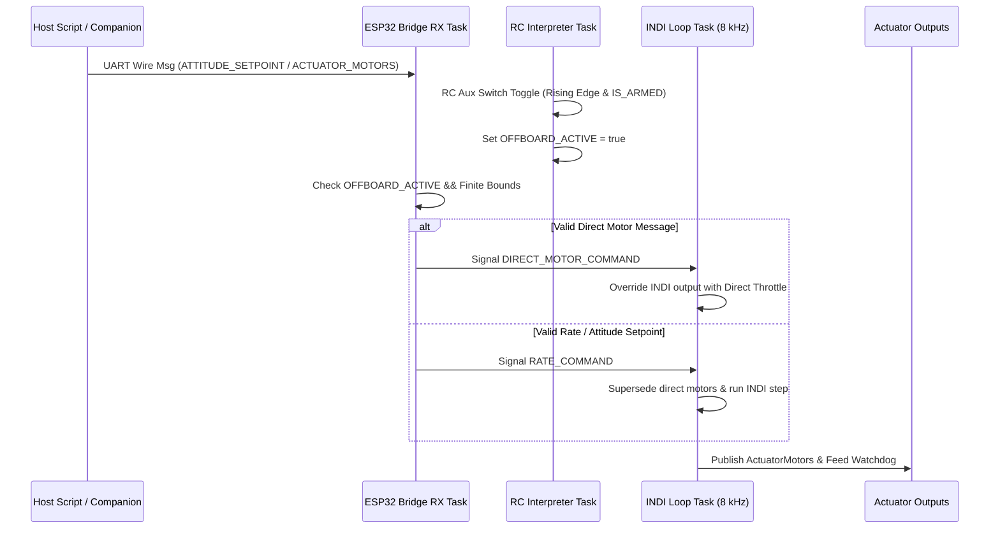
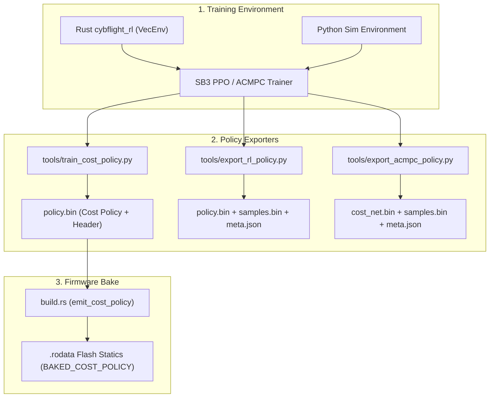

# Offboard Control & RL Deployment Workflow

`cybflight` supports two complementary paradigms for advanced neural and offboard flight control:
1. **External Offboard Command Streaming**: Streaming high-frequency rate, attitude, or direct normalized motor commands from an external companion computer or ground station script over UART or WiFi (via an ESP32 bridge).
2. **Onboard Neural Policy Execution**: Compiling learned neural network policies—such as end-to-end RL race policies or situation-conditioned NMPC cost adaptation networks—directly into the firmware binary as static read-only flash structures (`.rodata`) for zero-allocation, microsecond-latency execution.

This document details the streaming wire protocols, the policy training and export toolchains (`tools/train_cost_policy.py`, `export_rl_policy.py`, `export_acmpc_policy.py`), the static firmware baking mechanism (`build.rs`), the runtime execution tasks (`rl_policy_task.rs`, `outer_loop.rs`), and the step-by-step operational deployment checklist.

---

## 1. Streaming Protocol & Safety Gatekeeping

External offboard control allows host scripts (e.g., Python scripts, ROS 2 nodes, or hardware-in-the-loop test harnesses) to drive the drone by streaming binary wire messages over the ESP32 UART/WiFi bridge (`crates/cybflight/src/comm/esp_bridge.rs`).


*Figure 1: Control flow for offboard command streaming and RC safety gatekeeping.*

### Wire Message Types

The ESP32 bridge receiver task (`esp_bridge_rx_task`) decodes incoming wire payloads and dispatches setpoints to internal messaging channels when offboard mode is active:

*   **`ATTITUDE_CONTROL_SETPOINT` (Msg ID `0x09`)**: Carries collective thrust ($N$), attitude unit quaternion ($q$), target body rates ($\text{rad/s}$), and torque setpoints ($N\cdot m$). Validated for non-negative thrust and finite values. Signaled to `control::RATE_COMMAND`.
*   **`MANUAL_CONTROL_SETPOINT` (Msg ID `0x08`)**: Carries normalized thrust and body rates (roll, pitch, yaw). Validated for non-negative thrust and finite values. Signaled to `control::RATE_COMMAND`.
*   **`ACTUATOR_MOTORS` (Msg ID `0x0A`)**: Carries direct 4-motor normalized throttle commands ($[m_0, m_1, m_2, m_3] \in [0.0, 1.0]$). Validated for finiteness and range constraints. Signaled to `control::DIRECT_MOTOR_COMMAND`.

### Activation & Safety Gatekeeping (`OFFBOARD_ACTIVE`)

Offboard streaming and onboard RL execution are strictly gated by the atomic state flag `control::OFFBOARD_ACTIVE`:

1.  **RC Mode Switch**: Transition into offboard control requires toggling the dedicated RC mission channel switch (`rc_mission_channel`).
2.  **Confirmed Level Check**: The RC interpreter (`control/rc_interpreter.rs`) enforces level confirmation to ensure a switch held high at system boot or arming does not spuriously engage offboard control.
3.  **Arming Precondition**: Offboard mode engages (`OFFBOARD_ACTIVE.store(true)`) only on a confirmed rising edge of the RC channel while `motors::IS_ARMED` is `true`.
4.  **Instant Disengagement**: If the RC switch falls low or if the vehicle disarms, `OFFBOARD_ACTIVE` is immediately cleared (`false`). Control instantly reverts to manual RC rate control or safety failsafe routines.

### Failsafe Mechanisms & Command Staleness

To prevent flyaways or runaway motor commands due to network loss or host crashes:

*   **100 ms Command Staleness Gate (`CMD_STALE_TIMEOUT`)**: In `control/indi_task.rs`, incoming rate commands and direct motor commands are checked against `CMD_STALE_TIMEOUT` (100 ms). If no fresh message is received within 100 ms while armed, the command is declared stale, rates and collective thrust are zeroed, and direct motor overrides are cleared.
*   **System Watchdog Disarm**: The system hardware watchdog monitors `LAST_CONTROLLER_PUBLISH`. If `indi_task.rs` goes silent because commands are stale or outputs contain non-finite numbers ($\text{NaN}/\infty$), the watchdog heartbeat halts, triggering an automatic failsafe disarm.
*   **Direct Motor Precedence**: Receiving a valid rate or attitude setpoint via `RATE_COMMAND` explicitly clears any held direct motor command (`last_direct_motors = None`), ensuring high-level attitude control takes precedence over direct motor streaming.

---

## 2. Policy Training & Export Toolchain

`cybflight` provides Python tools to train and export two distinct neural control artifacts: end-to-end actor policies and situation-conditioned NMPC cost adaptation models.


*Figure 2: End-to-end pipeline from reinforcement learning in Python to firmware static allocation.*

### Python-Rust Co-Simulation Bridge (`cybflight_rl`)

The PyO3/CPyExt bridge in `crates/cybflight_rl/src/lib.rs` exposes `VecEnv`, a parallel batch wrapper around `cybflight_sim::rl_env::RecoveryEnv`.
*   **Rayon Parallelization**: Steps $n$ simulation environments across thread pools using Rayon (`par_iter_mut`), auto-resetting finished episodes and placing terminal observations into the standard Stable-Baselines3 (SB3) `infos` dict.
*   **Constants Exported**: Exposes `OBS_DIM` (59), `NZ` (19), and `COST_MAP_VERSION` (20) to Python scripts.

### Exporter Tools

#### 1. Learned NMPC Cost Policy (`tools/train_cost_policy.py`)
Trains a situation-conditioned NMPC cost policy using `cybflight_rl.VecEnv` and SB3 PPO, exporting a flat binary checkpoint with a versioned header:
```text
Header Layout (Little-Endian):
[0..4]   u32 MAGIC        = 0x50434643 ("CFCP")
[4..8]   u32 FORMAT       = 1
[8..12]  u32 MAP_VERSION  = COST_MAP_VERSION (e.g. 20)
[12..16] u32 N_LAYERS     = L
[16..16 + 8*L] Layer shapes (in_features, out_features) per layer
[Body]   Flat float32 weights W(out, in) row-major followed by bias b(out)
```
The script also generates a JSON probe sweep (`probe.json`) that evaluates policy output $z$ across systematic variation of situation inputs (e.g., contour error, lag error, tilt angle, thrust margin) to verify that the learned mapping exhibits physical situation sensitivity.

#### 2. End-to-End RL Race Policy (`tools/export_rl_policy.py`)
Exports trained gate-racing PPO checkpoints into `cybflight_sim` test fixtures:
*   `policy.bin`: Flat row-major linear layer weights and biases matching `nn.Linear.weight.numpy().tobytes()`.
*   `samples.bin`: $N \times (16\text{ world\_state\_ned} + 20\text{ obs} + 4\text{ raw\_action} + 1\text{ gate})$ float32 matrix. Pairs raw world states with the exact observation constructed by the Python environment. This allows Rust regression tests (`cybflight_sim/tests/nn_gate_race.rs`) to verify the ENU-native Rust observation pipeline against Python ground truth without tautological self-derivation.
*   `traj.bin`: Step-by-step state and clamped motor action rollout.
*   `meta.json`: Shapes, parameters, gate locations, and event logs.

#### 3. ACMPC Policy Exporter (`tools/export_acmpc_policy.py`)
Exports Actor-Critic Model Predictive Control policies (`cybflight-isaac` project):
*   `cost_net.bin`: Flat LE float32 linear layer weights of the cost network before its sigmoid head, enabling tight numerical comparison of GELU towers without sigmoid compression masking small errors.
*   `samples.bin`: Includes intermediate `cost_logits` and box-DDP step control `mpc_u0` alongside raw observations and final actions.

---

## 3. Firmware Embedding & Onboard Execution

### Static Firmware Baking (`build.rs`)

Neural models are compiled into the firmware binary during Cargo build time via `crates/cybflight/build.rs`. The vehicle YAML config selects the cost policy stem:

```yaml
# vehicles/simulation/research_1khz.yaml
mpc_cost_policy: v20b  # Reads crates/cybflight/data/cost_policies/v20b.bin
```

During build execution, `build.rs::emit_cost_policy()` performs stringent validation checks on `data/cost_policies/<stem>.bin`:
1.  **Header Check**: Asserts `MAGIC == 0x50434643` and `FORMAT == 1`.
2.  **Cost Map Version Assertion**: Asserts that `map_version == cost_adapt::COST_MAP_VERSION`. If a `cost_adapt` fence constant or observation layout is changed in Rust, `COST_MAP_VERSION` is incremented. `build.rs` will immediately fail the build if a checkpoint trained on an older map version is referenced, preventing incompatible cost semantics from flying.
3.  **Dimension Matching**: Asserts input dimension `shapes[0].inputs == OBS_DIM` (59) and output dimension `shapes[L-1].outputs == NZ` (19).
4.  **Topology Continuity & Width**: Checks hidden layer continuity and enforces `width <= POLICY_MAX_WIDTH` (128).
5.  **Sidecar Check**: Emits a cargo warning if `data/cost_policies/<stem>.md` provenance sidecar is missing.

`build.rs` emits static arrays into `$OUT_DIR/vehicle_data.rs`:
```rust
pub static BAKED_COST_POLICY_SHAPES: [LayerShape; 3] = [ ... ];
pub static BAKED_COST_POLICY_WEIGHTS: [f32; 17024] = [ ... ];
```
Weights are stored bit-exact in `.rodata` flash (not zero-initialized `.bss`), eliminating runtime allocation and preventing 8 kHz boot-loop stack overflows.

### Runtime Onboard Neural Execution Tasks

#### 1. Onboard Race Policy Task (`control/rl_policy_task.rs`)
Runs as an Embassy asynchronous task on the firmware executor:
*   **Execution Period**: Ticks at fixed intervals (e.g., 100 Hz).
*   **Activation Check**: Checks `IS_ARMED && OFFBOARD_ACTIVE`. On the rising edge of `OFFBOARD_ACTIVE`, resets track gate index to 0 (`policy.track.reset()`).
*   **Data Freshness & Finite Guards**: Subscribes to `VEHICLE_ODOMETRY`, `IMU_1`, and `PROCESSED_MOTOR_STATE`. If samples are older than `odom_stale_timeout` or contain non-finite numbers, the task skips policy evaluation.
*   **Allocation-Free Forward Pass**: Constructs `VehicleState` and invokes `RacePolicy::step()`. `cybflight_core::nn::Mlp` evaluates matrix multiplications in-place using two 128-float stack scratch buffers (1 KiB total).
*   **Direct Motor Output**: Signals normalized motor throttles $[m_0, m_1, m_2, m_3] \in [0.0, 1.0]$ to `control::DIRECT_MOTOR_COMMAND`.

#### 2. Onboard Learned MPC Cost Modulation (`control/outer_loop.rs` & `mpc/cost_adapt.rs`)
Runs within the NMPC outer loop tick at 50–100 Hz:
*   **Path-Frame Situation Observation**: Assembles a 59-dimensional observation vector in the reference path frame $\{ \hat{t} = v_\text{ref}/\|v_\text{ref}\|, \hat{n}, \hat{b} \}$. The vector contains path-frame position/velocity errors, body z-axis vectors, attitude error rotation vectors, body rates, velocities, thrust/rate margins across horizon preview nodes, and commanded thrust/rate fractions.
*   **Residual Weight Map**: Evaluates `CostPolicy::act()`, returning a 19-dimensional residual vector $z \in [-1.0, 1.0]^{19}$.
*   **Asymmetric Fencing**: Applies exponential scaling to nominal SQP cost weights:
    $$w = \begin{cases} w_\text{nom} \cdot \text{UP}^z & z \ge 0 \\ w_\text{nom} \cdot \text{DOWN}^{-z} & z < 0 \end{cases}$$
    State channels carry specific asymmetric fences (e.g., contour $[100, 2000]$, lag $[50, 500]$, attitude yaw $[50, 200]$ soften-only), and body rate weights scale as $w_\text{rate} = w_\text{rate,nom} \cdot 4^z$.
*   **Latency-First Ordering**: The policy evaluation runs **after** step 9 (`RATE_COMMAND.signal`) of the outer loop tick. Output residual $z$ is scaled by effective gain $z_\text{eff} = \text{mpc\_learned\_gain} \cdot z$ and stored to modulate the cost nominal for the **next** tick's SQP solve. This 10 ms (1-tick) weight staleness ensures the ~0.2 ms policy compute time (26k MACs + 256 `tanhf` evaluations) never adds latency to the critical rate command publish path.
*   **Gated Modulation**: When disarmed, off-trajectory, or not in `Executing` state, the policy continues evaluating for telemetry logging to blackbox topic `/mpc_cost` (Mid tier, channel 16), but forces $z_\text{eff} = 0$, guaranteeing exact nominal weights.

---

## 4. Deployment Workflow & Safety Checklist

To deploy a new learned cost policy or drag model onto target flight hardware (e.g., SAKURAH743 board), follow this gated step-by-step procedure:

<!-- openwiki: mermaid parse failed and this diagram was converted to a text fence so it does not break rendering. Fix the diagram source and restore the mermaid fence. Parser error: Heuristic: an unescaped angle bracket inside a label breaks rendering; rephrase the label. -->
```text
flowchart TD
    S0["Step 0: Airframe Identification
    (sysid_mcap.py, verify tau <= 30ms)"] --> S1
    S1["Step 1: Constant-Tune Baseline
    (w_rate 20->10, mpc_drag_* set, gain=0)"] --> S2
    S2["Step 2: Drag Model Validation
    (Compare lag with mpc_drag_* ON vs OFF)"] --> S3
    S3["Step 3: Policy Ramp-In
    (mpc_learned_cost=1, gain 0.25 -> 0.5 -> 1.0)"] --> S4
    S4["Step 4: Held-Out Mission Verification
    (Time-optimal splits, verify RMSE ratios)"] --> S5
    S5["Step 5: Parameter Synchronization
    (param save -> just param-sync)"]
```
*Figure 3: Gated operational deployment workflow for learned MPC cost policies.*

### Step-by-Step Procedure

#### Step 0: Airframe System Identification
1. Fly nominal flight tune on mission `indoor_figure8_mid` with blackbox logging set to `sysid`.
2. Run system identification:
   ```bash
   python3 analysis/sysid_mcap.py <log.mcap> --vehicle vehicles/simulation/research_1khz.yaml
   ```
3. Extract rotor-drag coefficients (`mpc_drag_x`, `mpc_drag_y`) and motor time constant $\tau$.
4. **Gate Criteria**: Verify $\tau \le 30\text{ ms}$. If $\tau \ge 40\text{ ms}$, keep `mpc_learned_gain = 0.0` until motor response is improved or policy is retrained with measured $\tau$.

#### Step 1: Constant-Tune Baseline Verification
1. Update vehicle YAML parameters:
   * `mpc_w_rate_r/p/y`: Set from 20 to 10.
   * `mpc_drag_x/y/z`: Set identified rotor-drag coefficients.
   * `mpc_learned_cost`: Set to `0`.
   * `mpc_learned_gain`: Set to `0.0`.
2. Fly hover $\rightarrow$ `figure8_slow` $\rightarrow$ `figure8_mid`.
3. Check blackbox logs (`/mpc` $u_0$ trace) to verify `w_rate = 10` introduces no high-frequency control chatter.

#### Step 2: Prediction Model Drag Term Validation
1. Perform hot-reload toggling `mpc_drag_x/y` on vs off disarmed.
2. Fly `figure8_mid` under both settings.
3. Verify time-indexed position lag drops significantly on fast track segments when drag parameters are active.

#### Step 3: Policy Ramp-In
1. Enable policy execution: set live parameter `mpc_learned_cost = 1`.
2. Ramp policy gain incrementally across flights:
   * Flight 1: `mpc_learned_gain = 0.25` on `figure8_mid`.
   * Flight 2: `mpc_learned_gain = 0.50` on `figure8_mid`.
   * Flight 3: `mpc_learned_gain = 1.00` on `figure8_mid`.
3. Analyze `/mpc_cost` blackbox logs at each step:
   * Confirm total policy + solve time is within $< 1.0\text{ ms}$ CPU budget.
   * Verify $|z| < 0.7$ without tick-to-tick high-frequency oscillation.
   * Confirm geometric RMSE decreases relative to Step 2 baseline.

#### Step 4: Time-Optimal Mission Verification
1. Fly held-out aggressive track `splits_timeopt`.
2. Confirm tracking geometric RMSE ratios match simulation predictions (e.g., $\approx -19\%$ mean geometric RMSE reduction).

#### Step 5: Parameter Synchronization
1. Save active runtime parameters to non-volatile flash via shell: `param save`.
2. Synchronize back to vehicle YAML source repository:
   ```bash
   just param-sync
   ```
3. Commit updated vehicle YAML file with identified drag coefficients, validated nominal rate weights, and active learned cost policy settings.

---

## Related Pages
* [Neural and Offboard Control](../concepts/neural-and-offboard-control.md) — Architecture of onboard neural inference, cost adaptation, and offboard streaming interfaces.
* [NMPC and Trajectory](../concepts/nmpc-and-trajectory.md) — Real-time SQP-RTI solver formulation, QuadModel predictive kinematics, and cost function adaptation.
* [Building and Flashing](building-and-flashing.md) — Firmware compilation options, cargo feature flags, and target flashing procedures.
