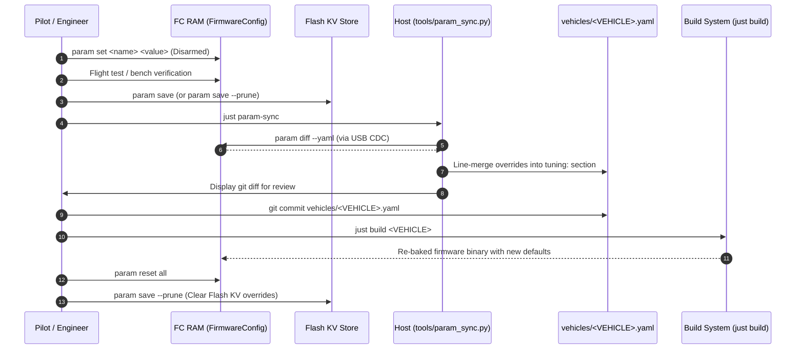

The **Parameter Tuning & Sync Workflow** defines the end-to-end lifecycle for inspecting, modifying, persisting, synchronizing, and documenting flight controller parameters in CybFlight.

It bridges real-time parameter tuning on the bench or flight field with version-controlled vehicle configuration files (`vehicles/<VEHICLE>.yaml`) and auto-generated parameter documentation (`docs/parameters.md`).

---

## Architecture & Parameter Lifecycle

CybFlight parameter management relies on a distinct three-tier hierarchy:

1. **Baked Vehicle Defaults**: Initial values generated at compile time from `vehicles/<VEHICLE>.yaml` (under the `tuning:` section) and compiled directly into the binary as read-only constants.
2. **In-Memory RAM Parameters**: Active runtime parameters maintained in core memory (`FirmwareConfig`). These can be read or mutated via the USB CDC shell or Ground Station GUI.
3. **Flash Key-Value (KV) Store**: Persistent overrides saved in STM32 internal flash bank 2 (sectors 6 and 7). During boot, `init_from_flash()` loads baked defaults and replays valid KV records to restore persisted overrides.



*Figure 1: Complete parameter tuning lifecycle from live RAM mutation, flash persistence, host YAML synchronization, git review, firmware re-baking, to flash pruning.*

---

## USB CDC Shell Parameter Commands

The firmware provides an interactive parameter shell accessible over USB CDC serial. Shell commands allow real-time parameter query, mutation, diffing, persistence, and reset.

```text
param list [group] | param <group> list
param get <name>
param set <name> <value>
param diff [--yaml]
param save [--prune]
param reset <name>|all
param defaults
```

### 1. `param list [group]` / `param <group> list`

Displays parameters grouped by config tree subtree (such as `airframe.body`, `eskf.filter`, `indi`, `mpc`, or `build`).

- **Config Subtree Filtering**: Passing a group filter lists only matching subtrees. Group separators `.`, `-`, and `_` are interchangeable.
- **Build Facts**: Includes a read-only `[build]` section listing compile-time selections (board target, receiver protocol, outer loop law, position source, IMU rate) to verify hardware features without ambiguity.
- **Reboot Marker**: Parameters marked with `(reboot)` require a flight controller reboot before in-memory changes take effect in subsystem tasks.

### 2. `param get <name>`

Queries the active in-memory value of a specific parameter by its flat string identifier (e.g., `param get mass`).

### 3. `param set <name> <value>`

Mutates an in-memory parameter value in RAM while the vehicle is disarmed.

- **Disarmed Safety Guard**: The shell explicitly refuses `param set` while `IS_ARMED` is true (`refused: disarm before modifying params`), preventing accidental parameter modification or controller destabilization in flight.
- **Numeric Bounds Validation**: Validates the input against metadata limits `[min, max]`. Values outside bounds are rejected with `rejected: <name> must be in [<min>, <max>]`.
- **Blackbox Session Guard**: Edits to `blackbox_*` parameters are rejected while a recording session is active (`refused: recording session active - 'blackbox record off' before editing blackbox_* params`).
- **Live vs. Reboot Application**: Modifying `live` parameters immediately updates runtime structures. Modifying `reboot` parameters echoes `(reboot required)`.

### 4. `param diff [--yaml]`

Inspects runtime parameter overrides relative to the baked vehicle YAML defaults.

- **Standard Human Format**: `param diff` outputs formatted rows comparing active values against baked defaults:
  ```text
  mass                         = 0.85  (baked 0.78)
  mpc_q_pos                    = 12.0  (baked 10.0)
  ```
- **YAML Snippet Format**: `param diff --yaml` emits a clean YAML snippet header and key-value mapping consumed by synchronization tools:
  ```yaml
  # vehicle: sakura_vicon
    mass: 0.85
    mpc_q_pos: 12.0
  ```

### 5. `param save [--prune]`

Persists in-memory parameter overrides into STM32 internal flash bank 2 (sectors 6 and 7).

- **Plain `param save`**: Appends changed key-value records to the flash KV log without erasing flash sectors.
- **Prune `param save --prune`**: Rewrites and compacts the flash KV store to contain *only* parameters that differ from baked defaults. This drops redundant keys so that subsequent vehicle YAML edits are not shadowed by stale flash records.

### 6. `param reset <name>|all` & `param defaults`

Reverts parameter(s) in RAM back to their baked vehicle YAML defaults.

- Reverting in RAM does not automatically erase flash. To make a reset permanent across reboots, follow `param reset all` with `param save --prune`.

---

## Interactive Parameter Tuning Tools

### USB CDC Shell Tool (`tools/fc_shell.py`)

`tools/fc_shell.py` is a lightweight, zero-dependency Python script that communicates with the flight controller over USB CDC serial. It operates on macOS and Linux using Python standard library modules (`termios`, `fcntl`, `select`).

To wake the `embassy-usb` CDC driver (`CdcAcmClass::wait_connection()`) immediately upon opening the port, `fc_shell.py` asserts the `TIOCM_DTR` and `TIOCM_RTS` modem control lines via `fcntl.ioctl`.

#### Common Shell Commands

```bash
# Query active parameters
python3 tools/fc_shell.py "param get mass" "param get mpc_q_pos"

# Update parameter in RAM and save to flash
python3 tools/fc_shell.py "param set mpc_q_pos 15.0" "param save"

# Wait for port enumeration after reboot, then inspect estimator parameters
python3 tools/fc_shell.py --wait 10 "param list eskf"

# Monitor telemetry streams for 10 seconds, then disable streaming
python3 tools/fc_shell.py "stream att on" --monitor 10 --after "stream off"

# Command reboot into STM32 ROM DFU mode (0483:df11)
python3 tools/fc_shell.py --dfu
```

### Desktop Configurator GUI (`cybflight-gs`)

The Ground Station GUI (`cybflight-gs`) provides a graphical parameter editor in its **Parameters** tab.

```text
+-----------------------------------------------------------------------------------+
|  Filter: [ mpc               ]   Group: [ mpc.gains  v ]  [ Search Clear ]    |
+-----------------------------------------------------------------------------------+
| Name              | Unit   | Min   | Max   | Baked | Active | Edit Value   | St |
|-------------------|--------|-------|-------|-------|--------|--------------|----|
| mpc_q_pos         | —      | 0.1   | 100   | 10.0  | 10.0   | [ 15.0     ] | *  |
| mpc_q_vel         | —      | 0.1   | 100   | 5.0   | 5.0    | [ 5.0      ] |    |
+-----------------------------------------------------------------------------------+
| [⚡ Apply to FC RAM (1)]  [💾 Save to Flash]  [★ Save & Prune Flash]               |
+-----------------------------------------------------------------------------------+
```

- **Dirty Cell Tracking**: Highlighted edit fields flag local modifications that differ from active FC RAM values.
- **⚡ Apply to FC RAM**: Batches `param set <name> <value>` commands over USB serial for all modified rows.
- **💾 Save to Flash**: Sends `param save` to append active overrides into flash memory.
- **★ Save & Prune Flash**: Sends `param save --prune` to compact the flash KV store against current baked defaults.
- **Mock FC Integration**: When disconnected from physical hardware, selecting Mock FC mode routes parameter commands into an in-process simulated flight controller (`MockFcBackend`).

---

## Vehicle Parameter Synchronization Workflow (`just param-sync`)

The parameter synchronization workflow merges tuned parameter overrides from a physical flight controller back into the vehicle's source YAML file (`vehicles/<VEHICLE>.yaml`).

The firmware never modifies YAML files on host disk directly; explicit host-side pull and merge ensures human review before committing changes to git.

### Workflow Steps

1. **Bench / Flight Tuning**: Modify parameters on the drone using `param set` and save overrides with `param save`.
2. **Execute Parameter Sync**: Run `just param-sync` (or `python3 tools/param_sync.py --vehicle <VEHICLE>`).
3. **Automated CDC Fetch & Merge**:
   - `param_sync.py` connects over USB serial (115200 baud) and executes `param diff --yaml`.
   - The script parses the `# vehicle: <BAKED_VEHICLE>` header and key-value override pairs.
   - It line-merges overrides into `vehicles/<VEHICLE>.yaml` under the top-level `tuning:` key, preserving existing comments, indentation, and structure.
   - It outputs an automatic `git diff` for developer inspection.
4. **Git Review & Commit**: Inspect the `git diff` output and commit `vehicles/<VEHICLE>.yaml`.
5. **Re-Baking Firmware Defaults**: Rebuilding the binary (`just build <VEHICLE>`) bakes the updated tuning values as compile-time defaults.
6. **Flash KV Store Pruning**: On the flight controller, execute `param reset all` followed by `param save --prune`. This clears redundant flash KV records so they do not shadow future vehicle YAML edits.

### Vehicle Mismatch Protection

`tools/param_sync.py` reads the `# vehicle:` metadata header returned by `param diff --yaml`. If the firmware was baked for a vehicle target different from the target YAML file (e.g., firmware baked for `goku_f745` merged into `sakura_vicon.yaml`), the script aborts immediately:

```text
FC firmware was baked for vehicle 'goku_f745' but you are merging into 'sakura_vicon' — aborting (use --force-vehicle-mismatch to override)
```

Passing `--force-vehicle-mismatch` overrides this safety check if intentional cross-vehicle parameter transfer is required.

---

## Automated Documentation Generation (`just params-doc`)

Parameter documentation (`docs/parameters.md`) is automatically generated from the Rust parameter schema registry.

### Generator Executable (`crates/cybflight_sim/src/bin/param_doc.rs`)

The `param_doc` binary in the `cybflight-sim` crate inspects the `FirmwareConfig` parameter registry (`PARAM_COUNT` items derived via `#[derive(Params)]`).

For each parameter index, it extracts:
- Parameter identifier name (`ParamName::of`)
- Unit string (`meta.unit`)
- Minimum and maximum range bounds (`meta.min`, `meta.max`)
- Runtime application type (`live` vs. `reboot`)
- Description documentation string (`meta.doc`), with markdown pipe characters (`|`) automatically escaped.

### Regeneration Command

```bash
just params-doc
```

This command executes `cargo run -p cybflight-sim --bin param_doc` and redirects output to `docs/parameters.md`.

Whenever parameter fields, units, bounds, or doc comments in `crates/cybflight_core/src/params.rs` are modified, developers must run `just params-doc` and commit the updated `docs/parameters.md` file alongside code changes.

---

## Related Documentation

- [Parameter & Vehicle Configuration System](../concepts/parameter-system.md) — Comprehensive reference on compile-time YAML baking, proc-macro parameter schemas, and dual-sector flash KV store persistence.
- [Desktop Configurator & Ground Station (`cybflight-gs`)](../integrations/ground-station-and-gs.md) — Architecture of the GUI desktop app, live USB serial communication engine, and Mock FC simulator.
- [Building & Flashing Firmware](building-and-flashing.md) — Guide to compiling vehicle features and flashing binaries over DFU.
- [Hardware Bringup Workflow](hardware-bringup.md) — Step-by-step procedures for bringing up new airframes, sensor calibration, and motor direction setup.
